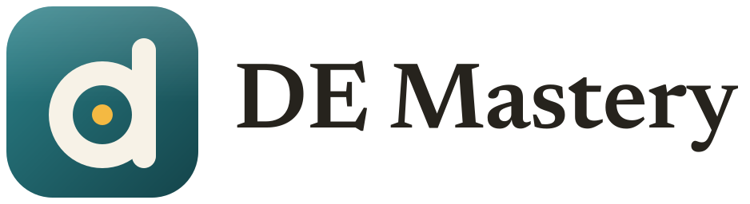
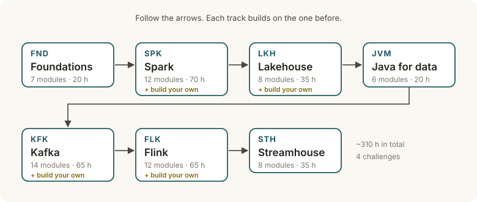

<p></p>

# DE Mastery

A self-paced course that takes an analytics engineer (SQL, dbt, a cloud warehouse) to a data
platform engineer: **Spark, Kafka, Flink, lakehouse table formats and streamhouse architectures.**



## How it works

Every module has the same four steps:

1. **Read** a short lesson: why the tool exists, how it works, how it maps to what you already know,
   and when *not* to use it. Many lessons have a diagram.
2. **Practice** with coding exercises. Automated tests grade them, and the tests themselves have been
   checked against deliberately broken solutions.
3. **Explain** it back and rehearse interview questions.
4. **Build** a small version of the tool at the end of each core track (a query engine, a table
   format, a Kafka broker, a stream processor).

The course has 67 modules, 90 exercises and 4 build-your-own challenges, about 310 hours in total.
Everything runs on a laptop with 32 GB of RAM and no Docker. Exercises that need Kafka, Flink, Paimon
or Fluss download them once with the scripts in [labs/](labs/README.md).

## Start

```bash
uv sync                  # install the tooling (needs uv and Python 3.12)
uv run de doctor         # check your setup and print fixes
uv run de next           # your next exercise
```

Spark needs Java 17+. If `de doctor` can't find it, run `bash labs/setup_jdk.sh`.

**Read the course in a browser:** `uv sync --extra web && uv run de web`, then open
http://127.0.0.1:8000. It has the lessons, a roadmap where you can tick off modules, and the exercise
statements. Exercises are still run and graded in the terminal. See [docs/WEB.md](docs/WEB.md).

## Where to look

| | |
|---|---|
| [docs/TUTORIAL.md](docs/TUTORIAL.md) | **Start here:** the study loop and every command |
| [ROADMAP.md](ROADMAP.md) | Track order and why |
| `content/<TRACK>/<MODULE>/` | The lessons, exercises and quizzes |
| `byo/` | The build-your-own challenges |
| [docs/TESTING.md](docs/TESTING.md) | How exercise tests are proven valid (for contributors) |
| [docs/DIAGRAMS.md](docs/DIAGRAMS.md) | How to add a lesson diagram (for contributors) |

Don't open `solution/`, `alt_solutions/` or `mutants/` folders: they contain the answers.
