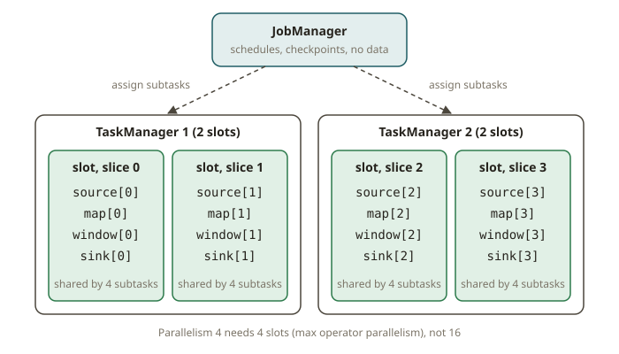
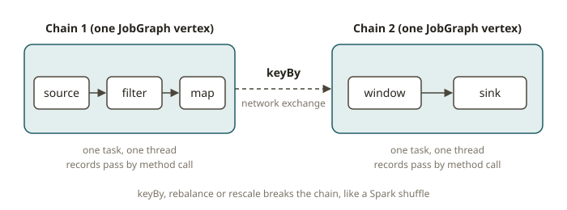

# FLK-01 · Philosophy & architecture — JobManager, TaskManagers, slots, parallelism

## Why Flink exists

You already run batch all day: dbt builds a model, Spark/Athena scans a window of data, the job
finishes, the cluster goes away. That model answers "what was true as of the last run." Flink
answers a different question: **"what is true right now, and keep it true as new events arrive."**
It is a **stateful stream processor** — streaming is the primitive, and a bounded dataset (a file,
a table) is just a stream that happens to end. The same engine runs both; a batch job is a special
case of a streaming job.

The hard problems Flink is built to solve are the ones that make streaming different from "a loop
that reads Kafka":

- **Event time, not arrival time.** Events arrive late and out of order; Flink reasons about *when
  something happened*, not when you saw it (FLK-03).
- **Large managed state.** A running job holds aggregates, join buffers and dedup sets — gigabytes
  to terabytes — and Flink manages that state, snapshots it, and recovers it (FLK-06).
- **Exactly-once results across failures.** When a machine dies mid-stream, the job restarts from a
  consistent snapshot so the output is correct, not merely "eventually re-read" (FLK-06).

If you only need "once a day, recompute the mart," Flink is the wrong tool — see *When NOT to use
it*. Flink earns its complexity when latency and continuous correctness matter.

## How it works: the cluster

A Flink job runs on a **cluster** with two kinds of process. Map it onto what you know from Spark:

| Flink | Spark analogue | Role |
|---|---|---|
| **JobManager** (JM) | Driver + cluster manager | Receives the JobGraph, schedules tasks, coordinates checkpoints, reacts to failures. One per job (HA runs standbys). |
| **TaskManager** (TM) | Executor | A worker JVM that actually runs the operator subtasks and holds state. A cluster has many. |
| **Task slot** | ~ an executor core's share of resources | A unit of resource *isolation* inside a TM. A TM with N slots can run N parallel pipelines' worth of subtasks. |

The JobManager does **not** process data. It builds the execution graph, hands subtasks to slots on
TaskManagers, drives the checkpoint barriers, and restarts the job on failure. TaskManagers do the
work and own the state.

### Parallelism and slots

Every operator has a **parallelism**: how many parallel **subtasks** run it. A job's total slot
demand is driven by its operators' parallelism. The key non-obvious rule:

> **Slot sharing.** By default, subtasks of *different* operators from the **same job** can share one
> slot, as long as they are not two subtasks of the *same* operator. So a source→map→window→sink
> pipeline at parallelism 4 needs **4 slots**, not 16 — one slot holds one parallel "slice" of the
> whole pipeline. The number of slots a job needs therefore equals its **maximum operator
> parallelism**, not the sum.

This is why a job with max parallelism 4 runs on a cluster with 4 total slots (e.g. 2 TaskManagers ×
2 slots). If you ask for more parallelism than there are slots, the job cannot be scheduled and
stays in `CREATED`/`SCHEDULED`, never reaching `RUNNING`.

### Operator chains

Flink **chains** adjacent operators that don't need a network shuffle (a `map` after a `filter`,
say) into a single task that runs in one thread, passing records by method call instead of over the
network. A chain is broken by a **keyBy / rebalance / rescale** (anything that redistributes
records) — exactly like a Spark stage boundary at a shuffle. The chained operators show up as one
vertex in the JobGraph; the breaks become separate vertices connected by data exchanges.

### The job lifecycle

Submit a job → the JM builds the **JobGraph** (vertices = chained operators, edges = exchanges) →
schedules subtasks into slots → the job enters `RUNNING`. A **bounded** job (all sources finish)
transitions `RUNNING → FINISHED`. An unbounded job stays `RUNNING` until cancelled, or
`FAILED`/`RESTARTING` on error (and recovers from the last checkpoint, FLK-06).

## From your world

- **Driver/executors → JobManager/TaskManagers.** The JM is the always-on driver that never dies for
  the life of the job; TMs are the executors. The big difference from a Spark batch app: the job is
  *long-lived*, so state and recovery are first-class, not incidental.
- **Spark stages at shuffles → Flink operator chains broken by keyBy.** A `keyBy` is the streaming
  cousin of a shuffle: it hash-partitions by key and breaks the chain.
- **"How many executors do I need?" → "How many slots does max parallelism need?"** Sizing a Flink
  job is reasoning about parallelism × slot sharing, not guessing executor counts.

## When NOT to use it

- **Daily/periodic batch.** If the SLA is "refresh the mart overnight," dbt + Spark/Athena is
  simpler, cheaper and easier to operate. A standing Flink job to recompute a daily aggregate is
  pure overhead.
- **Stateless routing / light transforms on a topic.** Reformat JSON, drop a field, route by header
  — Kafka Connect SMTs or a tiny consumer are enough; you don't need managed state and checkpoints.
- **Teams without streaming-ops maturity.** Flink's power is stateful jobs; running them (savepoints,
  rescaling, backpressure, state size) is a real operational skill. Without it, a simpler tool wins.

## Further reading

Official Flink 2.x docs only:

- Flink architecture (JobManager, TaskManagers, slots):
  <https://nightlies.apache.org/flink/flink-docs-release-2.2/docs/concepts/flink-architecture/>
- Tasks and operator chains / slot sharing:
  <https://nightlies.apache.org/flink/flink-docs-release-2.2/docs/concepts/flink-architecture/#tasks-and-operator-chains>
- Parallel execution (parallelism, max parallelism):
  <https://nightlies.apache.org/flink/flink-docs-release-2.2/docs/dev/datastream/execution/parallel/>
- Glossary (JobGraph, task, subtask):
  <https://nightlies.apache.org/flink/flink-docs-release-2.2/docs/concepts/glossary/>
