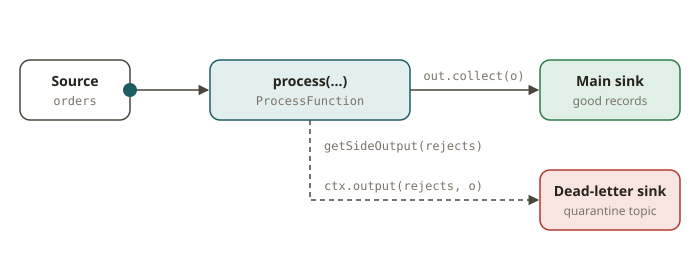

# FLK-02 · DataStream API — sources, keyBy, transformations, sinks, side outputs

## Why the DataStream API exists

Flink SQL (FLK-04) is the fastest way to express most streaming logic. Use it first. But some jobs
need **imperative control**:

- custom logic for each record
- access to keyed state and timers (FLK-07)
- precise routing of records to *different* outputs
- a source or sink that has no SQL connector

The **DataStream API** gives you this control. It is a typed, programmatic dataflow of
`DataStream<T>` transformations. The SQL planner itself compiles SQL down to this layer.

Compare it with dbt. You write a dbt model (declarative SQL). When SQL cannot express what you
need, you write a Python transform. The idea is the same here, but the processing is continuous
instead of batch.

## How it works: the shape of a job

Every DataStream job has the same three-part shape:

```
source  →  transformations  →  sink
```

### 1. Sources (FLIP-27 unified sources)

Flink 2.x uses the **FLIP-27 `Source` API** for connectors. You build a `KafkaSource` with a
builder. Then you add it with `env.fromSource(source, watermarkStrategy, "name")`:

```java
KafkaSource<String> src = KafkaSource.<String>builder()
    .setBootstrapServers(bootstrap)
    .setTopics("orders")
    .setGroupId("flk02")
    .setStartingOffsets(OffsetsInitializer.earliest())
    .setValueOnlyDeserializer(new SimpleStringSchema())
    .build();
DataStream<String> orders = env.fromSource(src, WatermarkStrategy.noWatermarks(), "orders");
```

For tests and bounded jobs, you can also use `env.fromData(...)` (an in-memory source). Both
produce a `DataStream<T>`.

### 2. Transformations

These are the core operators. All of them return a new `DataStream`:

| Operator | What it does |
|---|---|
| `map` | 1→1 transform |
| `flatMap` | 1→N (zero or more outputs per record) |
| `filter` | keep records matching a predicate |
| `keyBy(k)` | hash-partition by key — **the only operator that changes the key**. Required before keyed state/aggregations/windows |
| `reduce` / `sum` / aggregations | fold records of a key together |
| `union` / `connect` | merge streams (union = same type, connect = two types with a `CoProcessFunction`) |
| `process(...)` | the escape hatch: a `ProcessFunction` with full control, timers and side outputs |

`keyBy` is the streaming shuffle. After it, all records for a key go to the same subtask. This
makes per-key aggregation and state possible. FLK-01 showed it as the HASH chain break.

### 3. Side outputs

A single operator can emit to **more than one** stream. Follow these steps:

1. Declare an `OutputTag<T>`.
2. Emit to it from a `ProcessFunction` with `ctx.output(tag, value)`.
3. Read the extra stream with `mainStream.getSideOutput(tag)`.

```java
final OutputTag<Order> rejects = new OutputTag<Order>("rejects"){};  // anonymous subclass!
SingleOutputStreamOperator<Order> clean = orders.process(new ProcessFunction<>() {
    public void processElement(Order o, Context ctx, Collector<Order> out) {
        if (VALID.contains(o.currency)) out.collect(o);          // main output
        else ctx.output(rejects, o);                              // side output
    }
});
DataStream<Order> bad = clean.getSideOutput(rejects);
```

Use side outputs to build a **dead-letter stream**. Good records go downstream. Rejects go to a
quarantine topic. This happens in **one pass**, and Flink does not read the input again. The
`OutputTag` must be an *anonymous subclass*, `new OutputTag<T>("id"){}`. Then Flink can capture the
generic type at runtime.



### 4. Sinks

You attach a `KafkaSink` (FLIP-143) with `stream.sinkTo(sink)`. The delivery guarantees range from
none, to at-least-once, to exactly-once (two-phase commit, FLK-06). For tests, a `DiscardingSink` is
enough. Collecting with `executeAndCollect()` is also enough.

## From your world

- **dbt staging model → a DataStream `filter`+`map` pipeline.** `WHERE currency IN (...)` becomes a
  `filter`. `SELECT ... , dim.name` becomes an enrichment `map`/join. The "reject table" of the
  model becomes a **side output**.
- **A reject/quarantine table → a dead-letter side output stream.** In SQL, a second SELECT scans
  the source again for the bad rows. In Flink, the job routes them in the same pass.
- **`keyBy` is your `GROUP BY`/`PARTITION BY` key.** It also controls *physical* partitioning and
  state locality. It does not only set the grain of the aggregate.

## When NOT to use the DataStream API

- **When Flink SQL expresses it.** SQL is cleaner, shorter and easier to change for filters,
  projections, joins, windowed aggregations and even CDC (FLK-04/05/09). Use DataStream only for
  custom state/timers/routing or a missing connector.
- **For one-shot batch transforms.** Suppose a bounded reprocess is a job that Spark/dbt already do
  well. Then you do not need a DataStream job.

## Further reading

Official Flink 2.x docs only:

- DataStream API overview:
  <https://nightlies.apache.org/flink/flink-docs-release-2.2/docs/dev/datastream/overview/>
- Operators (map/flatMap/filter/keyBy/reduce/union):
  <https://nightlies.apache.org/flink/flink-docs-release-2.2/docs/dev/datastream/operators/overview/>
- Side outputs:
  <https://nightlies.apache.org/flink/flink-docs-release-2.2/docs/dev/datastream/side_output/>
- Kafka connector (KafkaSource / KafkaSink):
  <https://nightlies.apache.org/flink/flink-docs-release-2.2/docs/connectors/datastream/kafka/>
