# FLK-03 · Time & windows — watermarks, idleness, lateness, late side outputs

## Why event time exists

In a batch mart, you decide the grain ("daily GMV per company"). The data is already complete when
you compute it. Streaming is different. Events arrive **out of order** and **late**.

Here is an example. A sale that happened at 09:59 can arrive at 10:03. This is after you "closed" the
09:00–10:00 hour. Suppose you bucket by **arrival time** (processing time). Then that sale lands in
the wrong hour. Your hourly GMV is wrong whenever the network is slow. You also cannot reproduce the
number. If you replay the same events, you get a different answer, because the timing changed.

Flink's answer is **event time**. It buckets by *when the event happened* (a timestamp in the data).
It does not use the time when Flink saw the event. Then two questions remain:

1. **When is an hour "done" enough to emit a result?** → **watermarks.**
2. **What about events that arrive after that?** → **allowed lateness + late side outputs.**

You already know this problem from SCD2 and event marts. It is the "late-arriving fact" problem. In
Flink, it is a main part of the design.

## How watermarks work

A **watermark** is a marker that flows with the stream. It says *"I believe no event with a timestamp
≤ T will arrive after this."* Suppose a watermark of T passes an event-time window whose end is ≤ T.
Then the window **fires** (it emits its result). A **`WatermarkStrategy`** generates watermarks:

```java
WatermarkStrategy
    .<Order>forBoundedOutOfOrderness(Duration.ofSeconds(5))   // tolerate 5s of out-of-order
    .withTimestampAssigner((o, ts) -> o.eventTimeMs);
```

`forBoundedOutOfOrderness(d)` emits a watermark of `(max event timestamp seen) − d`. A larger `d`
tolerates more out-of-order data, but it delays results. A smaller `d` gives results sooner, but
more events count as late and are dropped. `forMonotonousTimestamps()` is the special case `d = 0`.
Use it for streams that are already ordered.

### Windows

A window assigner slices the keyed stream into finite buckets:

| Assigner | Shape | Use |
|---|---|---|
| **Tumbling** | fixed, non-overlapping (hourly GMV) | periodic aggregates on a fixed grain |
| **Sliding** | fixed size, steps smaller than size (overlap) | moving averages / rolling windows |
| **Session** | gap-based: a window closes after a gap of inactivity | user sessions, bursts |

In Flink 2.x, you build windows with `java.time.Duration`. The old `Time` class is gone:
`window(TumblingEventTimeWindows.of(Duration.ofHours(1)))`.

### Firing, lateness, and the late side output

By default, a window fires once when the watermark passes its end. Then Flink purges the state of the
window. Two settings change this:

- **`allowedLateness(d)`** keeps the window state for an extra `d` after the window fires. Events
  that arrive late but within `d` **re-fire** the window (an updated result). After `end + d`, Flink
  drops the state.
- **`sideOutputLateData(tag)`** routes late events to a side-output stream. These are events that
  arrive **after** the window can still accept them (past `end + allowedLateness`). Without this
  setting, Flink drops them silently. The side output is your dead-letter stream for late facts. You
  can audit or reconcile them.

Without a late side output, Flink **silently drops** events that arrive after the watermark has
passed their window. This silent drop is the classic streaming bug. Your totals are quietly too low
and nothing tells you.



## Idleness: the stuck-watermark trap

A keyed/partitioned source has **per-partition** watermarks. The watermark of the operator is the
**minimum** across its input partitions. The reason is that time cannot move past
data that a slow partition might still produce.

The minimum rule has a sharp edge. Suppose **one partition goes quiet** (it has no events, for example
a region with no overnight traffic). Its watermark **stops advancing**. The *combined* watermark then
freezes at the last value of that partition. **Every window stops firing**, even for busy partitions.
Results just stop coming.

The fix is **idleness**:

```java
WatermarkStrategy.<Order>forBoundedOutOfOrderness(Duration.ofSeconds(5))
    .withTimestampAssigner(...)
    .withIdleness(Duration.ofSeconds(10));   // mark a quiet partition idle after 10s
```

`withIdleness(d)` marks a partition **idle** if it produces no events for `d`. Flink **excludes** an
idle partition from the watermark minimum. The combined watermark can then advance on the active
partitions alone, and windows fire again. When the partition produces data again, it becomes active
and rejoins the minimum.

Suppose a stream can have quiet partitions and you forget idleness. This can cause a production
outage. The job runs fine in testing, because all partitions are busy. It stalls in production on
the first quiet night.

## From your world

| SCD2 / event mart | Flink time & windows |
|---|---|
| Late-arriving fact needing a back-dated correction | event-time window + allowed lateness (re-fire) |
| "As-of" grain | the event-time window boundary, not arrival time |
| A reconciliation/exception table for late loads | the **late side output** stream |
| A silently short daily total after a load delay | the bug you avoid by using event time + a late side output |
| A region with no overnight sales stalling a global rollup | the idleness fix |

## When NOT to reach for complex windowing

- **Already-ordered, complete input.** Suppose your source guarantees events in order and on time
  (this is rare). Then a simple `forMonotonousTimestamps()` and plain tumbling windows are enough.
  You do not need the lateness settings.
- **Processing-time is genuinely fine.** An example is "events in the last 5 minutes of wall-clock,
  best effort" (for example a liveness dashboard). Processing-time windows are simpler here, and you
  do not care about reproducibility.
- **Pure batch reprocessing.** Bounded, complete data that you compute with SQL/dbt does not need
  watermarks.

## Further reading

Official Flink 2.x docs only:

- Timely stream processing (event time, watermarks):
  <https://nightlies.apache.org/flink/flink-docs-release-2.2/docs/concepts/time/>
- Generating watermarks (strategies, idleness):
  <https://nightlies.apache.org/flink/flink-docs-release-2.2/docs/dev/datastream/event-time/generating_watermarks/>
- Windows (assigners, allowed lateness, side output for late data):
  <https://nightlies.apache.org/flink/flink-docs-release-2.2/docs/dev/datastream/operators/windows/>
