# FLK-04 · Flink SQL & dynamic tables — changelog semantics, append vs updating

## Why Flink SQL exists

You already write transformations as SQL (dbt models). Flink SQL lets you write the **same
SELECTs** against streams. A `CREATE TABLE AS` in dbt runs one time and finishes. A Flink SQL query is
different. It **keeps running** and keeps the result up to date as new events arrive.

The result of a Flink SQL query is a **dynamic table**. This is a table that changes over time. It
is the most important idea in Flink SQL. It also has a consequence that confuses every SQL person on
the first day.

## How it works: the stream–table duality

A stream and a table are two views of the same thing:

- A **dynamic table** is the current state of a result that updates continuously.
- Its **changelog stream** is the sequence of *changes* that produce that table.

Flink compiles every SQL query into operators that emit a **changelog**. This is a stream of rows.
Each row has a **RowKind** tag:

| RowKind | short | meaning |
|---|---|---|
| INSERT | `+I` | a new row |
| UPDATE_BEFORE | `-U` | retract the previous version of a row (the old value) |
| UPDATE_AFTER | `+U` | the new version of the row |
| DELETE | `-D` | remove a row |

### Append vs updating queries

The kind of changelog that a query produces decides two things. It decides where you can sink the
result, and how you reason about it:

- An **append-only** query emits only `+I`. Nothing that it already output ever changes. Examples are
  a plain `SELECT ... WHERE ...` (filter/project), and a windowed aggregation that emits once for
  each closed window (window TVF). You can write these to an ordinary append sink (a Kafka topic or
  a file).

- An **updating** query emits `-U`/`+U` (and `-D`). New input **revises** its past output. The
  standard example is an **unbounded `GROUP BY`**. Take `SELECT k, COUNT(*) FROM t GROUP BY k`. It
  first emits `+I (k, 1)`. When another `k` arrives, it emits `-U (k, 1)` and then `+U (k, 2)`. The
  row for `k` is updated in place. You cannot append this to a plain topic without losing the
  semantics. You need an **upsert sink** keyed by `k` (see `upsert-kafka`).

Remember this: **an unbounded GROUP BY in streaming does not "append counts". It retracts and emits
again.** The *final* state (after all input) equals the batch answer. But the *changelog* in between
contains retractions. The course grades a dbt-model port on its changelog. This proves that the
student built an updating query that converges to the right answer. It shows that the query does not
just print the right final number one time.

### Window table-valued functions (window TVFs)

Flink 2.x expresses windows in SQL with **window TVFs**. For example,
`TABLE(TUMBLE(TABLE t, DESCRIPTOR(ts), INTERVAL '1' HOUR))` produces rows with the columns
`window_start` and `window_end`. You then `GROUP BY` these columns. A windowed aggregation over a
window TVF is **append-only**, because each window emits once when it closes. An unbounded `GROUP BY`
is updating. You already have the SQL skill. The new part for streams is to know which queries
append and which queries update.

### upsert-kafka

`upsert-kafka` is a connector that reads and writes a **compacted, keyed** changelog. Each record is
an upsert for its key. A null value is a delete (a tombstone). It is the natural sink for an updating
query. It materialises the dynamic table as the latest value per key, in the same way as a
Kafka-backed dimension table. Use `kafka` (append) for append-only queries. Use `upsert-kafka` for
updating queries.

## From your world

| dbt | Flink SQL |
|---|---|
| A staging model (`SELECT ... WHERE`) | an **append-only** query (+I only) |
| A `GROUP BY` aggregate model, full-refresh | an **updating** query (-U/+U) that converges to the same totals |
| An incremental model's merge target | an **upsert-kafka** sink keyed by the grain |
| A daily windowed rollup | a **window TVF** aggregation (append-only per closed window) |
| "The model's final result" | the dynamic table's **final materialised state** |

You must change how you think. A dbt model gives you a *result*. A Flink SQL query gives you a
*changelog*, and the folded state of this changelog is that result. When you port a model, you must
know whether it appends or updates. This decides the sink and how you show that the result is
correct.

## When NOT to use Flink SQL

- **One-shot batch models.** Suppose dbt already builds the mart nightly. Then keep it in dbt. A
  standing Flink SQL job that recomputes a daily aggregate costs money and gives no latency benefit.
- **Logic that SQL cannot express cleanly.** Examples are custom per-record state machines, timers,
  broadcast rule updates and async I/O. For these, use the DataStream/Process API (FLK-02/FLK-07).
- **When the retractions of an updating query would overwhelm the sink.** A high-churn unbounded
  GROUP BY that feeds a non-upsert sink is an anti-pattern. Use a window TVF (append) or an upsert
  sink.

## Further reading

Official Flink 2.x docs only:

- Dynamic tables (stream–table duality, changelog):
  <https://nightlies.apache.org/flink/flink-docs-release-2.2/docs/dev/table/concepts/dynamic_tables/>
- Flink SQL overview:
  <https://nightlies.apache.org/flink/flink-docs-release-2.2/docs/dev/table/sql/overview/>
- Window TVFs (TUMBLE / HOP / CUMULATE):
  <https://nightlies.apache.org/flink/flink-docs-release-2.2/docs/dev/table/sql/queries/window-tvf/>
- upsert-kafka connector:
  <https://nightlies.apache.org/flink/flink-docs-release-2.2/docs/connectors/table/upsert-kafka/>
