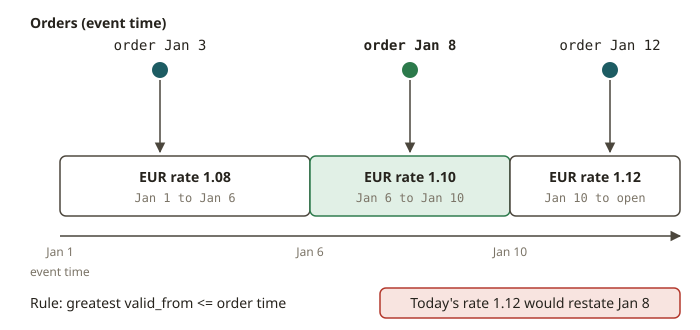

# FLK-05 · Joins — regular, interval, temporal (point-in-time) & lookup

## Why joins in a stream are different

In a batch warehouse, you join `orders` to `dim_customer`. The dimension is simply there. It is the
whole table, as it looks right now. In a stream, there is no "right now". Both inputs arrive over
time and out of order. They can arrive forever.

So "join" splits into several kinds of join. Each kind answers a different question. If you pick the
wrong kind, you quietly get wrong numbers.

- **Regular join** (`FROM a JOIN b ON ...`): it joins every `a` with every matching `b`, *ever*. It
  keeps both sides in state forever (or until a TTL). A later row on either side can change a
  previous match. Then the join emits retractions. The result is correct, but the state grows without
  bound. This is dangerous for facts.
- **Interval join**: it joins only rows whose timestamps are within a bounded window of each other
  (`a.ts BETWEEN b.ts - 1h AND b.ts`). The interval bounds the state. Use it for "events near each
  other in time".
- **Temporal / versioned join** (`FOR SYSTEM_TIME AS OF`): it joins each `a` to the **version of `b`
  that was effective at the event time of `a`**. This is the stream form of an **SCD2 as-of join**.
  It is the most important join for finance. The state for `b` is bounded to the versions that you
  still need.
- **Lookup join**: for each `a`, it looks the key up in an **external** table (JDBC/HBase) at
  processing time. Flink keeps no `b` state. The external store is the source of truth. This is the
  simplest join, but it reads "now", not "as of the event". It is wrong for back-dated corrections.

The exercise in this module uses the temporal join. This is where analytics engineers often make
mistakes. **You must value an order placed on Jan 8 with the FX rate and the customer address that
were in effect on Jan 8.** Do not use today's rate or today's address. Converting at today's rate does
not double-count anything. But it silently restates history. This is a SOX accuracy defect.

## How a point-in-time (temporal) enrichment works

The mechanism is always the same three ideas. This is true if you write it in Flink SQL or by hand in
the DataStream API.

1. **Both sides carry an event-time timestamp and a watermark.** The order has `order_ts`. Each FX
   rate or address version has an `effective_from`. A watermark tells the operator "no more rows with
   a timestamp ≤ W will arrive". With this, the operator can decide that an as-of answer is final.
2. **The dimension is a set of versions in keyed state.** The join key (currency, customer id) is the
   state key. A version `(value, effective_from)` is an SCD2 row with an open `valid_to`.
3. **For each fact, pick the version with the greatest `effective_from ≤ fact event time`.** This
   is the as-of rule. You must wait until the watermark passes the timestamp of the fact. Then every
   version that is effective at or before that moment has already arrived. If you do not wait, you
   might pick an older version and miss a version that just arrived.

In **Flink SQL**, you write `LEFT JOIN fx FOR SYSTEM_TIME AS OF o.order_ts`. Here `fx` is a
*versioned table* (a changelog with a `PRIMARY KEY` and an event-time attribute). The planner builds
the keyed-state version store described above.

In the **DataStream API**, you build it yourself with a `KeyedCoProcessFunction`:

1. Key both streams by the join key.
2. Store incoming dimension versions in `ListState`.
3. Buffer each fact and register an **event-time timer at the timestamp of the fact**.
4. When the timer fires, the watermark has reached that timestamp. Scan the versions for the as-of
   match and emit it.

Writing it by hand is the point of FLK-05. It makes the "as of" rule and the watermark dependency
concrete. In the same way, if you write an SCD2 `MERGE` by hand, you learn what a temporal table *is*.

## From your world

| Kimball / dbt / SOX | Flink | Note |
|---|---|---|
| SCD2 dimension (`valid_from`/`valid_to`/`is_current`) | versioned table / buffered versions in keyed state | a version = an SCD2 row |
| As-of join: fact × dimension version effective at the event date | temporal join `FOR SYSTEM_TIME AS OF` | the correct FX / address |
| `current` view of a dimension | lookup join (JDBC) | reads "now", not "as of" |
| Converting at the policy/transaction date, not today | watermark-gated as-of pick | SOX accuracy |
| Window join of two fact tables near in time | interval join | bounded state |

## When NOT to use (each join)

- **Regular join on two unbounded facts.** The state grows forever. Use an interval join if the match
  is local in time. Use a temporal join if one side is really a slowly-changing dimension.
- **Temporal join when you actually want "latest".** Suppose back-dated corrections do not matter.
  An example is to enrich with the *current* name of a product for a live dashboard. Then a lookup
  join or a regular join on the current version is simpler. Temporal joins pay for version
  bookkeeping.
- **Lookup join for historical restatement.** A JDBC lookup reads the row as it is *now*. It gives
  the wrong answer when you reprocess old events. Use a temporal join over the change history of the
  dimension instead.
- **Interval join when the match is not local in time.** Suppose any `a` can match any `b`, regardless
  of time. Then an interval window drops valid matches.

## Further reading

Official Flink 2.x docs only:

- Joins in Continuous Queries (regular / interval / temporal / lookup):
  <https://nightlies.apache.org/flink/flink-docs-release-2.2/docs/dev/table/sql/queries/joins/>
- Versioned Tables & temporal table joins:
  <https://nightlies.apache.org/flink/flink-docs-release-2.2/docs/dev/table/concepts/versioned_tables/>
- Process Function (`KeyedCoProcessFunction`, timers, state):
  <https://nightlies.apache.org/flink/flink-docs-release-2.2/docs/dev/datastream/operators/process_function/>
- Working with State (keyed state, `ListState`, TTL):
  <https://nightlies.apache.org/flink/flink-docs-release-2.2/docs/dev/datastream/fault-tolerance/state/>
