# FLK-06 · State, checkpoints & exactly-once — surviving a TaskManager crash

## Why checkpoints exist

A stateful stream job holds its most valuable data *in memory*. This data includes running balances,
dedup sets, window accumulators and join buffers. A machine can die. For example, a TaskManager
process gets SIGKILL, a cloud provider takes back a spot instance, or the kernel kills a process
because of OOM.

Suppose the state disappeared. Then the job would restart from nothing. It would do one of two
things:

- It would **lose** data (it never reprocesses what was in flight).
- It would **duplicate** data (it reprocesses and emits twice).

For a financial ledger, both are SOX defects. A dropped entry is a completeness failure. A
double-posted entry is an accuracy failure.

Flink's answer is the **distributed snapshot** (the Chandy–Lamport / asynchronous barrier snapshot
algorithm). It works in these steps:

1. Periodically, the JobManager injects a **checkpoint barrier** into the sources.
2. The barrier flows through the dataflow with the records.
3. An operator sees the barrier on all of its inputs. Then it snapshots its state to durable storage
   and forwards the barrier.
4. Every operator acknowledges. Then the checkpoint is **complete**. It is a globally consistent
   cut of "all state as of the same logical point in the stream".

On failure, Flink restores every operator from the last complete checkpoint. It also **rewinds the
sources to the matching offsets**. Processing then resumes at the exact point where Flink took the
consistent snapshot.

## How exactly-once actually holds end to end

Checkpoints give exactly-once *for state*. To get exactly-once *to the sink*, you need three things:

1. **A replayable source.** The source must be able to rewind to the offset recorded in the
   checkpoint (Kafka offsets, a file split position, a bounded sequence). Then, after a restart, the
   job skips no input and does not read any input again by mistake.
2. **`enableCheckpointing(interval)` with EXACTLY_ONCE mode** (the default). Flink snapshots state
   consistently. Keyed state (your ledger balances) is part of the snapshot.
3. **A sink that commits on checkpoint.** There are two ways:
   - **Transactional / 2PC sink** (for example Kafka transactions, or the `FileSink` with
     `OnCheckpointRollingPolicy`): the sink *pre-commits* on checkpoint. It makes data visible only
     when Flink confirms that the checkpoint is complete. Flink rolls back output that the sink
     wrote since the last complete checkpoint and did not commit. This happens on restart. A
     downstream reader never sees duplicates.
   - **Idempotent sink**: an upsert keyed by a business id. Replays overwrite the old rows and do not
     duplicate them (effectively-once).

With all three, a crash in the middle of a run is invisible in the final committed output. **Every
input id appears exactly once.** There is no loss and no duplication. The exercise of this module
asserts this invariant.

## Savepoints vs checkpoints

- **Checkpoints** belong to Flink. Flink takes them automatically on an interval. They are tuned for
  cheap recovery. By default, Flink cleans them up when the job stops. They exist for *fault
  tolerance*.
- **Savepoints** are snapshots that the user triggers. They are self-contained and portable. They are
  meant for *operations*: stop a job and resume it later, upgrade the code, rescale, or migrate
  state. `cancel-with-savepoint` stops the job and gives you a path. You can restart from this path.
  FLK-12 uses this for upgrades without data loss.

Both use the same snapshot mechanism. The difference is lifecycle and intent.

## What the test does (fault injection, not timing)

The grader runs your job on a **real local cluster** (JobManager + 2 TaskManagers). It follows these
steps:

1. It waits for the first checkpoint to complete.
2. It sends **SIGKILL to a TaskManager**. This is a real crash, in the middle of the run.
3. It restarts a TaskManager, so that slots are available.
4. It lets the job recover from the last checkpoint and run to completion.
5. It reads the **committed** sink output and asserts the **ledger invariants**.

The ledger invariants are:

- **No loss:** every source id is present in the committed output.
- **No duplication:** no source id appears twice.
- **Balanced total:** the count of committed records equals the number of source records.

These are invariants. They are never wall-clock timings. This is the lesson of the fault-tolerance
section of docs/TESTING.md.

## From your world

| SOX / ledger | Flink | Note |
|---|---|---|
| No dropped entry (completeness) | replayable source + checkpointed state | rewind on restart |
| No double-posted entry (accuracy) | commit-on-checkpoint / transactional sink | uncommitted output rolled back |
| Period close you can re-run | savepoint → restart | portable, user-owned |
| Reconciliation after an incident | ledger invariants over committed output | count/sum match the source |

## When NOT to lean on this

- **Stateless, loss-tolerant telemetry.** Suppose it is fine to drop some records and there is no
  state. Then checkpointing adds overhead for little benefit. Raise the interval or disable
  checkpointing.
- **A truly idempotent downstream.** Suppose the sink already deduplicates by business key. Then
  at-least-once + idempotency is simpler than a transactional sink (less commit latency).
- **Huge state with tight latency.** Exactly-once with aligned barriers can add latency under
  backpressure. Unaligned checkpoints or a looser guarantee may be the right trade-off (see FLK-11).

## Further reading

Official Flink 2.x docs only:

- Checkpointing (enable, mode, interval):
  <https://nightlies.apache.org/flink/flink-docs-release-2.2/docs/dev/datastream/fault-tolerance/checkpointing/>
- Stateful stream processing & the barrier snapshot algorithm:
  <https://nightlies.apache.org/flink/flink-docs-release-2.2/docs/concepts/stateful-stream-processing/>
- FileSink (commit on checkpoint):
  <https://nightlies.apache.org/flink/flink-docs-release-2.2/docs/connectors/datastream/filesystem/>
- Savepoints:
  <https://nightlies.apache.org/flink/flink-docs-release-2.2/docs/ops/state/savepoints/>
