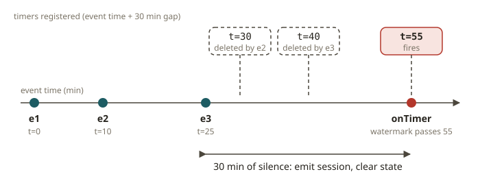
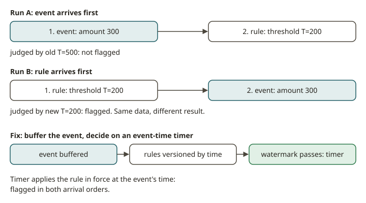

# FLK-07 · Process functions — timers, keyed state & broadcast rules

## Why process functions exist

Windows and SQL cover the common shapes. Examples are tumbling counts, hourly sums and as-of joins. But real
pipelines have logic that does not fit a built-in operator. Here are three examples:

- "Flag a login burst. Then close the session after 30 minutes of silence."
- "Apply the fraud rule that is currently in force."
- "Wait for a confirmation. Send an alert if it never comes."

For these cases, you use the lowest-level and most powerful primitive: the **process function**. It gives
you three things that the higher-level operators hide:

1. **Keyed state** that you control directly (`ValueState`, `ListState`, `MapState`). This is the per-key memory.
2. **Timers.** You register a callback that fires at a specific **event time** (or processing time).
   This is how you express "do something later". Examples are a session timeout, a deadline and a scheduled flush.
3. **Access to time and watermarks.** You can read the current watermark and react to it.

`KeyedProcessFunction` is the version for one stream. `KeyedBroadcastProcessFunction` adds a second input.
This input is a **broadcast** input: a low-volume control stream (rules, config, feature flags).
Flink replicates it to *every* parallel instance. So each key can use the latest rules.

## How a session timeout works with timers

A **session** groups events for a key that are close together in time. It ends after a gap of
inactivity. With a process function, you build it explicitly:

- On each event, update the keyed state of the session (count, sum, last-seen time).
  Also **register an event-time timer** at `event_time + gap`. If an earlier timer exists, delete it
  first. Only the timer of the latest event must fire.
- When the watermark passes that time and no newer event exists, `onTimer` fires. The session has timed
  out. Emit the session summary and clear the state.

The event time and the watermarks drive everything. The code never calls `sleep()`. So the result is
deterministic and replayable. The gap uses the clock of the data, not the wall clock.

## How broadcast rules work (and the ordering trap)

A fraud rule changes over time. An example is "flag any transaction over threshold T". Compliance makes
T stricter during a holiday and relaxes it after the holiday. You do not want to redeploy the job to
change T. So T arrives on a **broadcast stream**. `processBroadcastElement` stores the rule in
**broadcast state** (a `MapState` that Flink replicates to every instance). `processElement` reads it.

Here is the trap. The broadcast stream and the keyed stream are **independent inputs**. So nothing
guarantees that a rule arrives before the events that it must apply to. Suppose you evaluate an event
immediately against "whatever rule is in state right now". Then two runs can disagree. This is a flakiness bug.

The fix is the same as the fix for the as-of join (FLK-05). Do these three things:

1. Make the rule **versioned by an effective time**.
2. Buffer each event.
3. Evaluate the event on an **event-time timer**.

When the timer fires, the watermark has advanced. So the job knows the rule in force *as of the time of the event*.
"Apply the rule that was in effect when the event happened" gives two benefits. It is the correct business semantics,
because a transaction is judged by the policy of its day. It also makes the test deterministic.

## From your world

| Analytics / compliance | Flink | Note |
|---|---|---|
| Sessionize events (gap-based) | `KeyedProcessFunction` + event-time timer | timeout = register/delete timer |
| A dynamic business rule you can change without redeploy | broadcast stream → broadcast state | rules replicated to every instance |
| Apply the policy in force at the event's date | rule versioned by effective time + as-of eval | correct & deterministic |
| "Alert if a confirmation never arrives" | timer with no cancelling event | the deadline pattern |
| Per-customer running tally | keyed `ValueState`/`MapState` | the per-key memory |

## When NOT to use a process function

- **A built-in window fits.** Suppose you want a fixed tumbling, sliding or session window aggregation.
  Use the windowing API. It needs less code and it already handles state and eviction. Use a process function
  only when you need custom timer logic or control of each event.
- **The rule is static.** Suppose the threshold never changes. A constant (or a job parameter) is simpler
  than a broadcast stream.
- **No per-key state or timing.** A stateless filter or map does not need a process function.
- **You want to use processing-time timers for business logic.** Do not do this. Processing-time timers are
  non-deterministic across replays. Use event-time timers for anything that must reconcile.

## Further reading

Official Flink 2.x docs only:

- Process Function (`KeyedProcessFunction`, timers, state):
  <https://nightlies.apache.org/flink/flink-docs-release-2.2/docs/dev/datastream/operators/process_function/>
- The Broadcast State Pattern:
  <https://nightlies.apache.org/flink/flink-docs-release-2.2/docs/dev/datastream/fault-tolerance/broadcast_state/>
- Working with State:
  <https://nightlies.apache.org/flink/flink-docs-release-2.2/docs/dev/datastream/fault-tolerance/state/>
- Timely Stream Processing (event time, watermarks, timers):
  <https://nightlies.apache.org/flink/flink-docs-release-2.2/docs/concepts/time/>
