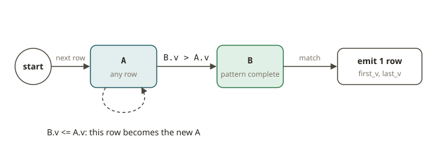

# FLK-09 · Streaming patterns — dedup, top-N, split/merge, MATCH_RECOGNIZE, OVER

## Why these patterns exist

Most streaming SQL that you write is a small set of shapes that you repeat. The Flink SQL tutorials
return to five of them, because they are the building
blocks of real pipelines:

- **Deduplication.** The same event arrives twice (a retried producer, an at-least-once source,
  a CDC double-emit). You want the *first* (or *last*) row per key.
- **Top-N.** An example is "the 3 largest orders per company right now". Flink maintains the result continuously.
- **Split / merge.** You split one stream into several streams (route by type). You merge several streams
  into one with a union.
- **Pattern recognition (`MATCH_RECOGNIZE`, CEP).** An example is "a login, then three failures, then a
  password change within 5 minutes". You find a *sequence* across consecutive rows.
- **OVER aggregation.** This is a running total or a moving average per key *without collapsing* the rows.
  It is the streaming analogue of a SQL window function.

One idea ties them together: **the kind of changelog that each pattern produces**. Dedup-keep-first and
OVER are **append-only** (`+I` only). Top-N and dedup-keep-last are **updating**. They emit `-U`/`+U`
or `-D`/`+I` when the answer changes. This is the idea that Flink SQL tests most often. It decides whether
you can write to an append sink or you need `upsert-kafka`.

## How each pattern works

### 1. Deduplication — `ROW_NUMBER() … = 1`

```sql
SELECT k, v FROM (
  SELECT k, v, ROW_NUMBER() OVER (PARTITION BY k ORDER BY ts) AS rn
  FROM events)
WHERE rn = 1
```

`ORDER BY ts` (ascending, a time attribute or a proctime) keeps the **first** row per `k`. It is
**append-only**. After the query sees the first row, it drops later duplicates and never retracts the first row.
`ORDER BY ts DESC` keeps the **last** row. It is **updating**, because a later row retracts the previous
"last" row. This is the standard dedup of Flink. It is `QUALIFY ROW_NUMBER() = 1` from your warehouse,
but it runs forever over a stream.

### 2. Top-N — `ROW_NUMBER() … <= N`

```sql
SELECT g, v FROM (
  SELECT g, v, ROW_NUMBER() OVER (PARTITION BY g ORDER BY v DESC) AS rn
  FROM s)
WHERE rn <= N
```

A streaming Top-N is an **updating** query. When a bigger value arrives, it enters the top-N. The
value that it displaces is **retracted** (`-D`/`+I` or `-U`/`+U`). You cannot write this to a plain append
sink. The sink must understand retractions (`upsert-kafka`, a lake upsert, a JDBC primary key).

### 3. Split / merge

Splitting uses several queries (or side outputs in DataStream). Each query reads one source with a different
`WHERE`. Merging uses `UNION ALL`. `UNION ALL` keeps duplicates and is append-only. `UNION`
(distinct) is an **updating** query, because it must suppress duplicates. Prefer `UNION ALL` for
event streams. You rarely want Flink to maintain a global distinct over an unbounded stream.

### 4. `MATCH_RECOGNIZE` (CEP)

```sql
SELECT * FROM events MATCH_RECOGNIZE (
  PARTITION BY g ORDER BY ts
  MEASURES FIRST(A.v) AS first_v, LAST(B.v) AS last_v
  ONE ROW PER MATCH
  PATTERN (A B)
  DEFINE B AS B.v > A.v)
```

`MATCH_RECOGNIZE` finds a **sequence** of rows that match a `PATTERN` (it looks like a regular expression) within each
partition. The rows are ordered by a time attribute. `DEFINE` gives the predicate for each pattern variable.
`MEASURES` projects values out of the match. It is the SQL face of Flink CEP. Use it for rules of the form
"this, then that, then the other" (fraud, funnels, SLA breaches). `ORDER BY` **must** be a
time attribute.



### 5. OVER aggregation

```sql
SELECT g, v,
  SUM(v) OVER (PARTITION BY g ORDER BY ts
               ROWS BETWEEN UNBOUNDED PRECEDING AND CURRENT ROW) AS run_sum
FROM events
```

An OVER window computes an aggregate **per row** over a range of preceding rows. It does *not* group
the rows away. Every input row produces exactly one output row that carries the running aggregate. It is
**append-only** and needs a time attribute in `ORDER BY`. Use it for running totals, moving averages
and "value vs the last hour's average" enrichment.

## What the test asserts (written test-first)

The test grades each pattern on its **changelog**. This is the set of `(RowKind, fields)` that the query emits.
The test also grades the **final materialized state**. To get it, apply +I/+U/−U/−D in order and keep the surviving rows.
The test compares this state to an independent **DuckDB** batch answer over the same events (G6).
We never grade the SQL text. An alternate query that computes the same answer in a different way must pass (G3).
The dedup and OVER tests also assert that the stream is **append-only** (no retractions). The Top-N test asserts that
retractions are present. This property distinguishes the shapes most.

## From your world

| Your warehouse / dbt | Flink SQL pattern | Changelog |
|---|---|---|
| `QUALIFY ROW_NUMBER() OVER (… ORDER BY ts) = 1` (dedupe staging) | dedup keep-first | append-only |
| "latest row per key" snapshot | dedup keep-last (`ORDER BY ts DESC`) | updating |
| `QUALIFY ROW_NUMBER() … <= 3` (top-3 per group) | Top-N | updating |
| `UNION ALL` of staging models | split/merge | append-only |
| `SUM(x) OVER (PARTITION BY … ORDER BY …)` window function | OVER aggregation | append-only |
| A funnel / sessionization CASE-ladder | `MATCH_RECOGNIZE` | append-only (ONE ROW PER MATCH) |

## When NOT to use these

- **Top-N / dedup-keep-last to an append-only sink.** These queries retract. A Kafka topic without
  `upsert-kafka`, or a file sink, will double-count. Match the sink to the changelog.
- **`UNION` (distinct) over an unbounded stream.** It keeps unbounded state to suppress duplicates.
  Use `UNION ALL`. Or dedup explicitly with a bounded time window.
- **`MATCH_RECOGNIZE` for simple filters or single-row conditions.** CEP maintains NFA state for each partition.
  A plain `WHERE` or a windowed aggregation is cheaper when you do not need a sequence.
- **OVER with an unbounded `ROWS` range on a high-cardinality key with no state TTL.** The state grows
  forever. Bound the range or set an idle-state retention.

## Further reading

Official docs only (Flink 2.2):

- Deduplication: <https://nightlies.apache.org/flink/flink-docs-release-2.2/docs/dev/table/sql/queries/deduplication/>
- Top-N: <https://nightlies.apache.org/flink/flink-docs-release-2.2/docs/dev/table/sql/queries/topn/>
- Set operations (`UNION` / `UNION ALL`): <https://nightlies.apache.org/flink/flink-docs-release-2.2/docs/dev/table/sql/queries/set-ops/>
- Pattern recognition (`MATCH_RECOGNIZE`): <https://nightlies.apache.org/flink/flink-docs-release-2.2/docs/dev/table/sql/queries/match_recognize/>
- OVER aggregation: <https://nightlies.apache.org/flink/flink-docs-release-2.2/docs/dev/table/sql/queries/over-agg/>
