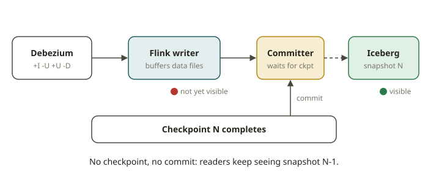

# FLK-10 · CDC & lake sinks — Debezium changelog → Iceberg, commit on checkpoint, schema evolution

## Why Flink is the CDC-to-lakehouse engine

You already load your lakehouse. An operational database changes, and those changes must arrive in
Iceberg. Then your dbt/Spark models can read a current table that you can query. The clean way to do this is
**Change Data Capture (CDC)**. Debezium usually turns the write-ahead log of the database into a stream of
**change events** (insert / update / delete). A stream processor
**applies** those changes to a target table. Flink is purpose-built for this, for three reasons:

- It understands **changelog semantics** natively. A Debezium event stream is a changelog
  (`+I` / `-U` / `+U` / `-D`). These are the same RowKinds that you met in FLK-04.
- Its Iceberg sink **commits on checkpoint**. So the target table advances **atomically** and
  **exactly-once**. Each Iceberg snapshot matches a completed Flink checkpoint.
- It handles **schema evolution**. A new column in the source becomes a new Iceberg column. The
  old rows read back `NULL` for it.

This is the SOX-grade loading path. It has no double-applied change and no dropped change. It also keeps a full snapshot
history on the target.

## How it works

### 1. Read the change stream as a changelog

Flink includes the `debezium-json` format (part of `flink-json`, in the dist). You declare a table with
`'format' = 'debezium-json'`. The table interprets each Debezium envelope
(`{"before":…, "after":…, "op":"c|u|d"}`) and emits the right RowKinds:

```sql
CREATE TABLE cdc (
  id INT, name STRING, amt INT,
  PRIMARY KEY (id) NOT ENFORCED
) WITH ('connector'='filesystem', 'path'='…', 'format'='debezium-json');
```

- `op=c` → `+I`
- `op=u` → `-U` (old) then `+U` (new)
- `op=d` → `-D`

In production, the source is `upsert-kafka` or the Flink CDC connectors (Debezium embedded). They read
the database log directly. In this module, the graded path needs no Docker. It reads a **Debezium-JSON file**, so the
whole pipeline is deterministic and needs no containers. The live Postgres→Debezium path is an
optional layer of the `streaming` lab.

### 2. Define an upsert-capable Iceberg sink

You want to **apply** a changelog, not only append it. For this, the Iceberg table must be **v2** (merge-on-read,
position/equality deletes). It must also have a **primary key**. Then Flink knows which row an update or delete
targets:

```sql
CREATE TABLE ice.db.customers (
  id INT, name STRING, amt INT,
  PRIMARY KEY (id) NOT ENFORCED
) WITH ('format-version' = '2');
```

Then the sink is an `INSERT … SELECT` from the changelog table into the Iceberg table:

```sql
INSERT INTO ice.db.customers SELECT id, name, amt FROM cdc;
```

Flink sends `+U`/`-U`/`-D` into Iceberg equality deletes and new data files. Both use the primary
key. The result is that the Iceberg table always shows the **current** state of the source.

### 3. Commit on checkpoint (exactly-once)

The Iceberg sink **buffers writes. It commits an Iceberg snapshot only when a Flink checkpoint
completes**. This makes the pipeline exactly-once. On recovery, Flink replays from the last
checkpoint. The committer of the sink is idempotent for each checkpoint id. So the sink never
double-commits a snapshot and never loses one. You can see it on disk. For each committed checkpoint, the
`metadata/` folder of the table gets a new `vN.metadata.json` and a `snap-*.avro` manifest list.



### 4. Schema evolution

When the source adds a column, evolve the target with an Iceberg `ALTER TABLE … ADD`:

```sql
ALTER TABLE ice.db.customers ADD (region STRING);
```

Iceberg schema evolution is **metadata-only** and **safe**. Existing rows read back `NULL` for the
new column. New rows carry it. Iceberg does not rewrite any data. This is the same column-add that you use in
your Athena/Iceberg tables. Here the CDC pipeline drives it.

## What the test asserts

- **Reconciliation (G6).** The test applies the change events. Then the contents of the Iceberg table must equal
  an independent **DuckDB** fold of the *same* events (apply c/u/d by primary key). Deleted keys are
  absent. Updated keys show the latest values. The streaming result must equal the batch answer over
  the same changelog (TESTING.md streaming rule).
- **Commit on checkpoint.** The table has ≥1 Iceberg snapshot after the job completes (the commit
  happened). The data is visible only through that committed snapshot.
- **Schema evolution.** After `ALTER … ADD`, old rows read `NULL` for the new column. New rows
  carry its value. The test reconciles this against the DuckDB fold that models the same evolution.

The test grades nothing on timing or on the exact SQL text (an alternate upsert phrasing passes).

## From your world

| Lakehouse loading | Flink CDC → Iceberg | Note |
|---|---|---|
| Nightly `MERGE` of a source extract | continuous changelog apply | no batch window; always current |
| Snapshot isolation of your Iceberg tables | commit on checkpoint = one snapshot per checkpoint | atomic, exactly-once |
| `ALTER TABLE ADD COLUMN` in Athena | `ALTER TABLE … ADD` on the Flink Iceberg catalog | metadata-only, old rows NULL |
| Dedup/latest-per-key staging | the sink applies updates/deletes by primary key | target = current state |

## When NOT to use this

- **Append-only event logs.** Suppose you never update or delete. Then a plain append Iceberg sink (or Kafka →
  Iceberg) is simpler than a v2 upsert table with equality deletes.
- **Tiny, low-change dimensions.** A periodic batch `MERGE` (dbt/Spark) may cost less to operate
  than a standing Flink job.
- **No primary key available.** Upsert needs a key. Without a key, you can only append. You must model dedup and SCD2
  explicitly downstream.
- **Heavy historical backfills.** First bulk-load with batch. Then switch the CDC job on for the
  tail. It is wasteful to stream a full history through equality deletes.

## Further reading

Official docs only (Flink 2.2 / Iceberg):

- Debezium format: <https://nightlies.apache.org/flink/flink-docs-release-2.2/docs/connectors/table/formats/debezium/>
- CDC connectors overview: <https://nightlies.apache.org/flink/flink-docs-release-2.2/docs/connectors/table/overview/>
- Iceberg Flink connector (writes, upsert, schema): <https://iceberg.apache.org/docs/latest/flink-writes/>
- Iceberg schema evolution: <https://iceberg.apache.org/docs/latest/evolution/>
