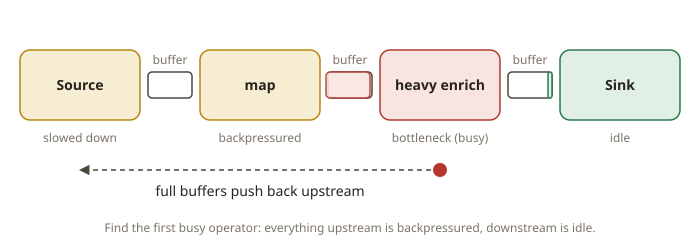
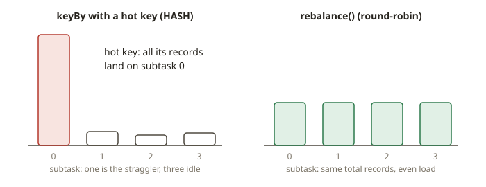

# FLK-11 · Performance & state at scale — backpressure, parallelism, redistribution, skew

## Why backpressure is the first thing you look at

A Flink job is a chain of operators. Bounded buffers connect the operators. Suppose one operator cannot keep up.
Then its input buffers fill, and the full buffers spread **upstream**. The source slows down to match
the slowest operator. This is **backpressure**. It is the built-in flow control of Flink. It is not a bug.
It is how the system stays stable without dropping data. But sustained backpressure means a
**bottleneck**. One operator (or one *subtask* of one operator) is the limiting stage, and the whole
job runs at its speed.

This is the same problem as Spark skew, but in streaming. In Spark, one straggler task holds up the
stage. In Flink, one busy subtask backpressures the source. The fix has the same form: **spread the
work across more parallel subtasks, and redistribute records so that the work is balanced.**

## How to find and fix it

### 1. Locate the bottleneck

Use the Flink Web UI (or REST `/jobs/<id>/vertices/<v>/backpressure`). The **busy** or backpressured
vertex is the bottleneck. Everything upstream of it is backpressured (red). Everything downstream is idle.
You tune the bottleneck.

### 2. Raise the parallelism of the bottleneck operator

Suppose a heavy operator runs at parallelism 1 while slots are free. Then it processes records on a single
subtask. Raise its parallelism (`.setParallelism(n)`, or the job default). Then `n` subtasks share
the load. This is the biggest lever. It is like the addition of Spark tasks to a stage.

### 3. Redistribute records so the parallel subtasks get records

Parallelism alone is not enough. The records must be **spread** across the subtasks. The edge that feeds
the heavy operator decides this with its **ship strategy**:

- `FORWARD` — one-to-one, same parallelism, no redistribution (the default for chained operators). Suppose you raise
  the downstream parallelism but keep FORWARD. Then the work is not balanced.
- `REBALANCE` — round-robin across all downstream subtasks. This is the standard fix for a **skew-free**
  bottleneck. The distribution is perfectly even.
- `RESCALE` — round-robin to a *subset* of local subtasks. It uses less network. It works well when you scale by an
  integer factor.
- `HASH` (`keyBy`) — partition by key. You need it when the operator is keyed. But it **brings back
  skew** if a few keys dominate. A hot key sends all its records to one subtask.

Take a heavy map that is not keyed. Use `rebalance()` before the map and a higher map parallelism. Then
a single busy subtask becomes `n` subtasks with an even load. Take a keyed operator with a hot key.
You fix skew by changing the key (for example, salting). This is the streaming analogue of the salted aggregation in SPK-06.

### 4. The plan changes — and this proves the fix

You raise the parallelism and insert a redistributing edge. Then the **job graph changes**. The parallelism of the heavy
operator goes up. The edge that feeds it is no longer `FORWARD`. It is `REBALANCE` / `RESCALE` / `HASH`.
You can read this directly from `StreamExecutionEnvironment.getExecutionPlan()`
(the JSON `nodes[].parallelism` and `predecessors[].ship_strategy`). You can see a real throughput fix in the
plan, not only on the clock. This is why this module grades the plan and not a stopwatch.

## What the test asserts (robust by design)

Wall-clock throughput on a shared machine with a heavy load is noisy. So the test grades the two things that a
genuine fix guarantees:

1. **The plan changed in the right direction.** The parallelism of the bottleneck operator **increased**.
   The edge that feeds it uses a **redistributing** ship strategy (`REBALANCE` / `RESCALE` / `HASH`)
   and not `FORWARD`. This is deterministic and does not depend on timing.
2. **Correctness is preserved.** The output of the job still equals the baseline (and the DuckDB oracle).
   You cannot "optimize" by changing the answer.

Together these are the operational definition of "throughput improves": more subtasks do balanced
work on the bottleneck, and the result is the same. (Where the test uses a wall-clock check at all, it is a generous,
averaged, relative bound. It is never a hard latency limit. So it stays stable under load, per
TESTING.md.)

## From your world

| Spark tuning | Flink equivalent | Note |
|---|---|---|
| Straggler task holds up a stage | one busy subtask backpressures the source | find it in the UI |
| `repartition(n)` to add tasks | raise the operator parallelism + `rebalance()` | spread the load |
| Salting a skewed join key | change/salt the `keyBy` key | fixes hot-key skew |
| AQE skew-join handling | manual rebalance / rescale (no AQE in Flink) | you choose the strategy |
| Shuffle = Exchange in the plan | redistributing edge in the job graph | read it off the plan |

## When NOT to just raise parallelism

- **The bottleneck is skew, not low parallelism.** More subtasks do not help a single hot key.
  `keyBy` sends that key to one subtask in all cases. Fix the key (salting) instead.
- **The sink or an external system is the limit.** Suppose a slow database sink backpressures the job.
  More map parallelism does not help. Scale the sink or batch the writes to the sink.
- **State explosion.** Higher parallelism multiplies the state instances and the checkpoint cost. Watch
  RocksDB/ForSt and the checkpoint duration. To rescale a stateful job, you need a savepoint (FLK-12).
- **Tiny jobs.** Parallelism has scheduling overhead. For small streams, FORWARD-chained operators
  cost less.

## Further reading

Official docs only (Flink 2.2):

- Monitoring backpressure: <https://nightlies.apache.org/flink/flink-docs-release-2.2/docs/ops/monitoring/back_pressure/>
- Physical partitioning (rebalance/rescale/keyBy): <https://nightlies.apache.org/flink/flink-docs-release-2.2/docs/dev/datastream/operators/overview/>
- Parallel execution & setting parallelism: <https://nightlies.apache.org/flink/flink-docs-release-2.2/docs/dev/datastream/execution/parallel/>
- Flink architecture (tasks, operator chains, slots): <https://nightlies.apache.org/flink/flink-docs-release-2.2/docs/concepts/flink-architecture/>
