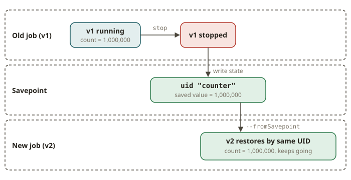

# FLK-12 · Deploy & operate — upgrade a stateful job via savepoint without losing state

## Why savepoints exist

A Flink job that runs for weeks holds state that is worth more than the code. Examples are running totals,
dedup sets, session windows and machine-learned counters. You deploy a new version (a bug fix, a
new feature or a rescale). You must **not** throw that state away. A **savepoint** is a
self-contained snapshot of all the state of a job. You trigger it yourself. Flink writes it in a stable, portable
format. The upgrade has four steps:

1. Take a savepoint.
2. Stop the old job.
3. Start the new job **from** the savepoint.
4. The new job resumes with the state of every operator intact.

This is the streaming equivalent of a zero-downtime migration. The ledger balances carry forward across the deploy.

Checkpoints (FLK-06) are the *automatic* snapshots for fault tolerance. The system owns them. After a crash, the job
recovers from the latest checkpoint. **Savepoints** are the *manual* snapshots that you own. You use them for
**upgrades and migrations**. Flink does not expire them automatically. They are the hand-off between job
versions.

## How a stateful upgrade works

### 1. Keep state in Flink-managed state, not instance fields

State that survives a savepoint must live in the managed state of Flink:

- **Keyed state** (`ValueState`, `ListState`, `MapState`, …) comes from the runtime context.
  It is scoped per key. This is the common case.
- **Operator state** (`ListState` via `CheckpointedFunction`) is for state that is not keyed and belongs to one subtask,
  such as the read offset of a source.

A plain Java **instance field** is *not* checkpointed. Suppose you keep a counter in `transient long n`. It looks
fine while the job runs. But on restore, it resets to zero. This is the classic bug "my state vanished after the
deploy".

### 2. Assign stable operator UIDs

A savepoint maps each piece of saved state to an operator by its **UID**. Suppose you do not call
`.uid("…")`. Then Flink derives a UID from the position of the operator in the graph. This UID **changes** when
you edit the job. Then Flink cannot map the state back. Always give stateful operators an
explicit, stable `.uid()`, so an upgraded job can find its state. (`allowNonRestoredState` lets you
*drop* state deliberately when you remove an operator. It does not replace stable UIDs.)

### 3. The upgrade cycle

```
# stop the old job and snapshot its state
flink stop --savepoint-path s3://…/sp <job-id>        # or cancel-with-savepoint

# start the new jar FROM the savepoint
flink run --fromSavepoint s3://…/sp-… new-job.jar
```

The operators of the new job restore their state by UID. A keyed counter that stood at 1,000,000 before
the deploy stands at 1,000,000 after it. Processing continues from exactly the point where it stopped.
There is no double-counting and no reset.



### 4. Managed vs cloud runs

Locally, you drive this with a standing JobManager + TaskManager (the graded path here). In
production, the **Flink Kubernetes Operator**, **AWS Managed Service for Apache Flink** or
**Confluent Cloud Flink** do the stop-with-savepoint and start-from-savepoint for you on every
deploy. These managed runs are flagged ☁️free / 💲 and the test does **not** grade them. The local savepoint
cycle teaches the same guarantee.

## What the test asserts (deterministic, no wall-clock)

The graded test runs a two-phase cycle on a native local cluster:

1. Start the job. A bounded source emits 5 records. The keyed counter reaches **5**. Take a
   savepoint and stop the job.
2. Restart the **same** job **from the savepoint**. The source now has 10 records. It replays its restored
   offset and emits 5 **more** records. Suppose the state of the counter was truly restored. Then the counter
   continues 6…10 and the final count is **10**. Suppose the state was lost (for example, kept in an instance
   field). Then the counter starts from 0 and counts only the 5 new records. It ends at **5**.

So the invariant is **"the restored count equals 10, not 5"**. This is a ledger-style no-loss check, not a
timer. The test polls readiness through the REST job state and the output file. It does not use `sleep()` for
correctness.

## From your world

| Deploy / migration | Flink savepoint upgrade | Note |
|---|---|---|
| Zero-downtime schema migration keeping data | stop-with-savepoint → start-from-savepoint | state carries across versions |
| A dbt run that must not drop accumulated marts | restore keyed state by UID | no reset, no double-count |
| Blue/green deploy | old job snapshot → new job restores it | portable savepoint format |
| Idempotent re-run after a fix | `--fromSavepoint` resume | continues, not restarts |

## When NOT to (or when it needs care)

- **You remove or rename a stateful operator** and you do not plan for its state. You must either keep
  the UID or pass `allowNonRestoredState` to drop the state deliberately.
- **Incompatible state schema changes** (you change the type of a state). The state may not restore. Evolve the state
  schema deliberately (Avro/POJO state evolution) or migrate.
- **Rescaling** changes the key-group assignment. Always go through a savepoint. Never use a plain restart.
- **You treat savepoints as cheap or automatic.** They are manual and can be large. Checkpoints remain
  the mechanism for crash recovery.

## Further reading

Official docs only (Flink 2.2):

- Savepoints: <https://nightlies.apache.org/flink/flink-docs-release-2.2/docs/ops/state/savepoints/>
- Assigning operator UIDs / production readiness: <https://nightlies.apache.org/flink/flink-docs-release-2.2/docs/ops/production_ready/>
- Working with state (keyed vs operator state): <https://nightlies.apache.org/flink/flink-docs-release-2.2/docs/dev/datastream/fault-tolerance/state/>
- Upgrading applications and Flink versions: <https://nightlies.apache.org/flink/flink-docs-release-2.2/docs/ops/upgrading/>
