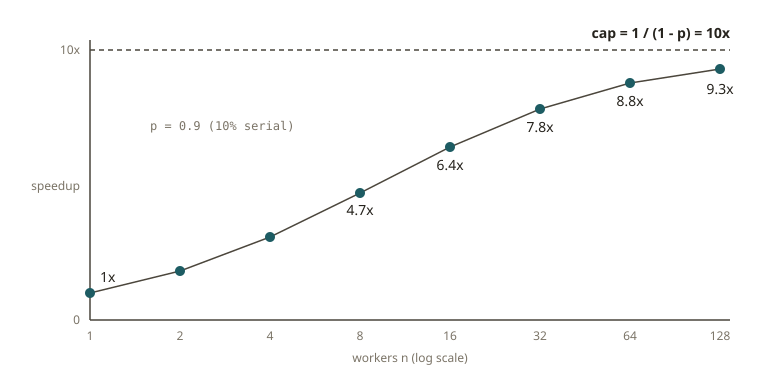

# FND-01 · Why distributed?

## Why it exists

A single machine has two hard limits. It runs out of **capacity** (RAM, disk, cores). It also
runs out of **time** before the deadline. Distributed data systems exist to get past these limits.

Sometimes your data or your SLA no longer fits one box. Then you must spread the work across
many boxes that connect through a network. Everything hard about Spark, Kafka and Flink comes
from that one decision. This includes partitioning, shuffles, replication, consensus,
watermarks and exactly-once. The reason is this: *the data lives in more than one place, and the
network between those places is slow and unreliable.*

So the first engineering question is not "which framework?" The first question is **"do I need
to distribute at all?"** Much "big data" is only a few hundred gigabytes. A single modern server
with DuckDB or Polars can process this in seconds. It has none of the operational cost of a
cluster.

## How it works

**Scale up vs. scale out.** Scaling *up* means you buy a bigger machine (more cores, more RAM,
NVMe). Scaling *out* means you add more machines.

Scale-up is simpler. It has no network shuffle and no partitioning strategy. You reason about
only one process. But it has a ceiling. You cannot buy an infinitely large box. The price also
grows super-linearly at the top end.

Scale-out has no ceiling. But some joins and aggregations need data from more than one node.
Each of these pays for a **shuffle**. In a shuffle, data crosses the network. The network is
orders of magnitude slower than RAM.

**Amdahl's law** gives the limit on how much parallelism can help. Let `p` be the fraction of
the work that you can run in parallel. Then `(1 - p)` is the part that is serial by nature. With
`n` workers, the best speedup is:

```
speedup(n) = 1 / ((1 - p) + p / n)
```

As `n → ∞`, the speedup has a cap of `1 / (1 - p)`. Suppose 10% of your job is serial
(`p = 0.9`). Then you can never go faster than 10×, however many machines you rent. The serial
part becomes the wall. Examples are reading a file header, a final global sort, or a
single-threaded UDF.

**Gustafson's law** is the optimistic counterpart. In practice, we make the problem bigger so
that it fills the machines. So bigger datasets keep more of the work parallel. Both laws are
true. They answer different questions:

- Amdahl: fixed work, more workers.
- Gustafson: more workers, bigger work.



**The real cost model.** Take an aggregation that scans a lot of data. The largest cost is
usually the *bytes read*, not the CPU. Columnar formats, with predicate pruning and column
pruning, cut the bytes read by 10–100×. This often helps more than adding nodes.

This is why a measured 10 GB aggregation on a laptop-class DuckDB can match a small Spark
cluster. DuckDB reads only the columns and row groups that it needs. It does this in one
process, with no shuffle.

## From your world

Redshift already taught you this architecture. A Redshift cluster has two kinds of node:

- The **leader node** plans the query. It also does the final serial merge.
- The **compute nodes** scan and aggregate slices in parallel.

The leader node is Amdahl's `(1 - p)`. Suppose a query ends in one giant `ORDER BY` with no
`LIMIT`. All the data goes through the leader, and the query stops scaling. The same thing
happens in two other cases. One is a Spark job with a final `collect()` to the driver. The other
is a single-reducer `count distinct`. In both cases, more executors do not make the job faster.

**DISTKEY** is the partitioning decision that we study next (FND-02). If you choose it well,
joins stay *local* (no network). If you choose it badly, every join is a shuffle.

Now think about a Yelp mart table that is "only" 20–80 GB, for example a monthly commerce fact.
Often the honest answer is: *do not distribute*. A `CREATE TABLE ... AS SELECT` in DuckDB reads
far fewer bytes than a cluster setup. A single Athena query does the same. Both finish before
the cluster would have launched its executors.

## When NOT to use it

- **Data fits in RAM (or almost fits).** A typical case is up to ~100 GB of data on one machine
  with 32–128 GB of RAM. (DuckDB can spill to disk when the data is larger than RAM.) Here,
  DuckDB, Polars and pandas usually win on wall-clock time *and* cost. They have no shuffle and no
  JVM warmup. They have no cluster to look after.
- **The job is serial by nature.** Suppose Amdahl's `(1 - p)` dominates. An example is a tight
  sequential dependency or a single-threaded library. More machines add coordination cost for
  almost zero speedup.
- **The latency of a single small query matters more than throughput.** Cluster scheduling and
  task launch overhead can be larger than the whole single-box runtime.
- **You cannot yet state the bytes.** Suppose you did not estimate the input size and the bytes
  scanned (FND-07). Then you cannot justify a cluster. "It feels big" is not a sizing argument.

Distribute in these cases:

- The working set truly exceeds one machine.
- Throughput at scale is cheaper than a bigger box.
- You need fault tolerance across machines (FND-03).

## Further reading

- Amdahl, G. (1967). *Validity of the single processor approach to achieving large scale
  computing capabilities.* AFIPS Conference Proceedings.
  https://dl.acm.org/doi/10.1145/1465482.1465560
- Gustafson, J. (1988). *Reevaluating Amdahl's Law.* Communications of the ACM.
  https://dl.acm.org/doi/10.1145/42411.42415
- Dean, J. & Ghemawat, S. (2004). *MapReduce: Simplified Data Processing on Large Clusters.*
  https://research.google/pubs/pub62/
- Amazon Redshift Database Developer Guide — *Data warehouse system architecture.*
  https://docs.aws.amazon.com/redshift/latest/dg/c_high_level_system_architecture.html
- DuckDB Documentation — *Why DuckDB.* https://duckdb.org/why_duckdb
