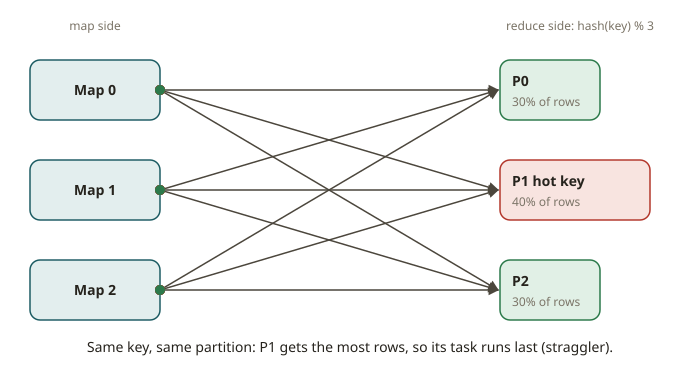

# FND-02 · Partitioning & shuffles

## Why it exists

Suppose your data lives on many machines. Then the most important decision is **which machine
holds which row**. This mapping is the **partitioning scheme**. It decides whether a join or an
aggregation can run in one of two ways:

- *Locally*: each node works on its own data and no node talks to another node.
- With a **shuffle**: every node sends rows to every other node across the network.

Shuffles are the largest cost in distributed data processing. Partitioning exists to avoid them.

Every engine that you will learn makes the same bet. The bet is this: *put the rows that you
need to combine in the same place, and the expensive network step disappears.* Four names
describe this one idea:

- Spark's partitioner
- Kafka's partition key
- Iceberg's sort/partition spec
- Redshift's DISTKEY

## How it works

**Hash partitioning.** Assign each row to partition `hash(key) % P`, where `P` is the number of
partitions. Rows with the same key always go to the same partition. So a `GROUP BY key` or a join
on `key` is local.

Hashing spreads *distinct* keys evenly. But it does **nothing** about a single hot key. Suppose
40% of rows have `customer_id = 0` (a common substitute for NULL). Then 40% of rows go to one
partition. This is **skew**.

**Range partitioning.** Sort the key space into `P` contiguous ranges. For example, sample the
data to pick the boundaries. Then assign each row to the range that contains its key. This works
well for range scans and ordered output. But it is sensitive to the choice of boundaries. Bad
boundaries cause skew, in the same way as a hot hash key.

**Why shuffles are expensive.** A shuffle has two sides:

1. The *map* side writes every record to a local spill file. The file is keyed by the target
   partition of the record.
2. The *reduce* side works next. Every target partition pulls its slice from every source.

The cost grows with the data moved and with the number of connections (`O(mappers × reducers)`).
A shuffle serializes data, uses the disk, and crosses the network. These are the three slowest
things that a data system does. Most performance tuning means fewer and smaller shuffles.

**Detecting skew.** You rarely see skew in the plan. You see it in the **partition size
distribution**. Suppose one partition is 10× the median. Then one task runs 10× longer, and the
whole stage waits for it (a *straggler*).

The practical signal is this: compute the row count (or bytes) of each partition. Then look at
`max / mean`. A ratio near 1.0 is balanced. A large ratio means a hot key. There are two fixes:

- *Salting*: append a random suffix to the hot key to spread it, then re-aggregate.
- Use a different key.

## From your world

This is **DISTKEY / DISTSTYLE** with other names. In Redshift:
- `DISTSTYLE KEY` on `customer_id` is hash partitioning on `customer_id`. Suppose you join two
  tables that are both distributed on `customer_id`. Then Redshift does a *collocated* join, with
  no redistribution.
- `DISTSTYLE EVEN` is round-robin. It is balanced, but **every** join redistributes, because
  matching keys are not in the same place.
- `DISTSTYLE ALL` broadcasts a small dimension to every node. This is the same technique as a
  Spark broadcast join (which you will meet in SPK). It avoids the shuffle for small tables.

In your SOX commerce mart, `company_id` as a distribution key would be a classic skew trap. There
are three companies with very different volumes, so one slice does most of the work. `customer_id`
or `order_id` spreads the rows much better. The skew-detection exercise in this module is the
check that you would run before you trust a DISTKEY choice.

## When NOT to use it

- **Do not hash-partition on a low-cardinality or skewed key** (a boolean, a status flag,
  `company_id` with 3 values). You get a few giant partitions. Use a high-cardinality key, or
  salt the hot values.
- **Do not range-partition without sampling** the real data for boundaries. Guessed boundaries
  create skew and defeat the purpose.
- **Do not re-partition "just in case."** Each repartition is a full shuffle. Shuffle only when
  a later join or aggregation needs the rows in the same place. Ideally, shuffle **once** and
  reuse the result.
- **Do not partition a small table at all.** Broadcast it instead (DISTSTYLE ALL / broadcast
  join).

## Further reading

- Dean, J. & Ghemawat, S. (2004). *MapReduce.* (shuffle = the sort/transfer between map and
  reduce) https://research.google/pubs/pub62/
- Apache Spark SQL Performance Tuning — *Coalesce hints, repartition, and skew.*
  https://spark.apache.org/docs/latest/sql-performance-tuning.html
- Amazon Redshift Database Developer Guide — *Choosing a data distribution style.*
  https://docs.aws.amazon.com/redshift/latest/dg/c_choosing_dist_sort.html
- Apache Kafka Documentation — *Producer partitioning / the partitioner.*
  https://kafka.apache.org/documentation/#producerconfigs_partitioner.class
