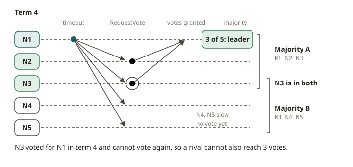

# FND-03 · Replication & consensus

## Why it exists

A single machine will fail. The disk dies, the process crashes, or the network cuts it off from
the other machines. If the data exists only there, the data is gone. **Replication** is the
answer. You keep copies on several machines, so the system survives the loss of some of them.

But when there is more than one copy, a new problem appears: **which copy is the truth?**
Suppose two replicas accept different writes. Then you have *split brain* and silent corruption.
**Consensus** is the set of rules that lets a group of machines agree on a single, ordered
history of events. The machines agree even when some of them fail or lag.

Kafka's ISR, ZooKeeper/KRaft, Flink's checkpointing coordinator, and the catalog behind your
lakehouse all depend on consensus. Learn the shape of consensus once. Then these systems stop
being magic.

## How it works

**Leader/follower replication.** One replica is the **leader**. It orders all writes. The
followers copy the log of the leader in order. Reads can come from the leader (always fresh) or
from followers (possibly stale). If the leader dies, you must promote a follower. You must
promote *only one*, or you get two leaders.

**Quorums.** Suppose you have `N` replicas. Require `W` of them to acknowledge each write. Require
reads to consult `R` of them. If `W + R > N`, every read overlaps at least one replica that saw
the latest write. So you can always find the newest value.

A common safe choice is `W = R = ⌊N/2⌋ + 1` (a **majority**). Majorities are special because any
two majorities of the same set must share at least one member. That overlap prevents two
conflicting decisions.

**Kafka's ISR (in-sync replicas).** Kafka makes this concrete. A partition has a leader and
followers. The **ISR** is the set of replicas that are caught up now. Use `acks=all` and
`min.insync.replicas = M`. Then Kafka acknowledges a produce only when `M` in-sync replicas have
it. Set `M = ⌊N/2⌋ + 1` and you have a majority quorum. You can lose a minority of brokers
without losing acknowledged data.

**Raft (consensus you can whiteboard).** Raft elects a leader by **terms**. Time is divided into
numbered terms. Each term has at most one leader.

1. A node that hears nothing from a leader becomes a *candidate*.
2. The candidate increments the term, votes for itself, and requests votes.
3. A node grants its vote in a term **only once**. It grants the vote only to a candidate whose
   log is at least as up to date as its own.
4. A candidate that collects a **majority** of votes becomes the leader for that term.

Two rules give safety: one vote per term, and a majority to win. These rules guarantee **at most
one leader per term**. Two different winners would each need a majority. Two majorities must
overlap on a voter who voted twice, and the rules do not allow that. This is the whole safety
argument for leader election. You will implement it.

## From your world

You already trust this every day. **Amazon S3** stores each object redundantly across multiple
devices and facilities. It acknowledges a `PUT` only when the object is durably stored on enough
of them. This is a quorum write. This is why **Athena never "loses" an S3 object**. The
durability you rely on is replication plus quorum acknowledgement. This is exactly the mechanism
in this lesson.

Your Iceberg tables inherit this durability, because the data and metadata files live in S3. The
atomic commit swaps a single catalog pointer. This pointer is one ordered log of table versions.
It is also a tiny consensus problem, because only one commit can win a given version.

Think about a SOX control like "no acknowledged transaction is ever lost." You are reasoning
about `W` and the ISR. An ack must mean *durably replicated to a majority*. If it does not, the
control is a lie.

## When NOT to use it

- **Do not require consensus for everything.** It costs a network round trip to a majority on
  every write. Some data can be derived again, or can tolerate eventual consistency. For this
  data, cheaper replication (async, read-your-writes) may be fine.
- **Do not set `min.insync.replicas = 1` and claim durability.** Suppose `acks=all` but `M = 1`.
  Then one broker failure after the ack loses data. The ISR gives no quorum.
- **Do not allow an even split to proceed.** Quorums need a strict majority. A 2-of-4 "tie" must
  not commit. If it does, two partitions could each think they won.
- **Do not read from a follower when you need strong consistency.** Followers lag. Use the
  leader or a quorum read (`W + R > N`).

## Further reading

- Ongaro, D. & Ousterhout, J. (2014). *In Search of an Understandable Consensus Algorithm (Raft).*
  https://raft.github.io/raft.pdf
- Lamport, L. (1998). *The Part-Time Parliament (Paxos).*
  https://lamport.azurewebsites.net/pubs/lamport-paxos.pdf
- Apache Kafka Documentation — *Replication and in-sync replicas (ISR), `acks`,
  `min.insync.replicas`.* https://kafka.apache.org/documentation/#replication
- Amazon S3 — *Data protection and durability.*
  https://docs.aws.amazon.com/AmazonS3/latest/userguide/DataDurability.html
