# FND-04 · Time

## Why it exists

In batch, time is simple: you process yesterday's data today, and "yesterday" is a closed set.
In streaming, time splits into two different clocks that rarely agree:

- **Event time** — when the thing actually happened (stamped by the source: the order was placed
  at 14:03:07).
- **Processing time** — when your system got around to handling it (the record reached the
  operator at 14:05:40, after a mobile client reconnected).

The network delays, retries, buffering and partitioning between those two moments mean events
arrive **out of order** and **late**. Every correct streaming aggregation has to answer one
question: *"How long do I wait for stragglers before I declare a window final?"* **Watermarks** are
the mechanism for answering it. They exist because you can never be *sure* all events have arrived
— so you make a bounded, explicit bet instead of waiting forever.

## How it works

**A watermark is a claim about completeness.** A watermark of value `W` asserts: *"I believe I have
seen all events with event time ≤ `W`."* It is a moving low-water mark on event time, derived from
the data itself, not from the wall clock.

**Bounded-out-of-orderness generator.** The most common watermark strategy: track the maximum event
time seen so far, `maxEventTime`, and emit `W = maxEventTime − allowedLateness`. The
`allowedLateness` (say, 5 seconds) is your bet on how out of order the stream is. Two required
properties:
1. **Monotonic (never goes backwards).** A watermark may only stay equal or increase. If a late,
   small-timestamp event arrives, it does *not* pull the watermark down — otherwise windows would
   un-close.
2. **Lagging.** It trails the newest event by `allowedLateness`, giving stragglers a grace period.

**Classifying an event against a watermark.** When an event with time `t` arrives and the current
watermark is `W`:
- `t > W` → **on-time** (its window has not been declared complete yet; it still counts normally).
- `t ≤ W` but within an **allowed-lateness grace** → **late but accepted** (the window result is
  updated/retracted).
- `t ≤ W` and beyond the grace → **dropped** (or sent to a *side output* / dead-letter so it is not
  silently lost).

The whole design is a trade-off: a larger `allowedLateness` catches more stragglers but delays
results and costs state; a smaller one is faster but drops more. There is no "correct" value —
only a value justified by the data's observed lateness distribution.

## From your world

You have been doing a batch version of this for years. In Kimball, a **late-arriving fact** is a
sale that lands after the day's load has run; a **late-arriving dimension** is a customer row that
shows up after the fact that references it. Your coping mechanisms — a lookback window on the
incremental dbt model (`WHERE event_date >= current_date - 3`), a "pending" bucket, a nightly
reconciliation that restates recent days — are a *coarse, batch* watermark. "Reprocess the last 3
days" **is** `allowedLateness = 3 days`; the day you stop restating a period **is** the watermark
advancing past it.

Streaming just makes the same decision continuous and explicit. When you later build Flink windows
(FLK-03) and CDC joins (FLK-05), "late-arriving dimension" becomes "the watermark hadn't advanced
past the dimension's event time yet," and your Kimball instinct — *how long do I keep a period open
before I trust the number?* — is exactly the right instinct.

## When NOT to use it

- **Don't use event-time windows when you only care about processing-time rates** (e.g. "requests
  per second as seen by the server"). Processing time is simpler and has no late-data problem.
- **Don't set `allowedLateness` to "a lot, to be safe."** Every open window holds state; a huge
  grace period means unbounded state and delayed results. Size it from the measured lateness
  distribution (p99), not fear.
- **Don't silently drop late events in anything auditable.** For a SOX-relevant total, route late
  events to a side output and reconcile — dropping them breaks completeness.
- **Don't let the watermark track wall-clock time** when the source can be idle or replayed; derive
  it from event timestamps, or an idle partition will wrongly advance (or stall) the watermark.

## Further reading

- Akidau, T. et al. (2015). *The Dataflow Model.* VLDB.
  https://research.google/pubs/pub43864/
- Akidau, T. *Streaming 101 / 102.* (event time vs processing time, watermarks)
  https://www.oreilly.com/radar/the-world-beyond-batch-streaming-101/
- Apache Flink Documentation — *Timely Stream Processing: event time and watermarks.*
  https://nightlies.apache.org/flink/flink-docs-stable/docs/concepts/time/
- Apache Flink Documentation — *Generating Watermarks (bounded out-of-orderness).*
  https://nightlies.apache.org/flink/flink-docs-stable/docs/dev/datastream/event-time/generating_watermarks/
