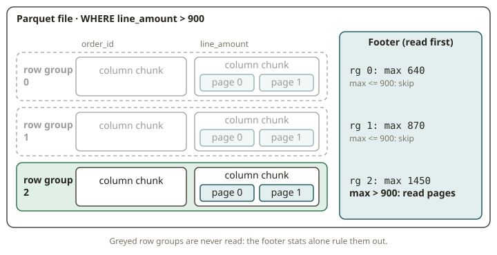

# FND-06 · Storage formats

## Why it exists

The file format decides most of your query cost. It does this long before any engine runs. The
core insight is this: analytics reads **a few columns from many rows**. OLTP reads **many columns
from a few rows**. Suppose a storage layout matches the first access pattern. Then the engine
reads far less data.

**Columnar** formats (Parquet, ORC) exist so that analytical scans read only the columns that a
query needs. They also read only the row ranges that a query needs. This one property is *skip
what you don't need*. It explains three facts:

- Athena bills by **bytes scanned**.
- Your Iceberg tables are Parquet underneath.
- The "same" query can cost 100× more on CSV than on Parquet.

## How it works

**Row vs columnar.** A row format (CSV, JSON, Avro) stores all fields of a record together. To
read one column, you still read every byte of every row. A columnar format stores the values of
each column contiguously. So reading `line_amount` touches only the bytes of `line_amount`.

Contiguity also makes **compression** and **encoding** much better. Adjacent values share a type.
They often share a pattern (dictionary, run-length, delta).

**Physical layout of Parquet** (what you will parse):
- A file is split into **row groups**. These are horizontal stripes of ~N rows, for example 128
  MB each.
- Each row group holds one **column chunk** per column.
- Each column chunk is split into **pages**. The pages carry the encoded, compressed values plus
  encoding metadata.
- Each column chunk stores **statistics** in the footer: `min`, `max`, `null_count`,
  `distinct_count`. This is the key point. The **footer** (file metadata) is at the end of the
  file. It indexes all of this.

**Predicate pushdown / row-group pruning.** This is the payoff. Take `WHERE line_amount > 900`.
The engine reads the footer. It looks at `max(line_amount)` of each row group. It **skips any row
group whose `max` is ≤ 900**. It does not read the data pages of that group at all.

Equality and range predicates on a column prune row groups when the `[min, max]` of the group
does not overlap the predicate.

- Pruning is dramatic when the data is **sorted or clustered** on the filtered column. The
  ranges are tight and do not overlap.
- Pruning is weak when the order is random. The range of every group covers everything, so
  nothing is skipped.

This is why *sort order is a performance feature*. It is not cosmetic.

**Avro and ORC, briefly.**
- Avro is a compact **row** format with a schema. It is good for streaming and for writes of one
  record at a time (Kafka). It is poor for scans of wide columns.
- ORC is another columnar format (stripes + indexes + bloom filters). It is common in the
  Hive/Trino world. It has the same idea as Parquet, with different internals.

## From your world

You already pay this bill: **Athena charges by bytes scanned.** Convert a table from CSV/JSON to
Parquet. Then `SELECT` only the columns that you need. This is the single biggest cost lever in
Athena. It is exactly column pruning.

The second lever is partitioning plus sort order. Then Athena or Spark can prune row groups.
Take `WHERE order_date = '2026-03-01'`. On data sorted by `order_date`, it reads a handful of row
groups. On unsorted data, it reads them all.

Your **Iceberg** tables make this explicit and queryable. Iceberg keeps the same Parquet
`min/max` stats at the **manifest** level. So it can prune whole *files* before it opens them.
The **sort order** of the table decides how tight those ranges are. Suppose you set an Iceberg
sort order on `(company_id, order_date)`. Then you deliberately engineer the row-group and file
pruning that you will study by hand in this exercise.

## When NOT to use it

- **Do not use columnar for OLTP or writes of one row at a time.** Appending single records to
  Parquet is wasteful, because you rewrite row groups. Use a row format (Avro) or a table format
  that batches commits.
- **Do not expect pruning on an unsorted column with high cardinality and random values.** Suppose
  the `[min, max]` of every row group spans the whole domain. Then no group is skipped. Pruning
  needs clustering.
- **Do not make row groups tiny.** Many tiny row groups mean a large footer overhead and poor
  compression. If row groups are too huge, you lose pruning granularity. There is a best size
  (often 64–256 MB).
- **Do not rely on stats that you disabled.** Suppose the writer did not write stats, or a column
  is a complex type without stats. Then the engine cannot prune on it. It will scan.

## Further reading

- Apache Parquet — *File Format / specification (row groups, column chunks, pages, statistics).*
  https://parquet.apache.org/docs/file-format/
- Apache Arrow / PyArrow — *Reading and writing Parquet; file metadata and statistics.*
  https://arrow.apache.org/docs/python/parquet.html
- Melnik, S. et al. (2010). *Dremel: Interactive Analysis of Web-Scale Datasets* (the columnar
  nested-storage model behind Parquet). https://research.google/pubs/pub36632/
- Apache Iceberg — *Spec: manifests, column metrics, and sort orders.*
  https://iceberg.apache.org/spec/
- Amazon Athena — *Columnar storage and performance / cost.*
  https://docs.aws.amazon.com/athena/latest/ug/columnar-storage.html
