# JVM-02 · Collections and streams

## Why this module

Much data-engineering Java does one job: it takes a collection of events and reshapes it. You
group, sum, filter, join to a lookup, and deduplicate. In Python you use comprehensions,
`collections`, and `itertools`. In Java you use the **Collections framework** (`List`, `Map`,
`Set`) and the **Streams API** (`java.util.stream`).

A Kafka Streams `KStream`/`KTable` pipeline follows the design of this API. Learn to read a
`stream().filter(...).map(...).collect(...)` chain. Then a Streams topology reads the same way.
Flink's DataStream operators also follow this design. In this module, Java starts to feel like SQL
and dbt again. The difference is that it is typed and compiled.

## How Java collections work

**Interfaces vs implementations.** You program to the interface and pick an implementation:

| Interface | Common implementation | Python analogue | Notes |
|---|---|---|---|
| `List<E>` | `ArrayList<>` | `list` | ordered, indexable, duplicates allowed |
| `Set<E>` | `HashSet<>` / `LinkedHashSet<>` | `set` | unique elements; `LinkedHashSet` keeps insertion order |
| `Map<K,V>` | `HashMap<>` / `TreeMap<>` | `dict` | `TreeMap` keeps keys sorted |

```java
List<String> xs = new ArrayList<>(List.of("a", "b"));
Map<String, Integer> counts = new HashMap<>();
counts.merge("a", 1, Integer::sum);   // the Java defaultdict(int) idiom
counts.getOrDefault("z", 0);          // like dict.get(k, 0)
```

Learn these two idioms:

- `map.merge(key, delta, (oldVal, newVal) -> ...)` accumulates values. It is the `defaultdict`/`Counter`
  pattern.
- `map.computeIfAbsent(key, k -> new ArrayList<>())` builds a `dict[list]` grouping.

**Immutable vs mutable factories.** `List.of(...)`, `Map.of(...)` and `Set.of(...)` return
*immutable* collections. If you add an element, Java throws an exception. Wrap the result in
`new ArrayList<>(...)` when you need to change it. This surprises Python developers, because they
expect every list to be mutable.

## How the Streams API works

A **stream** is a lazy pipeline over a source. It has this form: `source → 0+ intermediate ops →
1 terminal op`.

- Intermediate ops (`filter`, `map`, `flatMap`, `distinct`, `sorted`, `limit`) are lazy. Each one
  returns a new stream.
- The terminal op (`collect`, `reduce`, `count`, `forEach`, `toList`, `min`/`max`) runs the
  pipeline.

Nothing happens until the terminal op. This is the same as Spark's transformation/action split
(SPK-02). It is also the same as a Python generator, which produces values only when something
consumes them.



```java
import java.util.stream.Collectors;

double usdTotal = orders.stream()
    .filter(o -> o.currency().equals("USD"))     // WHERE
    .mapToDouble(Order::amount)                  // project to a double stream
    .sum();                                       // terminal

Map<String, Double> byCurrency = orders.stream()
    .collect(Collectors.groupingBy(               // GROUP BY currency
        Order::currency,
        Collectors.summingDouble(Order::amount)));// SUM(amount)
```

- **`map` vs `flatMap`.** `map` is 1→1 (project a column). `flatMap` is 1→many, and then Java
  flattens the result (SQL `UNNEST`/`explode`):
  `lines.stream().flatMap(l -> Arrays.stream(l.split(",")))`.
- **Method references.** `Order::amount` is a short form of `o -> o.amount()`. `Double::sum` is a
  short form of `(a,b) -> a + b`. `System.out::println` is a short form of
  `x -> System.out.println(x)`.
- **Collectors are your SQL aggregates.** They are `groupingBy`, `counting`, `summingDouble`,
  `averagingDouble`, `mapping`, `toMap`, `toList` and `joining`. `groupingBy(k, downstream)` works
  like `GROUP BY k` with an aggregate. You can nest it.
- **`reduce`** folds a stream. It takes an identity and a combiner, and the combiner must be
  *associative*. This is the same associativity rule that you learned in FND for parallel
  aggregation. If your combiner is not associative, a parallel stream gives wrong answers.

**Primitive streams.** `IntStream`, `LongStream` and `DoubleStream` avoid boxing. They add
`sum()`, `average()` and `summaryStatistics()`. Use `mapToDouble` or `mapToInt` to get a primitive
stream.

## From your world

| SQL / dbt / Python | Java Streams | Note |
|---|---|---|
| `WHERE p` | `.filter(p)` | lazy |
| `SELECT f(x)` | `.map(f)` | 1→1 |
| `UNNEST` / `explode` | `.flatMap(...)` | 1→many |
| `GROUP BY k` | `Collectors.groupingBy(k, ...)` | downstream = the aggregate |
| `SUM`/`AVG`/`COUNT` | `summingDouble`/`averagingDouble`/`counting` | as a downstream collector |
| `DISTINCT` | `.distinct()` | uses `equals`/`hashCode` |
| `ORDER BY` | `.sorted(comparator)` | `Comparator.comparing(...)` |
| generator laziness | intermediate ops are lazy | terminal op triggers |
| `defaultdict(int)` | `map.merge(k, 1, Integer::sum)` | the counting idiom |

## When NOT to use streams

- **Don't** use a parallel stream (`.parallelStream()`) without a reason. For small collections,
  the thread-pool overhead costs more than it saves. A non-associative `reduce` or a stateful
  lambda gives wrong or non-deterministic results. Parallelism belongs to Spark and Flink, not to a
  `parallelStream` here.
- **Don't** force a plain loop into a hard-to-read stream. Use a `for` loop with an early `break`
  if it is clearer. Streams work best for *declarative transforms*. They do not work well for
  control flow with side effects.
- **Don't** change external state from inside a lambda (`list.add(...)` in a `map`). It breaks
  under parallelism and it is a sign of bad code. Use a `Collector` instead.
- **Don't** reuse a stream. The terminal op consumes a stream once. A `List` is different.

## Further reading (official)

- Streams API package summary: <https://docs.oracle.com/en/java/javase/21/docs/api/java.base/java/util/stream/package-summary.html>
- `Collectors`: <https://docs.oracle.com/en/java/javase/21/docs/api/java.base/java/util/stream/Collectors.html>
- Collections framework overview: <https://docs.oracle.com/javase/tutorial/collections/index.html>
- `Map` (merge/computeIfAbsent): <https://docs.oracle.com/en/java/javase/21/docs/api/java.base/java/util/Map.html>
- Aggregate operations tutorial: <https://docs.oracle.com/javase/tutorial/collections/streams/index.html>
