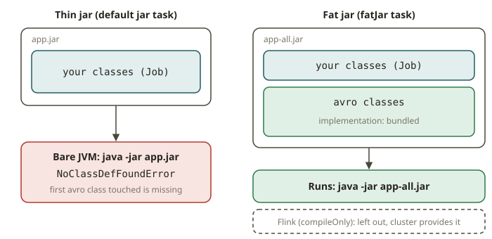

# JVM-03 · Build and dependencies

## Why a build tool and a fat jar

To deploy a dbt project you ship the repo; to deploy a Python job you build a wheel or a container.
To deploy a **Flink or Kafka Streams job** you ship a *jar* — and almost always a **fat jar** (also
called an uber jar or shaded jar): a single jar that contains your code *and* all its dependency
classes, so the cluster can run it with nothing else on the classpath. Getting this wrong is one of
the most common "it runs locally but `ClassNotFoundException` on the cluster" failures in Flink/
Kafka work, so it's worth doing by hand once.

Java has two mainstream build tools. **Maven** uses XML (`pom.xml`) and a fixed lifecycle;
**Gradle** uses a programmable build script. We use **Gradle with the Kotlin DSL**
(`build.gradle.kts`) because it is what most new Flink/Kafka projects use and because the typed
Kotlin DSL gives you IDE completion. You'll meet Maven's `pom.xml` in the wild, so the lesson shows
the mapping, but the exercise is Gradle.

## How Gradle works (the parts you need)

A minimal `build.gradle.kts`:

```kotlin
plugins {
    java                       // adds compileJava, jar, test, etc.
}

repositories {
    mavenCentral()             // where dependencies are downloaded from
}

dependencies {
    implementation("org.apache.avro:avro:1.12.0")   // compile + runtime
    compileOnly("org.apache.flink:flink-streaming-java:1.20.0") // provided by the cluster
    testImplementation("org.junit.jupiter:junit-jupiter:5.11.4")
}
```

Key ideas:

- **Configurations = dependency scopes.** `implementation` is on the compile and runtime classpath
  and *goes into the fat jar*. `compileOnly` is compile-only — use it for libraries the runtime
  already provides (Flink itself, the Kafka broker's classes) so you don't bundle a second copy and
  cause version conflicts. `runtimeOnly` is runtime-only (e.g. a logging backend). `testImplementation`
  is tests only. Choosing the right scope is the single most important fat-jar skill.
- **Tasks** are the units of work (`compileJava`, `jar`, `test`). You can register your own, e.g. a
  `fatJar` task.
- **The default `jar` is thin** — it contains only *your* classes, not dependencies. Running it on
  a bare JVM throws `NoClassDefFoundError` for the first dependency class touched. A **fat jar**
  copies the dependency classes in.



### Building a fat jar

The production approach is the **Shadow plugin** (`com.gradleup.shadow`), which also *relocates*
(renames) bundled packages to avoid version clashes — e.g. shading `com.google.guava` to
`myapp.shaded.guava` so your Guava can't collide with Flink's. In this offline lab we build the fat
jar with a plain `Jar` task so you see exactly what goes in; the concepts transfer directly:

```kotlin
tasks.register<Jar>("fatJar") {
    archiveClassifier.set("all")
    manifest { attributes("Main-Class" to "de.mastery.jvm03.Job") }
    duplicatesStrategy = DuplicatesStrategy.EXCLUDE          // handle collisions deterministically
    from(sourceSets.main.get().output)                      // your classes
    from(configurations.runtimeClasspath.get().map {        // + dependency classes
        if (it.isDirectory) it else zipTree(it)
    })
    // Drop other jars' signatures and module descriptors, or the fat jar won't verify / will clash:
    exclude("META-INF/*.SF", "META-INF/*.DSA", "META-INF/*.RSA", "META-INF/*.MF.orig")
}
```

**Why the excludes matter (the no-conflict rule).** When you merge many jars:
- Signed jars ship `META-INF/*.SF/.DSA/.RSA`. Copy them into a jar whose contents changed and the
  JVM's jar verifier throws `SecurityException: Invalid signature file digest`. You must drop them.
- Two dependencies may each contain the same file (`module-info.class`, `META-INF/services/...`,
  `reference.conf`). Without a `duplicatesStrategy`, Gradle *fails the build*; with `EXCLUDE` you
  keep the first (deterministic). Real services files should instead be *merged* (Shadow does this
  with `mergeServiceFiles()`), which is why Shadow exists — but excluding signatures and setting a
  duplicates strategy is the minimum for a jar that runs.
- A correct fat jar has **exactly one** copy of each class — no duplicate entries — and a
  `Main-Class` so `java -jar app-all.jar` works.

## From your world

| Python / dbt | Gradle (JVM) | Note |
|---|---|---|
| `pip install` / `requirements.txt` | `dependencies { implementation(...) }` | pinned coordinates `group:name:version` |
| building a wheel / zip | the `jar` / `fatJar` task | artifact to ship |
| a container image with deps baked in | a fat/uber jar | self-contained for the cluster |
| `--no-deps` for provided libs | `compileOnly(...)` | don't bundle what the runtime provides |
| dependency resolution conflicts | version conflicts / relocation (shading) | shade to isolate |
| `python -m mypkg` | `Main-Class` in the manifest + `java -jar` | entry point |

## When NOT to build a fat jar (or do it differently)

- **Don't bundle the runtime.** Mark Flink/Spark/Kafka-provided libraries `compileOnly`
  (`provided` in Maven). Bundling Flink into a Flink job jar causes classloader conflicts and
  bloats the artifact — a classic cause of `LinkageError`/`NoSuchMethodError` on the cluster.
- **Don't fat-jar a library.** Publish libraries thin with declared dependencies; only *application/
  job* artifacts are fat.
- **Don't ignore signature files or duplicate classes.** Those are the two bugs that make a fat jar
  compile fine but fail at runtime.
- **Prefer the Shadow plugin in production** for relocation and service-file merging; the manual
  `Jar` task here is to learn the mechanics offline.

> **FLK will reuse this.** The Flink lab in Phase 4 submits a job jar built exactly this way (your
> code fat-bundled, Flink marked `compileOnly`), so the packaging skill you build here is the one
> you'll use to run a real Flink job.

## Further reading (official)

- Gradle Java Library plugin / dependency configurations: <https://docs.gradle.org/current/userguide/java_library_plugin.html>
- Gradle Kotlin DSL primer: <https://docs.gradle.org/current/userguide/kotlin_dsl.html>
- Building Java applications / the `Jar` task: <https://docs.gradle.org/current/userguide/building_java_projects.html>
- `DuplicatesStrategy`: <https://docs.gradle.org/current/javadoc/org/gradle/api/file/DuplicatesStrategy.html>
- Flink: packaging / project configuration (fat jar, provided scope): <https://nightlies.apache.org/flink/flink-docs-release-1.20/docs/dev/configuration/overview/>
