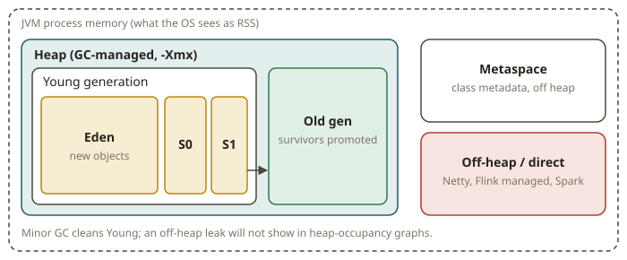
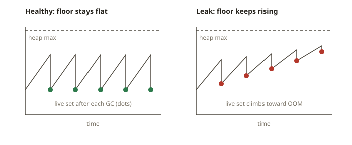

# JVM-05 · Concurrency and the JVM

## Why this matters for data engineers

You rarely write raw threads in Spark or Flink. The framework owns the parallelism. But you *do*
meet two hard facts of the JVM all the time. The first is **concurrency**. Examples are a Kafka
consumer poll loop, an async producer, the worker threads of a connector, and parallel I/O. The
second is **memory**. Examples are heap sizing, garbage collection pauses, off-heap buffers, and
the feared `OutOfMemoryError`.

When a Flink TaskManager or a Spark executor dies, the post-mortem is almost always a **heap/GC
log**. This module gives you two things:

- enough concurrency knowledge to avoid mistakes
- enough JVM-memory knowledge to read a GC log and find a leak

Finding a leak is the most valuable JVM-ops skill for a data engineer.

## How JVM concurrency works (the safe subset)

- **Threads** run concurrently. You almost never manage them by hand. Use an **ExecutorService** (a
  thread pool) to submit tasks:

  ```java
  ExecutorService pool = Executors.newFixedThreadPool(4);
  Future<Integer> f = pool.submit(() -> expensive());
  int result = f.get();            // blocks until done
  pool.shutdown();
  ```

- **`CompletableFuture`** composes async work without blocking. It is the JVM analogue of Python
  `asyncio`/futures:

  ```java
  CompletableFuture
      .supplyAsync(() -> fetch(url), pool)      // run on the pool
      .thenApply(this::parse)                   // transform the result
      .thenAccept(this::store);                 // consume it
  ```

- **The hazards.** There are three:
  - *Shared mutable state* across threads needs synchronization (`synchronized`,
    `java.util.concurrent.atomic`, concurrent collections). Without it, you get **race
    conditions**.
  - *Blocking* inside an async stage starves the pool.
  - *Deadlocks* come from mistakes in lock order.

  The data engineer's general rule has three parts. Keep per-record work pure and stateless. Push
  shared state into the framework's keyed state (Flink) or into a concurrent structure. Never call
  `Thread.sleep` in a hot loop. (You will touch this in CDC and connector code.)

Think of it this way: Python has a GIL, and Java does not. Java threads really run in parallel. So
data races are real, and you must protect shared state.

## How JVM memory and GC work

The default **G1** collector splits the heap into generations:

- **Young generation** (Eden + survivor spaces): holds new objects. **Minor GC** collects it. Most
  objects die young, and the GC reclaims them at low cost.
- **Old generation** (tenured): objects that survived enough minor GCs move (are *promoted*) here.
  **Major/Mixed/Full GC** collects it. This is more expensive.
- **Metaspace** holds class metadata. It is in native memory, outside the Java heap.
- **Off-heap / direct memory** (`ByteBuffer.allocateDirect`, Netty, Flink's managed memory, Spark's
  off-heap) lives outside the heap that the GC manages. This is important because an off-heap leak
  does not show in heap-occupancy graphs.



**What a healthy heap looks like:** a sawtooth (a line that rises, drops, and repeats). Occupancy
rises as you allocate. A GC cuts it back down. Then the cycle repeats. The *floor* of the sawtooth
is the occupancy right **after** each GC (the **live set**). It stays roughly flat over time.

**What a leak looks like:** the sawtooth *floor rises*. After every GC, the JVM retains more memory
than the last time, because something keeps references alive. Examples are a growing cache or
`Map`, an unbounded queue, and listeners that nobody removes. GCs run more often and reclaim less.
Pauses grow. Eventually the JVM throws `java.lang.OutOfMemoryError: Java heap space`. The skill is
to read this trend in a GC log.



### Reading a unified GC log

With `-Xlog:gc*`, the JVM prints lines like these:

```
[12.345s][info][gc] GC(7) Pause Young (G1 Evacuation Pause) 820M->410M(1024M) 12.1ms
[30.900s][info][gc] GC(21) Pause Full (G1 Compaction Pause) 1010M->980M(1024M) 180.4ms
```

Read `before->after(heap)`. For example, `820M->410M` means that a GC reclaimed memory down to a
410M live set. Track the **after** value across GCs:

- A flat floor is healthy.
- A floor that rises steadily to near the heap ceiling is a **leak** that heads for an OOM. Full
  GCs that barely free anything are also a sign of a leak.

## From your world

| Spark / lake ops | Plain JVM | Note |
|---|---|---|
| Spark executor OOM in logs (SPK-08) | `OutOfMemoryError: Java heap space` | same post-mortem skill |
| driver `collect()` blows the heap | retained live set grows | bound what you keep |
| shuffle spill to disk | GC pressure / off-heap buffers | memory tiers |
| `asyncio` futures | `CompletableFuture` | compose async, don't block |
| thread-unsafe pandas in a worker | shared mutable state → race | protect or avoid |

## When NOT to reach for threads / what NOT to conclude

- **Don't hand-roll threads in a Spark/Flink job.** The framework parallelizes. Your per-record
  function should be pure. Manual pools in a UDF cause oversubscription and non-determinism.
- **Don't blame GC for an off-heap leak.** Suppose heap-after is flat, but the process RSS keeps
  growing. Then suspect direct/native memory (Netty, mmap, JNI), not the Java heap.
- **Don't just raise `-Xmx` to "fix" a leak.** A real leak will fill any heap. A bigger heap only
  delays the OOM and makes pauses longer. Find the retained references.
- **Don't ignore allocation rate.** Frequent minor GCs with a flat floor are not a leak. They show
  high churn. To fix this, allocate less. Do not grow the old gen.

## Further reading (official)

- HotSpot GC tuning guide (generations, G1): <https://docs.oracle.com/en/java/javase/21/gctuning/introduction-garbage-collection-tuning.html>
- Unified JVM logging (`-Xlog:gc*`): <https://docs.oracle.com/en/java/javase/21/docs/specs/man/java.html#enable-logging-with-the-jvm-unified-logging-framework>
- `java.util.concurrent` package: <https://docs.oracle.com/en/java/javase/21/docs/api/java.base/java/util/concurrent/package-summary.html>
- `CompletableFuture`: <https://docs.oracle.com/en/java/javase/21/docs/api/java.base/java/util/concurrent/CompletableFuture.html>
- Troubleshooting `OutOfMemoryError`: <https://docs.oracle.com/en/java/javase/21/troubleshoot/troubleshooting-memory-leaks.html>
