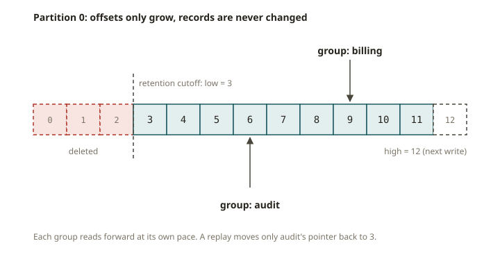

# KFK-01 · The log — events, state, retention and replay

## Why Kafka exists

You already work with a log, but you use a different name for it. An Iceberg table is a chain of
**snapshots**. Each commit appends an immutable file set and moves a pointer forward. "The table as
of snapshot 42" is a *position* in an append-only history. Time travel means reading the history up
to a position. Kafka uses this same idea, but it makes the log the main interface. In Iceberg, the
log is a side effect.

A Kafka **topic partition is an append-only, immutable, ordered log of records.** Producers append
records to the end. Each append gets an **offset** that always increases (0, 1, 2, …). Consumers
read forward from an offset that they choose. This is nearly the whole model. Almost everything else
is machinery that makes the log durable and shareable. Examples are replication, consumer groups,
and exactly-once.

This model is worth a whole system because it **decouples producers and consumers in time.** A
database row is *state*. It holds the latest value, and the system overwrites the old value. A log
keeps the *events* that produced the state, in order. The log also keeps them for a period of time
(retention). So a consumer that was offline can **replay** from any offset and rebuild the view that
it needs. A new consumer that you write next year can do the same. "Rebuild the orders table from
scratch" is no longer a risky migration. It becomes "read the log from offset 0 again."

## How the log works

- **Events vs. state.** An event is an immutable fact that happened: `order 7 set to $30 at 10:03`.
  State is a projection of the events: `the current total for account k`. The log stores events.
  Any state is a **fold** (left-reduce) over the log. You do the same when you rebuild an Iceberg
  dimension by replaying change rows. A dbt incremental model also folds new rows into a table.
- **Offsets.** Within one partition, offset order **is** append order, and it never changes.
  `get_watermark_offsets(tp)` returns the current low offset and high offset. The low offset is the
  earliest retained offset. The high offset is the next offset to be written. You can `assign` a
  partition at a specific offset and read forward. This is **replay from an offset**.
- **Replay from a timestamp.** You rarely know the offset that you want. You know *"from 09:00
  today."* `offsets_for_times([(topic, partition, ts_ms)])` returns, for each partition, the **first
  offset whose record timestamp is ≥ ts_ms**. If no record matches, it returns the log end. Seek to
  that offset and read forward. This is the log version of "give me the table as of this wall-clock
  time."
- **Retention.** The log is not infinite. **Time retention** (`retention.ms`) and **size retention**
  (`retention.bytes`) delete the oldest *segments*. **Log compaction** (`cleanup.policy=compact`) is
  a separate setting. It keeps only the latest record per key. This turns the log into a
  materialized "current state per key". `__consumer_offsets` and KTable changelogs work this way
  (KFK-08). You can replay only back to the earliest **retained** offset.
- **Keys and ordering.** A record may have a key. The partitioner sends all records with the same
  key to the same partition, so **Kafka preserves per-key order**. Kafka guarantees order only *within*
  a partition, never across partitions. The rest of this track depends on this fact.

## From your world

| Lakehouse / dbt / SOX | Kafka log | Note |
|---|---|---|
| Iceberg **snapshot id** | an **offset** (a position in history) | both are "the data as of a point in an append-only history" |
| Iceberg **time travel** to a snapshot | **replay** from an offset / timestamp | rebuild any view from the facts |
| dbt incremental **high-water mark** | the consumer's committed **offset** | "where did I get to last time" |
| Rebuilding a dimension by replaying change rows | folding the log into a KTable (KFK-08) | state = fold over events |
| SOX **completeness** (every fact accounted for) | read exactly `[low, high)` with no gaps | replay must cover every retained offset |

## When NOT to use Kafka

- **Request/response.** Sometimes a caller needs an answer *now* (an HTTP API, an RPC). That is not
  a log. Use a service call. Kafka decouples in time. This is the opposite of request/response.
- **A simple task queue with a few workers.** Sometimes you only need to "hand this job to one of N
  workers, ack it, forget it." SQS or RabbitMQ is simpler for this. You do not need the overhead of
  Kafka retention, replay, and ordering.
- **Tiny data volumes / daily batch.** Suppose a nightly `COPY`/`MERGE` already meets the SLA. Then
  a broker cluster adds operational work and gives no gain. Use the batch pipeline that you already
  have.
- **As your system of record / database.** The log is good for history and streaming. Point lookups
  ("give me order 7 right now") belong in a database or a compacted KTable. Do not do a linear scan
  of a topic for them.

## A note on what's coming (KIP-848, KIP-932)

Kafka 4.x includes the **new consumer group protocol (KIP-848)**. With it, the broker does the
rebalance coordination. This avoids the old "stop-the-world" rebalance, where all consumers stop.
You will meet it in KFK-04. **Share groups (KIP-932)** add queue-like semantics. Multiple consumers
share the records of a partition, and each record has its own acknowledgement. Share groups are
**early access** in this line. KFK-04 covers them only as a concept. This course does not grade
them, because the pinned client and broker support only a preview.

## Further reading

Official docs only:

- Apache Kafka — Introduction (the log, topics, partitions, offsets):
  <https://kafka.apache.org/documentation/#intro_concepts_and_terms>
- Topic-level configs (`retention.ms`, `retention.bytes`, `cleanup.policy`):
  <https://kafka.apache.org/documentation/#topicconfigs>
- Log compaction:
  <https://kafka.apache.org/documentation/#compaction>
- Confluent — Kafka 101: Topics / Partitioning:
  <https://developer.confluent.io/courses/apache-kafka/topics/>
