# KFK-02 · Topics, partitions, replication — leaders, ISR, acks, durability

## Why replication exists

A single log on a single disk is one power supply away from data loss. SOX asks you to prove
**completeness**: a write your system acknowledged must still be there after a failure. Kafka's
answer is **replication**: each partition has `replication.factor` copies on different brokers, one
**leader** and the rest **followers**. Clients talk only to the leader; followers pull from it to
stay in sync. If the leader's broker dies, a follower is promoted. The whole module is about one
question: *under which settings does an acknowledged write actually survive a broker failure, and
under which do you only think it did?*

## How durability is configured (objective ccdak:1 / ccaak:1)

Three knobs decide the guarantee. You must reason about them **together**, not one at a time.

- **`replication.factor` (RF).** How many copies exist. RF=3 means three brokers each hold the
  partition. RF=1 means one copy — a single broker loss is permanent data loss for that partition.
- **ISR — the in-sync replica set.** The subset of replicas currently caught up with the leader
  (within `replica.lag.time.max.ms`). A follower that falls behind or whose broker dies drops out of
  the ISR; when it catches up it rejoins. The **leader is always in its own ISR**. ISR shrinks and
  grows as brokers fail and recover.
- **`acks` (producer).** How many replicas must confirm a write before the producer calls it done:
  - `acks=0` — fire and forget. The producer never waits; a record can be lost even with no failure
    (e.g. the leader hasn't got it yet). Highest throughput, weakest guarantee.
  - `acks=1` — the **leader** has written it. Survives nothing worse than "leader stays up." If the
    leader acks then crashes before a follower copied the record, that record is **lost**.
  - `acks=all` (a.k.a. `-1`) — **all replicas in the ISR** have written it. This is the durable
    setting — but only as strong as the ISR is large.
- **`min.insync.replicas` (misr, a topic/broker config).** The floor on ISR size for an `acks=all`
  write to be *accepted*. If the ISR has fewer than `misr` members, the leader **rejects** the
  produce with `NOT_ENOUGH_REPLICAS` rather than acknowledging a write that isn't durable enough.
  `misr` only has teeth with `acks=all`.

The canonical durable config is **RF=3, acks=all, min.insync.replicas=2**. That tolerates one broker
down (ISR shrinks 3→2, still ≥ misr, writes continue and are on ≥2 brokers) and refuses writes if a
second broker is lost (ISR 2→1 < misr) — so you never acknowledge a write that lives on only one
disk. `misr=2` with RF=3 is the sweet spot: availability under one failure, safety under two.

## The decision table you must internalise

For a produce to a partition, given the number of replicas currently in the ISR:

| acks | min.insync.replicas | ISR size | Accepted? | If accepted, durable against 1 more broker loss? |
|---|---|---|---|---|
| 0 | any | ≥1 | yes (not even leader-confirmed) | no — may be lost with no failure at all |
| 1 | any | ≥1 | yes (leader only) | **no** — leader crash after ack loses it |
| all | 1 | ≥1 | yes | no — only the leader may hold it |
| all | 2 | ≥2 | **yes** | **yes** — on ≥2 brokers |
| all | 2 | 1 | **no** (`NOT_ENOUGH_REPLICAS`) | — rejected, nothing lost |
| all | 3 | 2 | no | — rejected |

The exercise makes you encode exactly this and then watch a real cluster behave accordingly.

## Leaders, elections, and unclean election

When a leader's broker dies, the controller elects a new leader **from the ISR** — a replica known
to be caught up, so no acknowledged data is lost. If you enable **unclean leader election**
(`unclean.leader.election.enable=true`), the controller may elect a replica that was *not* in the
ISR when every in-sync replica is gone — restoring availability at the cost of **silently losing**
the records that only the dead in-sync replicas had. Default is off, and for SOX-style completeness
you keep it off: prefer unavailability to silent loss. **KRaft** (Kafka 4.x, no ZooKeeper) runs the
controller quorum that performs these elections; the controller metadata log is itself replicated.

## From your world

| Lakehouse / SOX | Kafka durability | Note |
|---|---|---|
| "a committed row must survive a node failure" | `acks=all` + `misr=2` + RF=3 | the completeness guarantee |
| A write that "succeeded" but vanished | `acks=1` + leader crash | the silent-loss trap you must avoid |
| Refusing to commit when you can't guarantee durability | `NOT_ENOUGH_REPLICAS` under misr | fail loud, not silent |
| Choosing availability over correctness | unclean leader election | usually the WRONG trade for finance data |

## When NOT to crank durability to the max

- **Metrics / logs / lossy telemetry.** If dropping the occasional record is fine, `acks=1` (or even
  `0`) and RF=2 buy throughput and cost. Don't pay for `acks=all` you don't need.
- **A dev/single-broker cluster.** RF must be 1 (there is only one broker); `misr=2` on RF=1 just
  makes every `acks=all` write fail. Match misr to RF.
- **Latency-critical, replayable-from-source paths.** If the true source of record is elsewhere and
  you can replay, you may accept weaker acks and rebuild on loss.

## Further reading

Official docs only:

- Replication & ISR:
  <https://kafka.apache.org/documentation/#replication>
- Producer `acks`:
  <https://kafka.apache.org/documentation/#producerconfigs_acks>
- `min.insync.replicas` (topic config):
  <https://kafka.apache.org/documentation/#topicconfigs_min.insync.replicas>
- Unclean leader election:
  <https://kafka.apache.org/documentation/#brokerconfigs_unclean.leader.election.enable>
- KRaft overview:
  <https://kafka.apache.org/documentation/#kraft>
