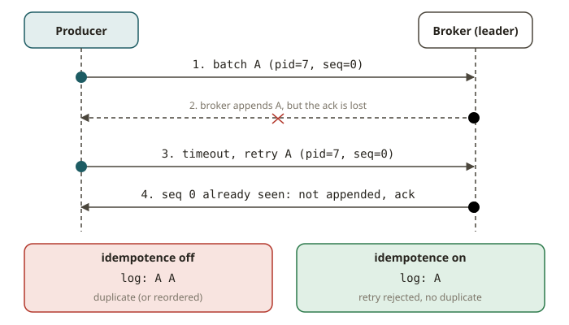

# KFK-03 · Producers — batching, idempotence, ordering under retries

## Why the producer decides correctness

The producer looks simple: `produce(topic, key, value)`. But many decisions happen between that
call and a durable record on the leader. These decisions determine throughput and ordering. They
also determine whether a retry creates a duplicate. This module teaches you to tune for throughput
**without** losing the two guarantees that a SOX-style financial feed needs. The two guarantees are
**no duplicates** and **no reordering per key**. They must hold even when the network has a short
failure and the client retries.

## How the producer works

The producer does not send a record immediately when you call `produce()`. It appends the record to
a per-partition **batch** in an in-memory buffer (`buffer.memory`). A background I/O thread sends
the batches to the brokers.

- **`linger.ms`** — how long the producer waits for a batch to fill before it sends the batch.
  `0` sends as soon as possible. This gives the lowest latency and the smallest batches. A wait of
  a few milliseconds greatly improves throughput. The producer shares the overhead of each request
  across more records.
- **`batch.size`** — the maximum bytes in a partition batch. Bigger batches mean fewer and larger
  requests. This gives higher throughput. The cost is more latency and more memory.
- **`compression.type`** (`lz4`, `zstd`, `snappy`, `gzip`) — compresses each batch. For text or JSON,
  `lz4` and `zstd` give high throughput and save storage. They use little CPU. Compression happens
  for each batch, so use it together with a `linger.ms` that is not zero.
- **The partitioner** decides which partition receives a record. When a record has a **key**, the
  default partitioner hashes the key. The **same key always goes to the same partition**. This is
  the basis of per-key ordering. When a record has no key, the partitioner spreads records across
  partitions (sticky batching) for throughput. Kafka guarantees order only *within* a partition.

To tune for throughput, follow these steps:

1. Raise `linger.ms` a little.
2. Raise `batch.size`.
3. Turn on `lz4` compression.

The result is fewer, bigger, compressed batches.

## Retries, ordering, and idempotence

Here is the trap. A produce request can fail for a short time (the leader moved, or a timeout). The
producer **retries**. Two bad things can happen:

1. **Duplicates.** Kafka wrote the record, but the ack was lost. The retry writes the record again.
2. **Reordering.** Suppose there is more than one in-flight request for each connection. A retried
   request can arrive *after* a later request that already succeeded. Then the order flips within
   one partition.

The fix is the **idempotent producer** (`enable.idempotence=true`). The producer gets a producer id
and per-partition sequence numbers. The broker rejects duplicates and out-of-order sequences. So a
retry does not duplicate and does not reorder. This setting also sets safe defaults:
`acks=all`, `retries=INT_MAX` (limited by `delivery.timeout.ms`), and
`max.in.flight.requests.per.connection<=5`. The last limit is easy to miss. Idempotence preserves
ordering across retries **only** up to 5 in-flight requests. If you set it to `6` or more, retries
can still reorder records.

So the recipe for safe throughput has three parts:

- Set **`enable.idempotence=true`**. This pins `acks=all` and limits in-flight requests.
- Tune `linger.ms`, `batch.size`, and `compression.type` for throughput.
- Give each record a key, so the events of each key stay in order in one partition.

You get bigger batches AND no duplicates AND no reordering.

> We never grade "how many records per second did you hit". Throughput depends on the machine and
> the load, so the test would be flaky. The exercise grades two things. First, the **properties**
> (the config) that make throughput safe. Second, the **invariant**: the per-key order in the
> consumed log equals the order that you produced, even with retries enabled.

## KIP-848 / KIP-932 note

These two items belong to the consumer side (KFK-04): the **new consumer group protocol (KIP-848)**
and **share groups (KIP-932)**. They do not change producer semantics. The idempotence and ordering
guarantees of a producer do not depend on how consumers are grouped.

## From your world

| SOX / dbt / lakehouse | Producer setting | Note |
|---|---|---|
| "every financial event recorded exactly once" | `enable.idempotence=true` | no duplicate on retry |
| "events for one account in the order they happened" | key = account id + idempotence | per-key order in one partition |
| dbt model micro-batch size vs latency | `linger.ms` / `batch.size` | throughput vs latency trade |
| Parquet/zstd column compression | `compression.type=zstd` | same idea, per batch on the wire |

## When NOT to turn every setting up

- **Strict low latency.** A big `linger.ms` adds latency. If you need less than 10 ms end to end,
  keep `linger.ms` small and accept smaller batches.
- **You really do not need ordering or deduplication.** For lossy metrics, you can leave idempotence
  off and use `acks=1` for speed. Never do this for financial or SOX data.
- **A very high in-flight count for raw speed.** Do not raise `max.in.flight` above 5 with
  idempotence and expect ordering. Above 5, the ordering guarantee under retry is lost.

## Further reading

Official docs only:

- Producer configs (`linger.ms`, `batch.size`, `compression.type`, `acks`, `retries`):
  <https://kafka.apache.org/documentation/#producerconfigs>
- Idempotent producer (`enable.idempotence`, `max.in.flight.requests.per.connection`):
  <https://kafka.apache.org/documentation/#producerconfigs_enable.idempotence>
- Message delivery semantics:
  <https://kafka.apache.org/documentation/#semantics>
- Confluent — Optimizing the producer for throughput:
  <https://developer.confluent.io/courses/architecture/producer-hardware/>
