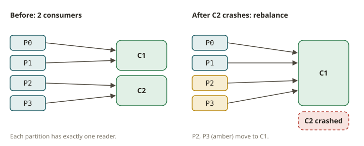
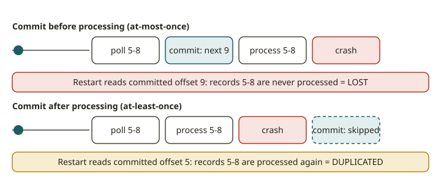

# KFK-04 · Consumers & groups — manual commits, at-least-once, no loss across crashes

## Why commit strategy is the whole ballgame

A consumer reads records and does work with them (write to a database, call an API, update a table).
The question that decides correctness after a crash is: **when do you record "I've handled up to
here"?** That recorded position is the **committed offset**. Commit too early and a crash loses
unprocessed records (**at-most-once**). Commit after processing and a crash reprocesses the last
few (**at-least-once**). This module makes you feel the difference by killing a consumer mid-stream
and watching what the next consumer picks up.

## How consumer groups work (objective ccdak:2 / dse-found)

- **Group.** Consumers sharing a `group.id` form a group; the partitions of the subscribed topics
  are **divided among** them, so each partition is read by exactly one consumer in the group at a
  time. Add a consumer → partitions **rebalance** to spread the load; remove one → its partitions
  move to the survivors. This is how you scale out and how you fail over.
- **Committed offset.** Per group, per partition, Kafka stores "the next offset this group should
  read" in the internal `__consumer_offsets` topic. A new/resuming consumer in the group starts from
  the committed offset (or `auto.offset.reset` — `earliest`/`latest` — if none exists).
- **The new protocol (KIP-848).** Kafka 4.x introduces the **consumer group protocol** that moves
  assignment to the group coordinator on the broker, replacing the old client-driven,
  "stop-the-world" rebalance with incremental, broker-driven reconciliation — fewer and shorter
  pauses. From the API you still `subscribe`, `poll`, and `commit`; the improvement is in how
  rebalances happen underneath.
- **Share groups (KIP-932).** A newer, **queue-like** mode where multiple consumers can share a
  single partition's records with **per-record acknowledgement** (like SQS), instead of the
  one-partition-per-consumer rule. It is **early access** in this Kafka line and not used in the
  graded exercise; know that it exists and when you'd reach for it (fan-out work queues where strict
  partition ownership is the wrong model).

## Commit strategies and delivery semantics (objective ccdak:2)

- **Auto-commit** (`enable.auto.commit=true`): the client commits the latest polled offsets every
  `auto.commit.interval.ms`, *regardless of whether you finished processing them*. Convenient, but a
  crash between an auto-commit and finishing the work **loses** those records → effectively
  at-most-once for the in-flight batch.
- **Manual commit after processing** (`enable.auto.commit=false`, then `commit()` once the work is
  durably done): the committed offset only ever advances past records you actually handled. A crash
  reprocesses from the last commit → **at-least-once** (no loss, possible duplicates).
- **Manual commit before processing**: the anti-pattern — commit, then do the work; a crash in the
  work loses records → at-most-once. Don't.

**At-least-once is the default correct choice** for a completeness-critical feed: you never drop an
event, and you handle the rare duplicate downstream with an idempotent write (an upsert keyed by a
business id — exactly your dbt/SCD2 MERGE habit). If you need *exactly-once* across a read-process-
write, you escalate to transactions (KFK-05).

**Lag** is `log-end-offset − committed-offset` per partition: how far behind the group is. Rising lag
means consumers can't keep up; it is the number you alert on (KFK-10).

## From your world

| SOX / dbt | Consumer behaviour | Note |
|---|---|---|
| Completeness: never drop a transaction | manual commit **after** processing (at-least-once) | a crash reprocesses, never skips |
| Idempotent `MERGE` absorbs reprocessing | dedup the at-least-once duplicate downstream | upsert by business key |
| High-water mark in an incremental model | the **committed offset** | "where did we get to" |
| Scaling a load across workers | more consumers in the group → rebalance | one partition per consumer |

## When NOT to use manual at-least-once commits

- **Lossy, high-rate telemetry** where dropping a few records is fine: auto-commit is simpler and
  faster.
- **You need exactly-once end-to-end** (no downstream dedup possible): use transactions (KFK-05),
  not plain manual commits.
- **Strict ordering across many consumers**: ordering is per partition; if one key's events must be
  strictly ordered, make sure that key stays on one partition and one consumer.

## Further reading

Official docs only:

- Consumer configs (`enable.auto.commit`, `auto.offset.reset`, `group.id`):
  <https://kafka.apache.org/documentation/#consumerconfigs>
- Consumer group / offset management & delivery semantics:
  <https://kafka.apache.org/documentation/#semantics>
- The new consumer group protocol (KIP-848):
  <https://cwiki.apache.org/confluence/display/KAFKA/KIP-848%3A+The+Next+Generation+of+the+Consumer+Rebalance+Protocol>
- Share groups (KIP-932):
  <https://cwiki.apache.org/confluence/display/KAFKA/KIP-932%3A+Queues+for+Kafka>
