# KFK-05 · Transactions & exactly-once — read-process-write, read_committed, fencing

## Why transactions exist

At-least-once (KFK-04) never loses data but can duplicate, and you lean on an idempotent sink to
clean up. Sometimes you can't: the "sink" is **another Kafka topic**, and you need the
read-from-A → transform → write-to-B → **mark-A-consumed** step to be **all-or-nothing**. If the
process dies after writing to B but before committing A's offset, at-least-once reprocesses and B
gets a duplicate. Kafka **transactions** make the write to B *and* the offset commit for A commit
**atomically** — so a consumer of B configured for `read_committed` sees each input reflected
**exactly once**. This is the SOX ledger property: every entry is written once and only once, and no
entry is dropped.

## How exactly-once works

Three mechanisms stack up:

1. **Idempotent producer** (KFK-03) — no duplicates/reordering from *producer retries*. This is the
   foundation; transactions require it (and set it automatically).
2. **Transactions** — a producer with a stable **`transactional.id`** can group a set of produces to
   one or more topics **and** the consumer offset commits for the input into a single atomic unit:
   - `init_transactions()` once at startup (also **fences** any older producer with the same id);
   - `begin_transaction()`;
   - `produce(...)` the outputs;
   - `send_offsets_to_transaction(consumer_positions, consumer_group_metadata)` — the input offsets
     become part of the transaction, so "consumed A up to here" commits atomically with "wrote B";
   - `commit_transaction()` (or `abort_transaction()` on error — nothing becomes visible).
3. **`read_committed` consumer** (`isolation.level=read_committed`) — a downstream consumer of B
   **only sees records from committed transactions**; aborted or in-flight transactional writes are
   invisible. (The default `read_uncommitted` would see them — which breaks exactly-once.)

Together these give **exactly-once semantics (EOS)** for a read-process-write loop: each source
record contributes to the output exactly once, even across crashes and retries.

## Zombie fencing

The dangerous failure is a **zombie**: a producer everyone thinks is dead (so a replacement took
over) but which is still alive and tries to commit. If both wrote, you'd duplicate. Kafka prevents
this with the `transactional.id` + an **epoch**: `init_transactions()` bumps the epoch and the broker
**rejects** any producer using an older epoch (`ProducerFenced`). So when a new instance initializes
with the same `transactional.id`, the old zombie is fenced out and its commits fail. This is why the
`transactional.id` must be **stable per logical processor**, not random per run — randomness defeats
fencing (two instances would have different ids and both could commit).

## Ledger invariants the test checks

Exactly-once is verified by **invariants**, not timing:

- **No loss:** every source record appears in the destination (as a committed record).
- **No duplicate:** no source record appears twice in the destination.
- **Atomicity under abort:** if a transaction aborts, **none** of its writes are visible to a
  `read_committed` consumer (all-or-nothing).

These are the streaming form of `sum(debits) == sum(credits)` and "no double-posted entry".

## From your world

| SOX / lakehouse | Kafka EOS | Note |
|---|---|---|
| No double-posted ledger entry | transactional produce + `read_committed` | each input reflected once |
| No dropped entry | offsets committed *inside* the transaction | atomic consume+produce |
| Idempotent `MERGE` as a fallback | at-least-once + idempotent sink | when a true transaction isn't available |
| Stable job identity | stable `transactional.id` | enables zombie fencing |

## When NOT to use transactions

- **No cross-topic atomicity needed.** If an idempotent upsert downstream already dedups (KFK-04),
  at-least-once is simpler and faster; transactions add latency (commit coordination) and
  operational complexity.
- **Pure ingestion with a non-Kafka idempotent sink.** Writing to a database with an upsert keyed by
  a business id gives effectively-once without Kafka transactions.
- **Very high throughput, loss-tolerant streams.** The transaction coordinator overhead isn't worth
  it for telemetry you can drop.

## Further reading

Official docs only:

- Transactions / EOS (configs: `transactional.id`, `isolation.level`):
  <https://kafka.apache.org/documentation/#semantics>
- Producer configs (`transactional.id`, `enable.idempotence`):
  <https://kafka.apache.org/documentation/#producerconfigs>
- Consumer `isolation.level`:
  <https://kafka.apache.org/documentation/#consumerconfigs_isolation.level>
- Confluent — Transactions / exactly-once semantics:
  <https://developer.confluent.io/courses/architecture/exactly-once/>
