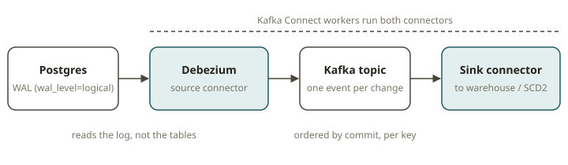
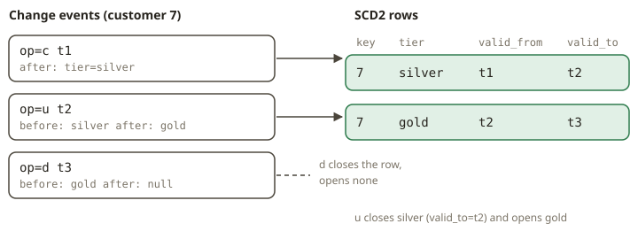

# KFK-07 — Kafka Connect & CDC

## Why it exists

Most of your source-of-truth data lives in operational databases, not in Kafka. You could poll
those tables on a schedule. But polling has three problems. It misses intermediate states. For
example, a row that you insert and delete between two polls never appears. It puts a heavy load on
the OLTP system. It also lags. **Change Data Capture (CDC)** reads the *transaction log* of the
database (the Postgres WAL). It emits one event for each committed row change, in commit order,
with before and after images. **Kafka Connect** is the runtime that hosts such connectors. So you do
not write custom ingestion code for each source.

For an analytics engineer, this is the missing half of SCD2. You already build slowly-changing
dimensions from daily snapshots in dbt. CDC gives you the *stream* of row changes directly. So you
can rebuild the dimension continuously, and you lose no intermediate state.

## How it works

- **Workers, connectors, tasks.** A Connect *cluster* is a set of worker JVMs. A *connector* is a
  configured integration (for example Debezium Postgres). The connector splits its work into
  *tasks*, and the tasks move the data. Source connectors read external systems and write to Kafka.
  Sink connectors read Kafka and write to external systems.
- **Converters** turn the internal records of Connect into bytes on the wire (JSON, Avro+Schema
  Registry, Protobuf). **SMTs** (Single Message Transforms) change records in-flight. For example,
  they rename fields, route topics, or extract the `after` image. A **DLQ** (dead-letter queue)
  captures records that fail conversion. So one bad row does not halt the pipeline.
- **Debezium change-event envelope.** The value of each CDC message is a record with these fields:
  - `op` — the operation. `c` (create/insert), `u` (update), `d` (delete), or `r` (read, emitted
    during the initial **snapshot** of existing rows).
  - `before` — the row image before the change (null for inserts/reads).
  - `after` — the row image after the change (null for deletes).
  - `source` — metadata (LSN, commit timestamp `ts_ms`, table, txId).

  A **tombstone** is a message with a non-null key and a **null value**. Debezium emits it after a
  delete, so that a compacted topic can drop the key entirely.
- **Snapshots.** When a connector starts for the first time, it emits `op=r` for every existing row
  (a consistent snapshot). Then it switches to streaming the WAL changes. Your downstream logic must
  treat `r` like an initial insert.
- **Outbox pattern.** Do not CDC the business tables directly. Instead, services write domain events
  to an `outbox` table in the same transaction. Debezium streams the outbox. This decouples the
  public event schema from the internal table shape.

## Deriving SCD2 from the change stream

Order the change events by commit time for each key. Use LSN as a tiebreaker. Then fold the events
into dimension versions:

- `r`/`c` for a new key → open a new current version (`valid_from = ts`, `valid_to = null`,
  `is_current = true`).
- `u` on an existing key → **close** the current version (`valid_to = ts`, `is_current = false`) and
  **open** a new version with the `after` image.
- `d` → close the current version. Do not open a new version (the entity is gone).
- A tombstone (null value) is a compaction marker. It carries no new state, so SCD2 derivation
  **skips** it. The preceding `d` already closed the row.

This version of a dimension is SOX-friendly and fully auditable. It has every state that the entity
ever had, with exact validity windows. You reconstruct it from the OLTP log.

## From your world

- A Debezium stream of a `customers` table **is** the input to a dbt SCD2 snapshot. The difference
  is that the stream is continuous and lossless. A daily `dbt snapshot` is not.
- `op=r` (snapshot read) is the initial load. `c/u/d` are the incremental changes that you would
  otherwise find by diffing two daily extracts.
- You close the old version on `u` and open a new one. This is exactly the `valid_from` /
  `valid_to` / `is_current` bookkeeping in a Kimball Type-2 dimension.
- The outbox pattern is the streaming equivalent of exposing a curated staging model instead of raw
  source tables. You publish a contract, not your schema.

## When NOT to use it

- When a nightly batch is enough. For example, a dimension that changes monthly does not need
  WAL-level CDC.
- When you cannot enable logical replication on the source, or the DBA will not grant replication
  slots. CDC needs `wal_level=logical` and a slot. The slot retains WAL. If a consumer stalls, the
  WAL can fill the disk.
- For high-churn tables where you want only the *latest* state and never the history. A compacted
  topic of `after` images (or a sink upsert) is simpler than full SCD2.

## Further reading

- Kafka — Connect concepts: https://kafka.apache.org/documentation/#connect
- Debezium 3.0 — Postgres connector (events, snapshots, tombstones): https://debezium.io/documentation/reference/3.0/connectors/postgresql.html
- Debezium — the change event structure: https://debezium.io/documentation/reference/3.0/connectors/postgresql.html#postgresql-events
- Debezium — the outbox event router: https://debezium.io/documentation/reference/3.0/transformations/outbox-event-router.html
