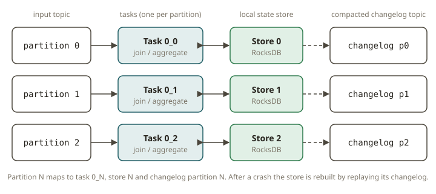

# KFK-08 — Kafka Streams

## Why it exists

Producers and consumers let you move events; they don't help you *transform* a
stream — join it, aggregate it, window it, keep state. You could build that
yourself with a consumer + a database + manual offset handling + crash recovery,
but you'd reinvent a hard distributed-systems problem. **Kafka Streams** is a Java
library (not a cluster) that turns a topology of stream operations into a fault
-tolerant, exactly-once application whose **state lives in Kafka itself**
(changelog topics), so a crashed instance recovers by replaying its changelog.

For an analytics engineer, Kafka Streams is "dbt joins and aggregations, but
continuous and incremental." The order↔customer join you'd write as a dbt model
becomes a streaming enrichment that updates as either side changes.

## How it works

- **KStream vs KTable.** A `KStream` is an **append-only event stream** — each
  record is an independent fact (an order placed). A `KTable` is a **changelog
  view of the latest value per key** — a dimension (the current customer record).
  A `GlobalKTable` is a fully-replicated table available on every instance, for
  non-co-partitioned lookups.
- **Joins.**
  - `KStream`–`KTable` (what you'll build): for each event, look up the current
    table value for its key and emit an enriched event. The stream drives output;
    a table update alone emits nothing. Requires **co-partitioning** (same key,
    same partition count).
  - `KStream`–`GlobalKTable`: lookup by a key *derived* from the stream record, no
    co-partitioning needed.
  - `KStream`–`KStream`: windowed, symmetric.
- **State stores & changelogs.** Aggregations and joins keep local state in a
  **state store** (RocksDB by default), backed by a compacted **changelog topic**.
  That is how state survives a crash: the store is rebuilt from the changelog.

- **Windows.** Tumbling, hopping, sliding, and session windows group events by
  **event time** for time-bounded aggregations (e.g. revenue per 1-minute window).
- **EOS v2** (exactly-once semantics) ties consume → process → produce → state
  update into one transaction, so a failure doesn't double-count.
- **Testing without a cluster.** `TopologyTestDriver` runs a whole topology
  **in-process, with no broker and no RocksDB**: you pipe input records in and read
  output records out, deterministically, in event time. This is the primary way
  Kafka Streams logic is unit-tested (and how this exercise is graded).

## From your world

- A `KTable` of customers **is a conformed dimension**: one current row per key,
  updated in place. A `KStream` of orders is the **fact stream** at order grain.
- The `KStream`–`KTable` join is the fact-to-dimension lookup you write in a dbt
  staging/mart model, except it fires per event and reflects the dimension's
  latest value at the moment the event arrives.
- Co-partitioning (same key, same partition count on both sides) is the streaming
  version of making sure your join keys line up — a mismatch silently drops or
  misroutes joins, like a bad grain in a Kimball model.
- A windowed revenue aggregation is a continuously-maintained periodic snapshot
  fact table.

## When NOT to use it

- When a periodic batch join in the warehouse is sufficient — Kafka Streams adds
  operational weight (state stores, changelogs, rebalancing) you don't need for a
  nightly dimension.
- Cross-language shops: Streams is JVM-only. If your team won't run Java services,
  Flink SQL or ksqlDB may fit better.
- Heavy multi-stream SQL-style analytics with complex joins — a SQL engine
  (Flink SQL) is often more ergonomic than hand-built topologies.

## Further reading

- Kafka — Streams concepts (KStream/KTable, joins, state): https://kafka.apache.org/documentation/streams/
- Kafka — Streams developer guide, joining: https://kafka.apache.org/documentation/streams/developer-guide/dsl-api.html#joining
- Kafka — Testing Streams with TopologyTestDriver: https://kafka.apache.org/documentation/streams/developer-guide/testing.html
- Kafka — Streams architecture (state stores, changelogs, EOS): https://kafka.apache.org/documentation/streams/architecture
