# KFK-11 · Cluster configuration & partition reassignment

## Why this module exists

The balance of a Kafka cluster depends on its **partition placement**. Every partition has a list of
**replica brokers**. The first broker is the preferred **leader**. The other brokers are **followers**
that stay in the **ISR** (in-sync replicas).

Sometimes you add a broker, lose a broker, or find that one node is a hotspot. Then you **reassign**
partitions to rebalance. There is a catch. To move a replica, Kafka must **copy the entire data of the
partition** from a current replica to the new broker over the network. On a busy cluster, a careless
reassignment that moves everything can saturate the network and make the cluster fail.

So the real skill is not "spread partitions evenly." Anyone can do that from scratch. The real skill
has two parts:

- **Rebalance with *minimal data movement*.**
- **Respect the constraints.** These are the replication factor and the rule that no two replicas of
  one partition are on the same broker. In a multi-rack or multi-AZ cluster, you also spread the
  replicas across racks. Then the failure of one rack cannot take a partition offline.

This is the Redshift WLM instinct applied to storage: move just enough work to fix the imbalance, and
no more.

## How reassignment works

**The replica list.** For each partition, Kafka stores an ordered replica list, for example `[2, 0, 1]`.
Broker `2` is the preferred leader. Brokers `0` and `1` are followers. Every valid assignment follows
these rules:

1. **Length == replication factor.** The list has `rf` replicas, no more and no fewer.
2. **No duplicates.** A partition cannot have two replicas on the same broker. That would defeat the
   purpose of replication.
3. **Rack awareness (if configured).** With `broker.rack` set, the replicas of a partition should be
   spread across as many distinct racks as possible. Then a whole-rack outage still leaves a replica
   up. With `rf <= number_of_racks`, every replica should be on a **distinct** rack.

**Minimal movement.** Suppose you reassign partition `P` from `[0,1]` to `[0,2]`. This moves ONE
replica (the `1` → `2` copy). If you reassign it to `[2,3]`, it moves TWO replicas. Suppose you must
move a cluster onto a new set of brokers. Then you want the assignment that satisfies all the
constraints **and keeps as many existing replicas in place as possible**. Each kept replica is data
that you do *not* have to copy.

**Applying it.** Follow these steps:

1. Write the new assignment as JSON.
2. Give it to `kafka-reassign-partitions.sh --execute`.
3. Run `--verify` until it reports that the move is complete.

You can **throttle** the replication traffic (`--throttle <bytes/s>`). Then the move does not starve
the production traffic. If you set the throttle too low, the reassignment never finishes. This is a
classic incident (see KFK-14). The controller drives the move. Kafka uses the preferred leader only
after the new replica is in the ISR.

## Broker & topic configuration you tune alongside

- **`min.insync.replicas`** + producer `acks=all`: how many replicas must acknowledge a write before
  Kafka considers it committed (durability vs availability).
- **`default.replication.factor`**, **`num.partitions`**: cluster-wide defaults for topics that Kafka
  creates automatically (prefer explicit creation).
- **Retention** (`retention.ms`, `retention.bytes`), **segment size**, **compaction** — sizing and
  storage (KFK-09 / KFK-14).
- **Quotas** (produce/consume/request) and **tiered storage** — they protect the cluster from a noisy
  tenant and move cold data off the brokers.

## From your world

| Redshift / warehouse | Kafka cluster config |
|---|---|
| WLM queue slots rebalanced to even out query load | partition reassignment to even out broker load |
| "don't reload the whole table, move the hot slice" | minimal-movement reassignment (keep replicas in place) |
| Multi-AZ deployment for fault tolerance | **rack awareness**: replicas across racks/AZs |
| Resize that saturates the cluster if done at peak | throttling the reassignment so it doesn't starve traffic |
| `max_concurrency_scaling_clusters` guardrails | `min.insync.replicas` + `acks=all` durability floor |

## When NOT to reassign (or to be careful)

- **Don't move everything to "rebalance".** A full shuffle copies every partition. This has a huge
  network cost and risk. Compute the minimal set of moves.
- **Don't reassign without a throttle on a busy cluster.** Replication traffic competes with
  production traffic. Throttle it, and watch the under-replicated partitions.
- **Don't ignore rack awareness** in a multi-AZ cluster. An assignment can look even and still put
  both replicas of a partition in one AZ. Then you lose that partition when the AZ goes down.
- **Prefer `kafka-reassign-partitions.sh --generate` / Cruise Control** for large clusters. Do not
  write the JSON by hand. But you must still be able to reason about the result and verify it. This
  module trains that skill.

## Further reading

Official docs only:

- Replication & balancing leadership:
  <https://kafka.apache.org/documentation/#basic_ops_cluster_expansion>
- `kafka-reassign-partitions.sh` (expand, --generate/--execute/--verify, --throttle):
  <https://kafka.apache.org/documentation/#rep-throttle>
- Rack awareness (`broker.rack`):
  <https://kafka.apache.org/documentation/#basic_ops_racks>
- Broker configs (replication, min.insync.replicas):
  <https://kafka.apache.org/documentation/#brokerconfigs>
- Confluent CCAAK (deployment architecture, cluster configuration):
  <https://www.confluent.io/certification/>
