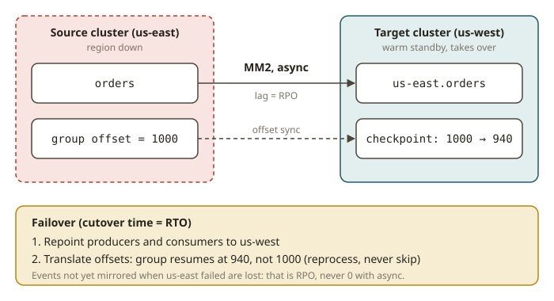

# KFK-13 · Deployment architecture: multi-region disaster recovery

## Why this module exists

A single-region Kafka cluster is a single point of failure for your streaming platform. If that
region goes down — AZ outage, network partition, bad deploy — producers can't write and consumers
can't read until it's back. For anything business-critical you need a **second region** and a
plan: how does data get there, how much can you lose, and how fast can you fail over? Those last two
are the numbers every DR plan lives or dies by:

- **RPO (Recovery Point Objective)** — the maximum **data loss** you can tolerate, measured in time.
  "RPO = 5 minutes" means after a disaster you may lose up to 5 minutes of the most recent events.
- **RTO (Recovery Time Objective)** — the maximum **downtime** you can tolerate: how long until the
  service is back, measured from the failure to full recovery.

This is the same DR discipline you'd apply to a warehouse or data mart, now for the log that feeds
them. The architecture you choose is a direct trade of **cost and complexity against RPO/RTO**.

## How multi-region Kafka works

**Async replication (the common case): MirrorMaker 2.** MM2 is a Kafka Connect-based tool that
consumes from a **source** cluster and produces to a **target** cluster in another region,
**asynchronously**. Because it is async, the target always lags the source a little — that lag is
your **RPO** (you lose whatever hadn't replicated yet). MM2 also mirrors consumer-group offsets and
topic configs, and it **renames** topics with a source-cluster prefix (e.g. `us-east.orders`) under
the default `DefaultReplicationPolicy` to avoid loops in active/active setups. Failover is a
**manual or orchestrated** cutover: point producers/consumers at the target, translate offsets, and
resume — so RTO is dominated by how automated that cutover is.

**Topologies.**

- **Active/Passive (warm standby).** One region serves; the other is a replica kept warm by MM2.
  Simpler, cheaper; failover is a deliberate cutover. RPO = replication lag; RTO = cutover time.
- **Active/Active.** Both regions serve local traffic and mirror to each other (prefixed topics
  prevent loops). Lowest RTO (the other region is already live) but more complex: you must handle
  duplicate/looping data and conflicting writes.
- **Stretched cluster (single cluster across regions).** Brokers span regions with rack-aware
  placement so replicas are in both; `acks=all` across regions gives **RPO ≈ 0** but adds
  cross-region write latency and needs ≥3 AZs/regions for quorum. Highest cost/latency, lowest RPO.

**Managed / newer options.** Confluent **Cluster Linking** (byte-for-byte offset-preserving async
replication, no Connect), and offerings like MSK, Confluent Cloud, WarpStream/diskless architectures
change the cost and operational model but the RPO/RTO reasoning is the same.

## From your world

| Warehouse / platform DR | Kafka multi-region DR |
|---|---|
| "how much data can we lose?" (RPO) | replication **lag** of MM2 / Cluster Linking = RPO |
| "how fast must we be back?" (RTO) | **cutover** automation = RTO |
| Cross-region read replica (async) | **MirrorMaker 2** async mirror (active/passive) |
| Multi-AZ synchronous replica | **stretched cluster** with `acks=all` (RPO≈0, higher latency) |
| DR runbook / game-day exercise | failover procedure: repoint clients, translate offsets |
| Cost vs resilience trade in the mart | topology choice trades cost/complexity vs RPO/RTO |

## When NOT to / pitfalls

- **Don't claim RPO = 0 with async replication.** MM2 and Cluster Linking are asynchronous; there is
  always some lag. RPO ≈ 0 requires a synchronous (stretched) design and you pay in latency.
- **Don't forget offset translation.** Consumers that fail over must resume at the right place; MM2's
  offset-sync / checkpoint topics (or Cluster Linking's preserved offsets) make this possible — plan
  for it or you reprocess or skip data.
- **Don't ignore the prefix in active/active.** Mirrored topics are renamed to prevent loops;
  consumers must know which topics to read in each region.
- **Don't size a stretched cluster across 2 regions only.** Quorum needs an odd number of failure
  domains (≥3) or a region loss can lose the controller quorum.

## Further reading

Official docs only:

- Geo-replication / MirrorMaker 2 (Kafka docs):
  <https://kafka.apache.org/documentation/#georeplication>
- MirrorMaker 2 configuration & replication policy:
  <https://kafka.apache.org/documentation/#georeplication-mirrormaker>
- Rack awareness (for stretched clusters):
  <https://kafka.apache.org/documentation/#basic_ops_racks>
- Confluent CCAAK (deployment architecture):
  <https://www.confluent.io/certification/>
