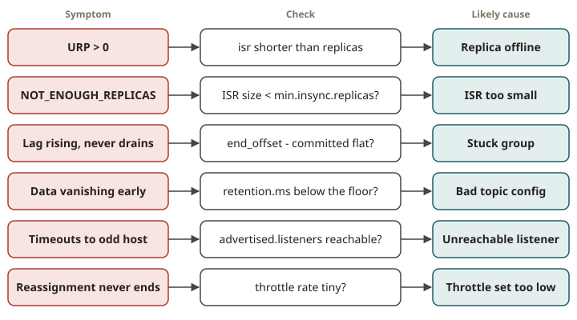

# KFK-14 · Operating & troubleshooting a cluster

## Why this module exists

Running Kafka in production is a sequence of incidents, and the engineers who are good at it all do
the same thing: **read the symptom, name the cause, apply the smallest fix, verify health is
restored.** That is a runbook — exactly what you already keep for a warehouse or data mart. This
module turns the six most common Kafka incidents into that loop, as `diagnose(...)` + `fix(...)`
functions you can run and test, so the muscle memory is real rather than a slide you half-remember
at 3 a.m.

The uniting idea is **health is measurable**: under-replicated partitions, ISR size, consumer lag,
retention, listener reachability and reassignment throttle are all things an operator can *query*
with `AdminClient` / the CLI and *assert on*. A fix is only a fix if the metric returns to healthy.

## The six incidents and how you reason about them

**1. Under-replicated partitions (URP) after a broker loss.** A broker dies; every partition it
hosted a replica for now has fewer in-sync replicas than its replication factor. Symptom: URP > 0
(`kafka-topics.sh --describe --under-replicated-partitions`, or `isr` shorter than `replicas` in the
metadata). Cause: a replica is offline. Fix: bring the broker back (it rejoins and re-syncs) or
reassign the replica to a live broker. Health = URP back to 0.

**2. `min.insync.replicas` violation.** A topic has `min.insync.replicas=N`, but fewer than `N`
replicas are in the ISR (e.g. after losing brokers). With `acks=all`, producers now get
`NOT_ENOUGH_REPLICAS` — writes are rejected to protect durability. Symptom: produce fails with that
error even though a leader exists. Cause: ISR < min.insync.replicas. Fix: restore replicas (preferred)
or, as a deliberate availability trade-off, lower `min.insync.replicas` to what the ISR can meet.

**3. Stuck / lagging consumer group.** Lag keeps rising and never drains (a poison record, a dead
member, or offsets reset wrong). Symptom: `end_offset - committed_offset` large and not decreasing.
Cause: the group isn't making progress. Fix depends on root cause — here, when the group is simply
positioned wrong, reset its offsets (`kafka-consumer-groups.sh --reset-offsets`) to a sane point so
it can catch up. Health = lag drops.

**4. Retention misconfiguration.** A topic's `retention.ms` (or `retention.bytes`) is set far too
low, so data is deleted almost immediately and consumers that fall behind lose records. Symptom:
retention below a sane floor; data vanishing. Cause: a bad topic config. Fix: set `retention.ms`
to a correct value with `kafka-configs.sh --alter`. Health = retention at/above the floor.

**5. Wrong `advertised.listeners`.** A broker advertises an address clients can't actually reach
(e.g. an internal hostname, or the bind address `0.0.0.0`), so clients get the metadata but then
fail to connect to the returned endpoint. Symptom: bootstrap works but produce/consume times out
with connection errors to a bogus host. Cause: `advertised.listeners` ≠ a client-reachable address.
Fix: set `advertised.listeners` to the reachable host:port. (You diagnose this from the broker
config, because a live broker with broken advertised listeners can't be reached at all.)

**6. Throttled reassignment that never finishes.** A partition reassignment was started with a
replication **throttle** set too low, so the move is bandwidth-starved and `--verify` stays "in
progress" forever. Symptom: reassignment in progress long after it should be done; the throttle
rate is tiny. Cause: `leader.replication.throttled.rate` / `follower...` too low (or left set).
Fix: raise or remove the throttle so the move completes. Health = reassignment verifies complete.

## From your world

| Warehouse / platform incident | Kafka incident |
|---|---|
| A node drops; queries degrade until it rejoins | URP after a broker loss; restore the replica |
| A write is rejected to protect a constraint | `acks=all` + ISR < min.insync.replicas ⇒ NOT_ENOUGH_REPLICAS |
| A load job's backlog never drains | stuck consumer group; reset offsets / unblock |
| TTL set too low deletes data you needed | `retention.ms` too low; raise it |
| Service registered with an unreachable DNS name | wrong `advertised.listeners` |
| A resize throttled so low it never completes | reassignment throttle too low; raise/remove it |

## When NOT to / pitfalls

- **Don't lower `min.insync.replicas` as a reflex.** It trades durability for availability; prefer
  restoring replicas. Lower it only as a conscious, temporary decision.
- **Don't reset consumer offsets to `earliest` blindly** — you may reprocess huge volumes. Reset to
  the smallest point that unblocks the group.
- **Don't "fix" URP by deleting the topic.** The replica just needs a live broker; deletion is data
  loss.
- **Don't leave a reassignment throttle set after it completes** — it will throttle future
  replication too (`--verify` removes it when done).

## Further reading

Official docs only:

- Operations / monitoring (URP, ISR, lag):
  <https://kafka.apache.org/documentation/#monitoring>
- Datacenter / replication throttling (reassignment):
  <https://kafka.apache.org/documentation/#rep-throttle>
- Topic/broker configs (retention, min.insync.replicas, advertised.listeners):
  <https://kafka.apache.org/documentation/#configuration>
- `kafka-consumer-groups.sh` (reset-offsets):
  <https://kafka.apache.org/documentation/#basic_ops_consumer_group>
- Confluent CCAAK (observability, troubleshooting):
  <https://www.confluent.io/certification/>
