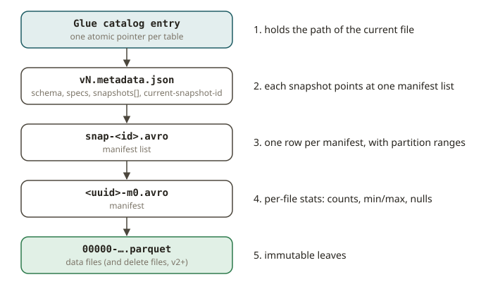

# LKH-01 · The Iceberg metadata tree

## Why a table format exists

In Athena, you query an Iceberg table with `SELECT ... FROM glue_db.orders`. It behaves like a
database table. You get a consistent view. You can time-travel. Schema changes do not rewrite
everything. But there is no database under the table. There is only a bucket of immutable Parquet
files in S3.

Iceberg turns this "pile of files" into a "table". It writes a tree of **metadata** next to the
data. Learn to read this tree. It is the most useful Iceberg skill. Every operational question is
answered by walking the tree. For example:

- *Why is this query slow?*
- *Why did the snapshot not expire?*
- *Which files does this filter actually read?*

You already trust this tree every time Athena prunes partitions for you. This module opens the box.
You will see how the behavior works, and it will not look like magic.

## How the tree is laid out

Iceberg metadata is a pointer chain with four levels. The chain starts with the newest state.

1. **Catalog entry → `metadata.json`.** The catalog (Glue, in your Athena world) stores *one*
   atomic pointer per table. The pointer holds the path of the current `metadata.json`. This file
   is the root of the tree. It lists the schemas, partition specs, sort orders and table
   properties. It also lists all **snapshots**, with the id of the *current* one. A commit is only
   an atomic swap of this one pointer (LKH-02).
2. **`metadata.json` → manifest list.** Each snapshot points at exactly one **manifest list**
   (a `snap-*.avro` file). The manifest list is the index of the snapshot. It has one row per
   **manifest**. Each row holds the partition-value ranges of that manifest. It also holds the
   counts of added, existing and deleted files.
3. **manifest list → manifests.** Each **manifest** (`*.avro`) lists a batch of data files or
   delete files. It also carries **per-file column statistics**. These are `record_count`, and
   `lower_bounds`, `upper_bounds` and `null_counts` for each column.
4. **manifest → data files.** The leaves are the immutable **Parquet data files**. In v2 and
   later, the leaves also include **delete files** (LKH-04).

**Why are there two index levels (the manifest list and the manifests)?** The two levels let a
query planner prune at low cost. The planner works in these steps:

1. It reads the small manifest list.
2. It drops each manifest whose partition range cannot match.
3. It reads only the remaining manifests.
4. It uses the per-file min/max values to drop single data files.

This is the same idea as row-group pruning in FND-06. But it works one level higher, over *files*
and not over row groups. This process is **scan planning**. The number of files that it chooses to
read is a measurable fact. `DataScan.plan_files()` returns exactly the file-scan tasks that a
correct engine would run.

Each write produces a new **snapshot**. A new snapshot means a new `metadata.json` version and a
new manifest list. Old snapshots keep pointing at their own manifest lists. This is how **time
travel** and atomic commits work. Iceberg never changes existing files. It only adds new files,
and the catalog pointer moves to the new `metadata.json`.

## From your world

| Athena / Glue / dbt | Iceberg metadata | Note |
|---|---|---|
| The table you `SELECT` in Athena | catalog → `metadata.json` | one atomic Glue pointer |
| Partition pruning you never see | manifest-list partition ranges | drops whole manifests |
| "Athena scanned 1.2 GB" cost line | `plan_files()` result | which data files are read |
| A dbt snapshot's historical rows | the `snapshots` list | each write = one snapshot |
| `VACUUM` on Redshift | expiring snapshots (LKH-05) | removes unreferenced files |

## When NOT to lean on the metadata tree

- **Do not read the Avro files by hand in production.** Use `t.inspect.*` or the SQL metadata
  tables (`.snapshots`, `.files`, `.manifests`) when they already answer your question. Parse the
  files by hand only to learn, or in the rare forensic case.
- **Do not use the per-file min/max as a secondary index for point lookups.** Iceberg prunes
  files. It is not a key-value store. If you need lookups by key in under one second, use the
  "when not to use a lakehouse" case from the track intro.
- **Do not treat "number of manifests" as "number of data files".** One manifest lists many files.
  Mixing the two levels is the classic beginner bug when you read metadata.

## Further reading

- Iceberg table spec (metadata, manifests, manifest lists, snapshots):
  <https://iceberg.apache.org/spec/>
- Iceberg terms (snapshot, manifest, manifest list, data file):
  <https://iceberg.apache.org/terms/>
- PyIceberg API (metadata inspection, scans):
  <https://py.iceberg.apache.org/api/>
