# LKH-02 · Commits & concurrency

## Why commits are the hard part

In LKH-01 you saw that a commit is "just" an atomic swap. The swap moves the single pointer of the
catalog to a new `metadata.json`. This sounds simple. It becomes hard when two writers try to
commit at the same time. For example:

- two dbt runs that overlap
- a backfill that races the hourly job
- a streaming sink and a compaction job

Imagine that both writers read the table at version *N*. Each writer builds new metadata on top of
*N*. Both writers blindly install their result. Then **one write is silently lost**. The writer
that swaps the pointer second erases the snapshot of the first writer from the current line. A lost
update is a quiet data-corruption bug. Table formats exist to prevent it.

Iceberg solves this with **optimistic concurrency control (OCC)**. No writer holds a lock during
the work. Each writer does its work against the snapshot that it read. It assumes that nobody
changes the table in the meantime. At commit time, the writer performs an **atomic
compare-and-swap**: "install my new metadata *only if* the table is still at the version I started
from." Sometimes someone else committed first, and the table moved. Then the swap fails, and the
writer gets a conflict error. Optimism works well when conflicts are rare. They are usually rare.

## How a commit actually works

1. **Read** the current `metadata.json` (version *N*, the base snapshot).
2. **Do the work** against that base. Write the data files. Build the new manifests and the new
   manifest list. Assemble metadata version *N+1*, whose parent is *N*.
3. **Commit = compare-and-swap** at the catalog. Atomically move the pointer from *N* to *N+1*
   **only if** the pointer is still *N*. The mechanism depends on the catalog (LKH-03). It can be
   a Glue/DynamoDB conditional update, a conditional commit of a REST catalog, or an object-store
   *put-if-absent* on the next metadata filename.
4. **On conflict** (the pointer was no longer *N*): the catalog rejects the swap. The client raises
   a conflict (`CommitFailedException` in PyIceberg). Your *N+1* now sits on a stale base.

The fix is **refresh and re-apply**. Follow these steps:

1. Reload the table to get the new state of the winner.
2. Recompute your change against that fresh base.
3. Try the compare-and-swap again. Use a bounded number of retries.

Each time, the operation is recomputed on fresh data. So no update is lost. The final state is *as
if the two writers had run one after another* (serial equivalence).

Two details:

- **Not every overlap is a true conflict.** Two pure appends to different files commute. Iceberg
  can often re-apply an append onto the new base automatically. You do not need to recompute
  anything. The conflicts that you *must* re-apply by hand are **read-modify-write** operations.
  Examples are an overwrite of a row by a value that you read, and delete-then-insert. In these
  cases, the value that your change used may have changed.
- **Isolation levels.** Iceberg supports *serializable* and *snapshot* isolation. Under serializable
  isolation, Iceberg rejects a conflicting concurrent change to rows that your operation depended
  on. Under snapshot isolation, Iceberg allows some commuting changes. The default for overwrites
  and merges is `serializable`.

## From your world

| dbt / warehouse | Iceberg OCC | Note |
|---|---|---|
| Two dbt runs writing one table | two writers racing to swap the pointer | last-writer-wins = lost update if naive |
| A warehouse transaction `COMMIT` | catalog compare-and-swap of metadata | atomic, all-or-nothing |
| "retry the model on deadlock" | refresh-and-reapply with bounded retries | recompute on the fresh base, don't blind-retry |
| `SERIALIZABLE` vs `READ COMMITTED` | serializable vs snapshot isolation | same vocabulary |

## When NOT to rely on OCC the naive way

- **Do not blind-retry.** Do not re-submit the *same* precomputed metadata after a conflict. It
  conflicts again. Or, worse, it installs a value that came from a stale read. This is the lost
  update that you wanted to avoid. Always `refresh()` and recompute first.
- **Do not catch the conflict and swallow it.** `except CommitFailedException: pass` changes a
  loud, recoverable conflict into a silent lost write. Catch the exception only to refresh and
  retry.
- **Do not use OCC for high-contention, tiny, hot updates.** Imagine hundreds of writers that
  update the same rows every second. Then optimism turns into a retry storm. That is a key-value
  store or OLTP workload. It is not a lakehouse table (the "when not to use it" case of the track).

## Further reading

- Iceberg spec — Optimistic Concurrency: <https://iceberg.apache.org/spec/#optimistic-concurrency>
- Iceberg spec — Commit Conflict Resolution and Retry:
  <https://iceberg.apache.org/spec/#commit-conflict-resolution-and-retry>
- Iceberg reliability / concurrent writes:
  <https://iceberg.apache.org/docs/latest/reliability/#concurrent-write-operations>
- PyIceberg transactions & table API (refresh, overwrite):
  <https://py.iceberg.apache.org/api/>
