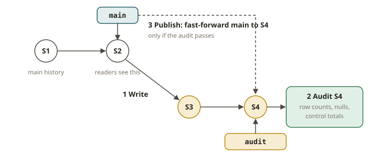

# LKH-03 · Catalogs, branching & write-audit-publish

## Why the catalog is the real boundary

LKH-01 showed that a table is a tree of files. LKH-02 showed that a commit is an atomic swap of one
pointer. The **catalog** **holds** that pointer. The catalog also decides who may swap it. In your
Athena world, the catalog is **Glue**. Glue maps `db.table` to the current `metadata.json`. With
Lake Formation, it also controls who can read or write.

Imagine that you swap the catalog. The same Iceberg files then become a table in another system.
This system can be a Hive metastore, a REST catalog (Polaris, Nessie, Unity, Lakekeeper), or a
plain filesystem. The data is portable. The catalog is the control plane.

A catalog does three jobs:

1. **Name resolution** (`db.table` → metadata path).
2. **Atomic commit** (the compare-and-swap of LKH-02).
3. **Governance** (permissions, lineage). This job is growing.

The REST catalog makes this standard with one HTTP protocol. Then any engine talks to any catalog
in the same way.

## Branching, tagging, and write-audit-publish

Iceberg can keep multiple named **references** to snapshots in one table:

- A **tag** is an immutable label on a single snapshot. It names one point in time ("eom-2026-01").
- A **branch** is a mutable reference. You can commit to it independently of `main`, exactly like a
  git branch. Writes to a branch do **not** change what readers of `main` see.

This is the mechanism behind **write-audit-publish (WAP)**. This pattern matches your SOX "audited
publish" control. A bad way is to write new data straight into the production table (`main`) and
hope that it is good. Instead, you follow these steps:

1. **Write** the new data to a short-lived **branch** (for example `audit`). Production readers on
   `main` are untouched. Nothing bad is visible yet.
2. **Audit** the data *on the branch*. Run your quality checks against the snapshot of the branch.
   Do not run them against main. Example checks are row counts, null rates, referential integrity
   and control totals.
3. **Publish** only if the audit passes. If main has not moved, **fast-forward** `main` to the
   branch tip. Or **cherry-pick** the snapshot of the branch onto main. If the audit fails, you
   drop the branch. `main` never saw the bad data.

The order is the whole point. The control is real only when you audit *before* you publish. Two
actions defeat the control. One is to audit the wrong snapshot (main instead of the branch). The
other is to publish before the audit. They are like a SOX control that is signed off on the numbers
of last quarter, or that is published before sign-off.



In Spark SQL (Iceberg extensions), the commands are:

```sql
ALTER TABLE t CREATE BRANCH audit;              -- create the staging branch
INSERT INTO t.branch_audit SELECT ... ;         -- write-audit-publish: WRITE
-- AUDIT: run checks against t.branch_audit (VERSION AS OF 'audit')
CALL cat.system.fast_forward('db.t', 'main', 'audit');   -- PUBLISH (ff)
-- or: CALL cat.system.cherrypick_snapshot('db.t', <snapshot_id>)
```

## From your world

| SOX / dbt / Athena | Iceberg | Note |
|---|---|---|
| Glue Data Catalog | the catalog (name → metadata, commit, governance) | one control plane |
| Lake Formation grants | catalog governance (Unity/Polaris/LF) | who may read/write |
| SOX "no unapproved data in the mart" | write to a branch, not main | isolation before sign-off |
| the audited publish / sign-off step | audit the branch, then fast-forward main | approval gate |
| dbt `--defer`/CI build on a PR | WAP branch validated before merge | same shape |

## When NOT to use branches / WAP

- **Do not branch for every tiny append.** If a failed load is cheap to retry, use no branch. WAP
  is best when a bad publish is expensive or regulated. Branch maintenance (and extra snapshots)
  has a cost.
- **Do not treat a branch as a long-lived parallel history.** Do this only if you really need it.
  A branch that lives forever accumulates snapshots. It also makes expiration more complex
  (LKH-05).
- **Do not rely on branch isolation for secrecy or row-level security.** That is the job of the
  governance of the catalog. A branch has a different purpose.

## Further reading

- Iceberg — Branching and Tagging:
  <https://iceberg.apache.org/docs/latest/branching/>
- Iceberg spec — Snapshot References (branches/tags):
  <https://iceberg.apache.org/spec/#snapshot-references>
- Iceberg Spark procedures (fast_forward, cherrypick_snapshot):
  <https://iceberg.apache.org/docs/latest/spark-procedures/>
