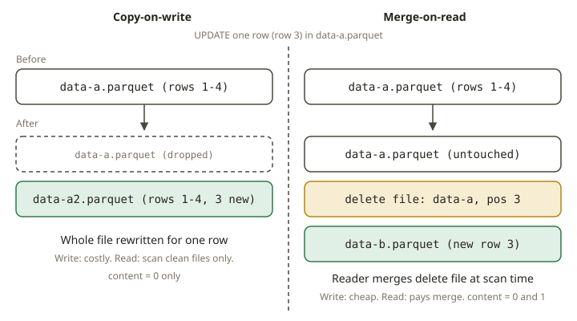

# LKH-04 · Row-level changes — SCD2, CoW & MoR

## Why row-level change is hard on immutable files

Parquet files are immutable: you cannot edit a row in place. Yet real tables need updates, deletes
and upserts — most of all the **SCD Type 2** dimensions you already build, where a changed
attribute closes the old version (sets `valid_to`) and opens a new one. Iceberg v2 makes row-level
change possible on top of immutable files in two ways, and choosing between them is the core
operational decision of this module.

## Copy-on-write vs merge-on-read

When a `MERGE`/`UPDATE`/`DELETE` touches rows inside a data file, Iceberg must either rewrite the
file or record the change separately:

- **Copy-on-write (CoW).** Rewrite each affected data file without the changed/deleted rows (and
  write the new versions as new data files). Reads stay fast — every data file is "clean" — but
  writes are expensive because whole files are rewritten even to change one row. This is the
  Redshift/warehouse mental model: the table is always materialised.
- **Merge-on-read (MoR).** Leave the data files alone and write a small **delete file** that marks
  which rows are logically removed (by position — a *position delete* — or by value — an *equality
  delete*; v3 adds compact **deletion vectors**). Writes are cheap; reads pay to merge the delete
  files against the data files at scan time. You trade read cost for write cost, and you accumulate
  deletes until compaction (LKH-05) folds them back in.



You can **see** which mode happened in the metadata — this is how you verify it rather than guess:

```sql
-- content: 0 = data file, 1 = position deletes, 2 = equality deletes
SELECT content, count(*) FROM local.db.t.files GROUP BY content;
```

After a delete, a **CoW** table shows only `content = 0` (data files rewritten); a **MoR** table
shows `content = 0` **and** `content = 1` (a delete file was added, no data rewrite). The table
properties that choose the mode are `write.delete.mode`, `write.update.mode` and
`write.merge.mode` (`copy-on-write` or `merge-on-read`).

## SCD2 with `MERGE INTO`

SCD2 is the canonical row-level job. The dimension carries `valid_from`, `valid_to`
(`NULL`/open on the current version) and `is_current`. A daily batch of natural-key rows is applied
in two steps:

1. **Close** every current row whose tracked attribute changed:
   `MERGE INTO dim t USING src u ON t.nk = u.nk AND t.is_current WHEN MATCHED AND t.attr <> u.attr
   THEN UPDATE SET t.valid_to = <batch_date>, t.is_current = false`.
2. **Insert** a new open version for every changed key *and* every brand-new key:
   `INSERT INTO dim SELECT nk, attr, <batch_date> AS valid_from, NULL AS valid_to, true AS
   is_current FROM src LEFT ANTI JOIN current-rows`.

Three mistakes break SCD2, and the tests hunt all three: **overwriting** the row instead of
versioning (history lost), leaving `valid_to` **open** on the superseded row (two "current" rows
for one key), and an **off-by-one** effective date (ranges overlap or leave a gap). The correct
result is checked against an **independent DuckDB oracle** that computes the same close/insert over
the same two daily batches — two engines agreeing is the G6 guarantee that the expected answer is
right.

## From your world

| Redshift / dbt / SCD2 | Iceberg | Note |
|---|---|---|
| SCD2 snapshot: close old, open new | two-step `MERGE` + `INSERT` | same bitemporal logic |
| `UPDATE`/`DELETE`/`MERGE` on a warehouse table | CoW (rewrite) or MoR (delete files) | you choose the trade-off |
| VACUUM rewrites to reclaim space | compaction folds MoR deletes back (LKH-05) | deletes accumulate until then |
| "the dimension is always materialised" | copy-on-write | fast reads, costly writes |
| high-frequency upserts/CDC | merge-on-read | cheap writes, read-time merge |

## When NOT to…

- **Don't use MoR for a read-heavy, rarely-written dimension.** The read-time merge tax and
  delete-file build-up aren't worth it; CoW keeps reads clean.
- **Don't use CoW for high-frequency CDC/upserts into large files.** Rewriting whole files per tiny
  change is write amplification; MoR (or deletion vectors) is the point.
- **Don't hand-maintain SCD2 with blind overwrites.** You lose history — the entire reason the
  dimension is Type 2. Version it; never mutate the old row's key fields in place.

## Further reading

- Iceberg spec — Row-level Deletes (position/equality deletes, deletion vectors):
  <https://iceberg.apache.org/spec/#row-level-deletes>
- Iceberg Spark writes (MERGE INTO, CoW/MoR modes):
  <https://iceberg.apache.org/docs/latest/spark-writes/>
- Iceberg configuration (`write.*.mode` properties):
  <https://iceberg.apache.org/docs/latest/configuration/>
