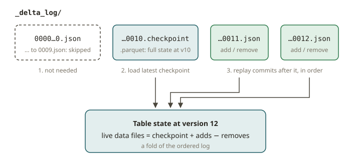

# LKH-06 · Delta Lake

## Why Delta exists

Delta Lake solves the same problem as Iceberg. It turns a pile of Parquet files in object storage
into a transactional table. But Delta came from the Databricks/Spark world, and it makes different
design choices. You will see it in job postings as often as Iceberg ("Delta shop"). The Databricks
Data Engineer exams also assume that you know it.

The point of this module is not to learn table formats again from the start. You already did that
with Iceberg (LKH-01..05). The point is to do a task that you know very well in Delta. This task
is a Slowly Changing Dimension Type 2 upsert. You also read the transaction log of Delta. Then you
see exactly where Delta and Iceberg agree and where they differ.

## How it works

**The transaction log (`_delta_log`).** A Delta table is a directory of Parquet data files plus a
`_delta_log/` directory. Each commit is a new JSON file (`00000000000000000000.json`,
`...0001.json`, …). The file contains *actions*:

- `add` (a data file is now live)
- `remove` (a data file is tombstoned)
- `metaData`
- `commitInfo`

The current table state is the result of a replay of all commits in order. This is the key
difference from Iceberg. In Iceberg, the current state is a single pointer in the catalog. The
pointer goes to one `metadata.json`, and this file *names* the live manifest list. In Delta, the
current state is the *fold* of an ordered log of commits. Both formats are append-only. Both give
atomic commits with optimistic concurrency. But the shape of the metadata is different.

**Checkpoints.** A replay of thousands of JSON commits would be slow. So Delta writes a
**checkpoint** every N commits (default 10). A checkpoint is a Parquet file. It materializes the
full set of live files at that version. A reader loads the latest checkpoint. Then it replays only
the JSON commits after the checkpoint. Delta uses checkpoints to solve the same scaling problem
that Iceberg solves with manifest lists and manifests.



**`MERGE INTO` for SCD2.** The upsert has the same shape as the upserts that you wrote in dbt
snapshots and SQL marts. For a Type 2 dimension, you keep history. An incoming row can change an
attribute. Then you **close** the current version (set its `valid_to`). You also **insert** a new
current version (`valid_to IS NULL`). One MERGE cannot do both for the same key: a changed key
matches, so `WHEN NOT MATCHED` does not insert its new version. Use two MERGE statements. In Delta
SQL:

```sql
-- 1. Close the current version of every changed key.
MERGE INTO dim t
USING updates u
ON t.business_key = u.business_key AND t.valid_to IS NULL
WHEN MATCHED AND t.attr <> u.attr
  THEN UPDATE SET t.valid_to = u.effective_date;

-- 2. Insert a new current version for every changed key and every new key.
--    Unchanged keys still match (t.attr = u.attr), so MERGE skips them.
MERGE INTO dim t
USING updates u
ON t.business_key = u.business_key AND t.valid_to IS NULL AND t.attr = u.attr
WHEN NOT MATCHED
  THEN INSERT (business_key, attr, valid_from, valid_to)
       VALUES (u.business_key, u.attr, u.effective_date, NULL);
```

The classic bug is `UPDATE SET attr = u.attr` (overwrite in place). The mutants in the exercise
encode this bug. It destroys history and makes the dimension SCD **Type 1**. SCD2 never changes the
old attribute. It closes the old row and adds a new row.

**Change Data Feed (CDF).** Set `delta.enableChangeDataFeed=true`. Then Delta records row-level
changes. A downstream consumer can read *what changed* between versions. It does not need to
compare snapshots:

```python
spark.read.format("delta").option("readChangeFeed", "true") \
     .option("startingVersion", 0).table("dim")
```

Each row carries a `_change_type` and a `_commit_version`. The `_change_type` is `insert`,
`update_preimage`, `update_postimage`, or `delete`. This is the Delta equivalent of the
consumption of a changelog stream (your Kafka/CDC world). It is the engine behind incremental
pipelines. Iceberg has an equivalent in its `create_changelog_view` procedure and in incremental
scans. The concept is the same, and the API is different.

**Liquid clustering & UniForm (context, not graded here).** *Liquid clustering* is a newer layout
feature of Delta. It replaces hive-style partitioning + ZORDER with a single `CLUSTER BY`. Delta
maintains it incrementally. It is the Delta counterpart to Iceberg sort orders + hidden
partitioning (LKH-05). *UniForm* writes Iceberg-compatible metadata next to the Delta log. Then
Iceberg readers can read a Delta table. The Further reading section describes both features.

## From your world

| dbt / SQL / Iceberg | Delta |
|---|---|
| dbt snapshot (SCD2) | `MERGE INTO` that closes + inserts versions |
| Iceberg catalog pointer → one `metadata.json` | `_delta_log/` ordered JSON commits folded into state |
| Iceberg manifest list / manifests | Delta **checkpoint** Parquet every ~10 commits |
| Iceberg `snapshots` metadata table | `DeltaTable.forPath(...).history()` |
| Iceberg changelog view / incremental scan | **Change Data Feed** (`_change_type`) |
| Iceberg sort order + hidden partitioning | **liquid clustering** (`CLUSTER BY`) |
| Reading Delta from a non-Spark engine | **UniForm** (Iceberg-compatible metadata) |

## When NOT to use Delta (or when the choice is a wash)

- **Do not switch formats for the sake of switching.** Suppose you already run Iceberg on
  Athena/Trino, and it works. Then Delta gives you little. The formats have comparable features
  for most batch work. Choose Delta when you are on Databricks (it is the native format there, with
  the best support). Or choose Delta when a tool that you must use only speaks Delta.
- **Do not assume that CDF gives you free history.** You must enable it *before* the changes that
  you want to read. It also adds write cost and files. Enable it where you have a real incremental
  consumer. Do not enable it everywhere by default.
- **Do not edit `_delta_log` by hand.** The log is the source of truth. A stray or malformed
  commit file corrupts the table. Treat the log as read-only metadata. Inspect it, and never patch
  it.

## Further reading

- Delta Lake transaction log protocol:
  <https://docs.delta.io/latest/delta-utility.html> and
  <https://github.com/delta-io/delta/blob/master/PROTOCOL.md>
- `MERGE INTO`: <https://docs.delta.io/latest/delta-update.html#upsert-into-a-table-using-merge>
- Change Data Feed:
  <https://docs.delta.io/latest/delta-change-data-feed.html>
- Checkpoints & table history:
  <https://docs.delta.io/latest/delta-utility.html#history>
- Liquid clustering:
  <https://docs.delta.io/latest/delta-clustering.html>
- UniForm (Iceberg compatibility):
  <https://docs.delta.io/latest/delta-uniform.html>
