# SPK-02 · Lazy evaluation and the DAG

## Why laziness exists

When you run `dbt run`, dbt does not execute your models the moment you write them. It parses
every `ref()` and builds a dependency graph of the whole project. Only then does it decide the
order in which to materialize the models. The graph is the unit of planning. The SQL is only the
leaves of the graph. Spark works the same way for a single job. The reason is the same:
**if the engine sees the whole computation before it runs any of it, it can optimize the whole
computation.**

A Spark **transformation** (`select`, `filter`, `withColumn`, `join`, `groupBy`) does *not* run.
It records a step in a logical plan and returns a new DataFrame. Nothing touches the data. Only
an **action** (`count`, `collect`, `show`, `write`, `take`) makes Spark do these things:

1. Compile the plan.
2. Optimize the plan with Catalyst.
3. Split the plan into stages and tasks.
4. Run the plan.

This is **lazy evaluation**. It is the most important mental model for predicting what Spark
will do.

The benefit is real. Take the plan `filter(...).select(two columns).count()`. Spark sees it as
one plan before it runs. So it can push the filter down to the scan and read only two columns.
This is the same predicate pushdown and column pruning that you expect from the Redshift
planner. If each transformation ran eagerly, Spark could not optimize across steps.

## Transformations vs. actions

There is one reliable test to decide "is this a transformation or an action?" Ask: **does it
return a DataFrame, or does it return data, a value, or nothing?**

- It returns a DataFrame → it is a **transformation** → it is lazy. Examples: `select`,
  `where`/`filter`, `withColumn`, `drop`, `join`, `groupBy().agg()`, `orderBy`, `distinct`,
  `union`, `repartition`.
- It returns rows or a number, or it writes data → it is an **action** → it triggers a job.
  Examples: `count`, `collect`, `take`, `first`, `show`, `foreach`, `write.save(...)`, `toPandas`.

`cache()`/`persist()` are a special case. They are lazy *markers*. Spark caches the data only
when the next action materializes it.

## Narrow vs. wide dependencies

Transformations are not all equal. The dividing line is this. Either a task can compute its
output from a single input partition, or it must pull data from *all* input partitions.

- **Narrow** dependency: each output partition depends on **one** input partition. Examples:
  `select`, `filter`, `withColumn`, `map`-like work. No data moves between machines. Narrow
  transformations pipeline together into one stage. They cost almost nothing to chain.
- **Wide** dependency: each output partition depends on **many** input partitions. So Spark must
  **shuffle**. A shuffle has three steps:
  1. Spark writes intermediate data to disk.
  2. Spark repartitions the data by key across the network.
  3. Spark reads the data back.

  Examples: `groupBy`, `join` (non-broadcast), `distinct`, `repartition`, `orderBy`. A shuffle is
  the expensive operation in Spark. Most of your tuning effort goes here (SPK-06/07).

In Redshift terms, a narrow transformation is work that a slice does on its own local data. A
wide transformation is a redistribution. Data moves across slices because the join/aggregation
key does not match the current distribution. `DISTKEY` exists to avoid that redistribution. In
the same way, a good partitioning (or a broadcast join) avoids a shuffle in Spark.

## Jobs → stages → tasks

The execution hierarchy has a strict order. You should memorize it:

- **Job**: one action triggers one job (sometimes more for multi-output writes).
- **Stage**: Spark splits a job into stages at every **shuffle boundary**. All the narrow
  transformations between two shuffles pipeline into a single stage. So **the number of stages in
  a linear job is (number of shuffles) + 1.**
- **Task**: within a stage, one task runs per partition (SPK-01). Tasks are the units that the
  scheduler sends to executors.

This gives you a rule that predicts the stage count. You will use it for the rest of the track:

> **Count the wide transformations (shuffles) on the path to the action. Stages = shuffles + 1.**

Here are examples:

- `filter().select().count()` has zero shuffles → 1 stage.
- Add a `groupBy().count()` → one shuffle → 2 stages.
- Add an `orderBy` on top → a second shuffle → 3 stages.
- A join adds a shuffle on *each* side that Spark shuffles. If one side is broadcast, the join
  adds no shuffle (SPK-06).

The exercises in this module ask you to predict these numbers. Then you check them against the
plan that Spark actually built. So you calibrate your intuition against the real result, not a
hand-written key.

You can see the DAG itself. `df.explain("formatted")` prints the physical plan. Each `Exchange`
node in the plan is a shuffle (a stage boundary). The DAG visualization in the Spark UI draws
the same thing as a graph. For a linear plan, `Exchange` count + 1 = stage count.

## From your world

| dbt / Redshift | Spark | What transfers |
|---|---|---|
| `dbt` builds a model DAG from `ref()` before running | Spark builds a job DAG from transformations before any action | Plan the whole thing, then run |
| `dbt run` executes the graph | an **action** executes the job | Nothing happens until you "run" |
| Redshift redistributes rows when join/group key ≠ DISTKEY | a **shuffle** at a wide transformation | The expensive data-movement step |
| `EXPLAIN` in Redshift shows `DS_DIST_*` redistributions | `explain("formatted")` shows `Exchange` nodes | Read the plan to find data movement |
| A model is "lazy" until `dbt run` | a DataFrame is lazy until an action | Laziness enables cross-step optimization |

The closest match is this. A Redshift `DS_DIST_BOTH` / `DS_DIST_INNER` in an `EXPLAIN` is the
analogue of a Spark shuffle `Exchange`. A Redshift `DS_BCAST_INNER` is a broadcast, not a
shuffle. Its analogue is a Spark `BroadcastExchange`. To spot shuffles in a Spark plan is the same skill as to
spot redistributions in a Redshift plan. Both show you where the cost is.

## When NOT to lean on laziness

- **Debugging intermediate results.** Because of laziness, an error in step 1 may appear only at
  the action in step 10. The stack trace points at the action, not at the mistake. When you
  debug, materialize early (`.cache()` + `.count()`, or `.show()`). This has a cost, and you
  accept it.
- **Reusing a DataFrame many times without caching.** Transformations are lazy and Spark does
  *not* memoize them. So if you call two actions on the same DataFrame, Spark recomputes the
  whole lineage twice. If you will use a DataFrame in many actions, use `cache()` on it (SPK-08).
  Otherwise laziness works against you.

## Further reading

Pinned to Spark **4.2.0**:

- RDD programming guide — transformations, actions, lazy evaluation, shuffle:
  <https://spark.apache.org/docs/4.2.0/rdd-programming-guide.html#transformations>
- Shuffle operations (why wide deps cost):
  <https://spark.apache.org/docs/4.2.0/rdd-programming-guide.html#shuffle-operations>
- SQL performance tuning (plans, Exchange):
  <https://spark.apache.org/docs/4.2.0/sql-performance-tuning.html>
- Web UI (jobs/stages/tasks): <https://spark.apache.org/docs/4.2.0/web-ui.html>
