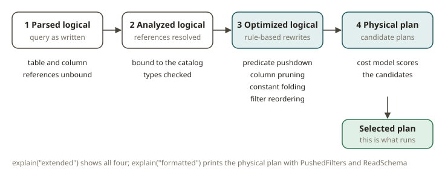

# SPK-05 · Catalyst and the physical plan

## Why Catalyst exists

When you write a dbt model, you describe *what* you want. The Redshift planner decides *how* to
get it. It decides the join order. It decides whether to use a hash join or a merge join. It
decides which predicates to push down to the scan. You use `EXPLAIN` to see that plan, and you
read it to find the slow part. The Spark **Catalyst** optimizer does exactly this job for
DataFrame and SQL queries. You give it a declarative description. It rewrites the description
through a pipeline of plans. Then it gives the physical plan to the execution engine.

This matters for the following reason. In Spark, the biggest influence on the cost of a job is
not CPU. It is **how much data Spark reads and shuffles**. Catalyst tries to reduce both. It
reads fewer columns (column pruning). It reads fewer rows (predicate pushdown). It does fewer
shuffles, or cheaper shuffles. If you can read a physical plan, you can quickly see two things.
Did Catalyst get these gains? Or did something in your code block them? This skill is the whole
module.

## How it works

Catalyst runs a query through four stages. `df.explain("extended")` shows all of them:

1. **Parsed / unresolved logical plan** — the query as you wrote it. Column and table references
   are not yet bound.
2. **Analyzed logical plan** — Spark has resolved the references against the catalog and checked
   the types.
3. **Optimized logical plan** — rule-based rewrites. These include constant folding, predicate
   pushdown toward the source, column pruning, filter reordering, `null` propagation, and boolean
   simplification. Here the `WHERE` clauses move down next to the scan.
4. **Physical plan** — Spark makes one or more candidate physical plans. A cost model picks one.
   This plan is what actually runs. `df.explain("formatted")` prints it as a numbered tree with a
   details section.

You will read two properties from the physical plan again and again:

- **`PushedFilters`** — Spark prints it on the `FileScan`/`BatchScan` node. A non-empty list
  means that Spark pushed those predicates *into* the Parquet reader. Spark then skips whole row
  groups by using footer statistics, and it never deserializes them. Suppose you expected to push
  a filter, and the list is empty. This is a red flag. Often the cause is a function that wraps
  the column and cannot be pushed, or a Python UDF.
- **`ReadSchema`** — the set of columns that the scan actually reads. Suppose you need only two
  columns. A narrow `ReadSchema` proves that column pruning happened. Parquet is columnar
  (FND-01), so a narrow read is a real I/O gain, not only a cosmetic one.

Spark gives you these modes through `explain(mode)`: `"simple"`, `"extended"`, `"codegen"`,
`"cost"`, or `"formatted"`. Read `"formatted"` to see the structure. `"cost"` adds the row and
size estimates of the optimizer.

## From your world

| Redshift / dbt | Spark / Catalyst | Note |
|---|---|---|
| `EXPLAIN` output | `df.explain("formatted")` | read the plan, don't guess |
| Predicate pushed to the scan / zone maps skip blocks | `PushedFilters` on `FileScan` + Parquet row-group skipping | same idea, Parquet footer stats |
| Column store reads only referenced columns | narrow `ReadSchema` (column pruning) | columnar win |
| Planner reorders joins / pushes `WHERE` early | optimized logical plan rewrites | rule-based, before physical |
| `DISTSTYLE`/`SORTKEY` influence the plan | AQE + partitioning (SPK-07/08) | later modules |

The mental model is the same as when you read a Redshift `EXPLAIN`. Find where the rows are.
See what Spark filtered before the expensive step. Confirm that the scan is narrow.

## When NOT to lean on it

- **Do not block pushdown with a Python UDF.** Take a `BatchEvalPython` or an opaque UDF in a
  filter. It stops Catalyst from pushing that predicate. Keep filters in native column
  expressions (SPK-09).
- **Do not assume that a `.cache()` or an intermediate `collect()` makes the job faster.** You
  materialize a wide intermediate result. Then Spark can read *more* data than if Catalyst
  prunes and pushes through the whole pipeline. Read the plan before and after.
- **Do not tune the plan by hand in small ways** when the real fix is upstream. Examples of an
  upstream fix: select fewer columns, write a filter against the partition column, or add a
  broadcast hint (SPK-06). Catalyst is good. Your job is to not block it.
- **`explain` is not a benchmark.** It tells you the shape of the work. It does not tell you the
  wall-clock time. Use it to reason about I/O and shuffles. Do not use it to claim that one plan
  is "X ms faster".

## Further reading

Pinned to Spark **4.0.0**:

- SQL performance tuning (pushdown, pruning, hints):
  <https://spark.apache.org/docs/4.0.0/sql-performance-tuning.html>
- `DataFrame.explain`:
  <https://spark.apache.org/docs/4.0.0/api/python/reference/pyspark.sql/api/pyspark.sql.DataFrame.explain.html>
- SQL programming guide (Catalyst, data sources):
  <https://spark.apache.org/docs/4.0.0/sql-programming-guide.html>
- Parquet data source (filter pushdown options):
  <https://spark.apache.org/docs/4.0.0/sql-data-sources-parquet.html>
