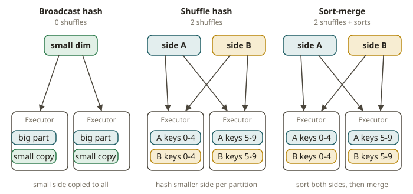
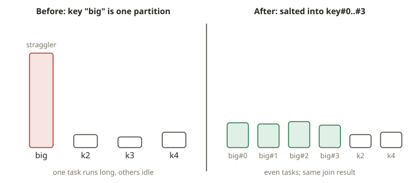

# SPK-06 · Joins and aggregations at scale

## Why join strategy is the whole game

In Redshift you learned that a join's cost is dominated by data movement: if both tables are
distributed on the join key the join is local, but if one must be redistributed (or broadcast with
`DISTSTYLE ALL`) across the cluster, that network shuffle is the expensive part. Spark is identical.
The *logic* of a join — which rows match — is trivial; the *cost* is the shuffle. So the single
most valuable skill here is choosing (or letting Spark choose) the right **physical join strategy**
and proving it from the plan.

## The three strategies

- **Broadcast hash join (`BroadcastHashJoin`).** The small side is collected to the driver,
  broadcast to every executor, and hashed in memory; the large side streams through with **no
  shuffle**. This is the fastest join when one side is small — the direct analogue of Redshift's
  `DISTSTYLE ALL` on a small dimension. Spark auto-broadcasts a side whose estimated size is below
  `spark.sql.autoBroadcastJoinThreshold` (default 10 MB), or when you wrap it in `F.broadcast(df)`.
- **Sort-merge join (`SortMergeJoin`).** Both sides are shuffled on the join key, sorted, and
  merged. This is the default for two large tables. It costs **two shuffles** (one per side) plus
  sorts — but it scales to any size and is robust.
- **Shuffle hash join (`ShuffledHashJoin`).** Both sides shuffled on the key; one side built into a
  hash table per partition. Used when one side is medium-sized and building a hash is cheaper than
  sorting. Spark picks it under specific size/config conditions.

The rule of thumb that matches your warehouse intuition: **broadcast the small dimension, sort-merge
two big facts.** Broadcasting the *large* side is a classic, expensive mistake — it tries to pull a
huge table to the driver and ship it everywhere.

## Broadcast variables and accumulators

Separate from the join operator, Spark exposes two low-level shared-state primitives:

- **Broadcast variable** (`spark.sparkContext.broadcast(value)`): ship a read-only Python object
  (a lookup dict, a model) to every executor once, instead of serialising it into every task. The
  broadcast *join* uses this mechanism under the hood, but you can also use a broadcast variable
  directly inside a UDF/mapPartitions.
- **Accumulator** (`spark.sparkContext.accumulator(0)`): a write-only-from-executors, read-on-driver
  counter for metrics (e.g. count bad rows seen). Accumulator values are only reliable in
  **actions**, not transformations that may re-run, so treat them as approximate monitoring, not as
  business logic.

## Skew: when one key dominates

If one join key value owns a huge share of the rows (one giant customer, a NULL key, a default
company), the partition holding that key becomes a straggler: every other task finishes and one
runs for ages. This is **data skew**. Classic fixes:

- **Broadcast the other side** if it is small (no shuffle, so no skewed partition).
- **Salting:** add a random suffix to the hot key on both sides so its rows spread across many
  partitions, then aggregate back. Salting must **not change the result** — a salt that drops or
  duplicates rows is a bug.

- **AQE skew-join handling (SPK-08):** `spark.sql.adaptive.skewJoin.enabled` splits oversized
  shuffle partitions at runtime. You will see this in the plan in SPK-08.

A multi-company gotcha from your world: `order_id` is unique per company but can repeat across
companies, and a surrogate id can collide after an acquisition. Always join dimensions on the full
**business key**, or you double-count — the Spark version of an intercompany double-count.

## From your world

| Redshift / dbt | Spark | Note |
|---|---|---|
| `DISTSTYLE ALL` on a small dim | `F.broadcast(dim)` / auto-broadcast | ship small side everywhere |
| Both tables on the dist key → local join | `SortMergeJoin` after shuffle on key | two shuffles |
| Skewed dist key straggler | skewed shuffle partition | salt or broadcast or AQE |
| Intercompany double-count | join on partial key | join on full business key |
| `COUNT`/`SUM` with `GROUP BY` | `groupBy().agg()` | one shuffle |

## When NOT to broadcast / not to salt

- **Don't broadcast a large table.** It OOMs the driver (collecting it) and wastes network. Check
  the estimated size, not the row count intuition.
- **Don't salt a join that isn't skewed.** Salting adds a shuffle-widening step and complexity for
  no gain if the key distribution is even. Measure first.
- **Don't lower `autoBroadcastJoinThreshold` to force sort-merge** as a habit; prefer letting AQE
  and the cost model decide unless you have a specific reason.
- **Don't rely on accumulators for correctness.** They can over-count on task retries; use them for
  monitoring only.

## Further reading

Pinned to Spark **4.0.0**:

- SQL performance tuning — join hints, broadcast, AQE skew:
  <https://spark.apache.org/docs/4.0.0/sql-performance-tuning.html>
- `pyspark.sql.functions.broadcast`:
  <https://spark.apache.org/docs/4.0.0/api/python/reference/pyspark.sql/api/pyspark.sql.functions.broadcast.html>
- RDD programming guide — broadcast variables and accumulators:
  <https://spark.apache.org/docs/4.0.0/rdd-programming-guide.html#shared-variables>
- Join hints in SQL:
  <https://spark.apache.org/docs/4.0.0/sql-ref-syntax-qry-select-hints.html>
