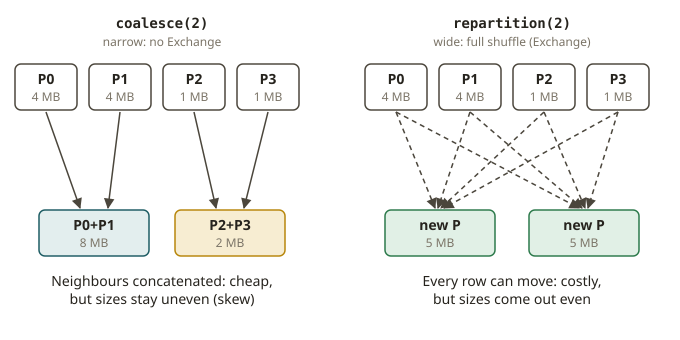

# SPK-07 · Partitioning, bucketing, and the small-file problem

## Why file layout is a first-class concern

You already know from Athena and Iceberg that *how data is laid out on disk* decides query cost:
partition on a column you always filter by, keep files big enough to amortise open/metadata cost
but small enough to parallelise, and you win before the engine even starts. Spark controls two
different "partition" concepts, and conflating them is the classic beginner mistake:

- **In-memory partitions** — how Spark splits a DataFrame across tasks *while computing*. Controlled
  by `repartition`, `coalesce`, and `spark.sql.shuffle.partitions`.
- **On-disk partitions** — the directory layout of the written output. Controlled by
  `write.partitionBy("col")`, which creates `col=value/` folders (Hive-style), exactly like your
  Athena/Iceberg partitions.

The number of **output files** per write equals (roughly) the number of in-memory partitions at
write time, multiplied across the on-disk partition folders. So the two concepts meet precisely at
write time, and that is where the small-file problem is born or avoided.

## repartition vs coalesce (objective 1.5)

- **`repartition(n)`** does a full shuffle to produce exactly `n` evenly-sized partitions (wide,
  adds an `Exchange`). Use it to *increase* parallelism or to rebalance skew.
- **`coalesce(n)`** merges existing partitions *without a shuffle* (narrow, no `Exchange`), only
  able to *reduce* the count. Use it to cut the file count cheaply after a filter has shrunk the
  data — but it can create skew because it just concatenates existing partitions.
- `repartition(n, col)` / `repartitionByRange` let you control the partitioning *expression*, which
  matters for bucketing-like effects and for writing one file per key group.

The exam loves the contrast: *to reduce files cheaply after a selective filter, use `coalesce`; to
rebalance or grow partitions, use `repartition`.*

## The small-file problem (objective 4.1)

Thousands of tiny files cripple a query: each file costs a metadata lookup and an open, listing
dominates, and readers can't align to row-group boundaries. The symptom in your Athena world is a
query that spends most of its time in S3 listing. The fix is to **target a file size** (commonly
~128 MB–1 GB) and derive the partition count from `total_bytes / target_size`, then
`repartition`/`coalesce` to that count before writing. At the tiny lab scale you target a **file
count** directly; the reasoning is identical.

A trap: `coalesce(1)` to "get one file" forces *all* data through one task — fine for a 10 MB
result, catastrophic for 100 GB. The right habit is to compute the count from the data size, not to
hard-code 1.

## Bucketing (objectives 2.3, 4.1)

**Bucketing** pre-shuffles a table on a key into a fixed number of buckets *at write time*
(`write.bucketBy(n, "key").sortBy("key").saveAsTable(...)`). Two bucketed tables joined on the
bucket key can then be joined **without a shuffle at read time**, because matching keys are already
colocated — the Spark analogue of choosing a Redshift `DISTKEY` so joins are local. The cost is
paid once at write; every later join on that key avoids an `Exchange`. Bucketing requires a managed
table (`saveAsTable`), not a bare path.

## From your world

| Redshift / Athena / Iceberg | Spark | Note |
|---|---|---|
| `DISTKEY` → local joins | `bucketBy(n, key)` | pre-shuffle once, join shuffle-free |
| `SORTKEY` | `sortBy` within buckets / `sortWithinPartitions` | clustering for scans |
| Athena/Iceberg partition columns | `write.partitionBy(col)` | `col=value/` dirs |
| S3 listing dominated by tiny files | target file size → derive partition count | small-file fix |
| Repartition a table to rebalance | `repartition(n)` (shuffle) | wide |
| Merge files after a filter | `coalesce(n)` (no shuffle) | narrow |

## When NOT to do these

- **Don't `coalesce(1)` large data** to make one file — it serialises everything through one task.
  Derive the count from size.
- **Don't `partitionBy` a high-cardinality column** (e.g. `customer_id`) — you get millions of tiny
  directories, the worst small-file explosion. Partition on low-cardinality, frequently-filtered
  columns (date, company).
- **Don't bucket unless the join key is stable and reused.** Bucketing pays a write-time cost and
  locks the bucket count; it only wins if you repeatedly join on that key.
- **Don't confuse `repartition` with `partitionBy`** — one is in-memory task layout, the other is
  on-disk directory layout. They interact at write time but are not the same thing.

## Further reading

Pinned to Spark **4.0.0**:

- SQL performance tuning (coalesce/repartition, AQE partition coalescing):
  <https://spark.apache.org/docs/4.0.0/sql-performance-tuning.html>
- Bucketing, sorting and partitioning (persistent tables):
  <https://spark.apache.org/docs/4.0.0/sql-data-sources-load-save-functions.html#bucketing-sorting-and-partitioning>
- `DataFrame.repartition` / `DataFrame.coalesce`:
  <https://spark.apache.org/docs/4.0.0/api/python/reference/pyspark.sql/api/pyspark.sql.DataFrame.repartition.html>
  <https://spark.apache.org/docs/4.0.0/api/python/reference/pyspark.sql/api/pyspark.sql.DataFrame.coalesce.html>
