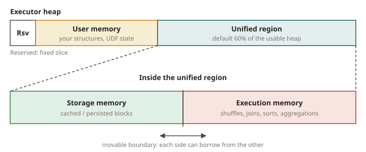

# SPK-08 · Memory, caching, and Adaptive Query Execution

## Why memory is where Spark jobs die

Most Spark failures that reach you as a human are memory failures: an executor OOMs, a stage spills
to disk and crawls, or the driver dies collecting too much. If you have tuned Redshift WLM memory
slots and watched queries spill, this is the same world — bounded memory, work that must fit or
spill, and a planner (now AQE) that adapts. The skills here are: read the memory model well enough
to diagnose an OOM from a log, cache deliberately, and know what AQE changes in the plan.

## The unified memory model

Each executor's heap is split by Spark into regions:

- **Execution memory** — for shuffles, joins, sorts, aggregations (transient).
- **Storage memory** — for cached/persisted DataFrame blocks.
- These two share a **unified region** and borrow from each other: cached blocks can be evicted to
  give a shuffle room, and vice versa (within limits).
- **User memory** — your data structures, UDF state.
- **Reserved memory** — a fixed slice Spark keeps for itself.

When execution memory is exhausted, Spark **spills** sorted/aggregated data to disk — correct but
slow. When even that is not enough, or a single record/partition is too big, you get an **OOM**.
Common causes, each with a signature:

- **Skew** (one giant partition) → one task OOMs or spills massively while others are fine.
- **A huge `collect()` / `toPandas()`** → the **driver** OOMs (not an executor).
- **A wide aggregation or explode** blowing up row counts → execution memory exhausted.
- **Too few shuffle partitions** → each partition too big to fit → spill or OOM.
- **A cartesian/exploding join** → unbounded intermediate.

## Diagnosing from logs

You will not have the UI on a 2 a.m. page — you have a log line. Learn the signatures:

- `java.lang.OutOfMemoryError: Java heap space` **on the driver** + a `collect`/`toPandas` in the
  stack → driver-side OOM; fix by not collecting the whole dataset.
- `OutOfMemoryError` on an **executor** during a shuffle/sort, with one task far larger → skew; fix
  by salting (SPK-06), more partitions, or AQE skew handling.
- `Spilling in-memory map ... to disk` repeatedly → execution-memory pressure; raise partitions or
  memory, reduce the aggregation width.
- `Container killed by YARN for exceeding memory limits` / `OOMKilled` → off-heap/overhead; raise
  memory overhead or reduce per-task footprint.

The exercise turns this into a machine-gradable task: given a log excerpt, return a structured
diagnosis (where the OOM happened and the single best fix).

## Caching and storage levels

`df.cache()` = `persist(MEMORY_AND_DISK)`. Other `StorageLevel`s trade memory for CPU/disk:
`MEMORY_ONLY` (fast, may recompute if evicted), `MEMORY_AND_DISK` (spill cached blocks to disk
instead of recomputing), `DISK_ONLY`, and `*_SER` (serialized, smaller but CPU to deserialize).
Rules of thumb, same instincts as materializing a CTE in your warehouse:

- Cache a DataFrame **only if you reuse it** across ≥2 actions, and it is **small enough** to help.
- Caching is lazy: nothing is stored until the first action materializes it.
- `unpersist()` when done; stale cached blocks waste storage memory and can force eviction/spill.
- Caching a wide intermediate can **defeat pushdown/pruning** (SPK-05) — read the plan.

## Adaptive Query Execution

AQE (`spark.sql.adaptive.enabled`) re-optimizes the plan **at runtime** using actual shuffle
statistics, something the static Catalyst plan cannot do. Three big wins, each visible in the final
plan:

- **Coalesce shuffle partitions** (`...adaptive.coalescePartitions.enabled`): collapses many tiny
  post-shuffle partitions into fewer right-sized ones — you see fewer partitions / an
  `AQEShuffleRead coalesced` node, instead of the static `shuffle.partitions` count.
- **Skew-join handling** (`...adaptive.skewJoin.enabled`): splits an oversized shuffle partition at
  runtime; the final plan shows a skew-handled `AQEShuffleRead`.
- **Dynamic join switching**: if a side turns out small after filtering, AQE can switch a planned
  sort-merge join to a broadcast join at runtime.

Because AQE changes the plan *after* the first stage runs, you must look at the **final** executed
plan (`df.explain()` after an action, or an `AdaptiveSparkPlan isFinalPlan=true` node) to see its
effects.

## From your world

| Redshift / warehouse | Spark | Note |
|---|---|---|
| WLM memory slots, spill to disk | execution/storage unified memory + spill | bounded memory, spill when over |
| Materialize a reused CTE | `cache()`/`persist()` a reused DataFrame | only if reused |
| Query queues adapting | AQE runtime re-optimization | uses real stats |
| OOM / disk-based query diagnosis | read executor/driver logs for OOM signatures | driver vs executor matters |

## When NOT to cache / NOT to rely on AQE

- **Don't cache a DataFrame used once.** It costs storage memory for no reuse benefit and can force
  spills elsewhere.
- **Don't cache to "make it faster" blindly** — a wide cached intermediate can read more than a
  pushed-down pipeline. Measure, read the plan.
- **Don't assume AQE fixes everything.** It coalesces and handles some skew, but a pathological skew
  or a driver-side `collect` OOM still needs the real fix (salting, not collecting).
- **Don't tune `shuffle.partitions` by hand** when AQE coalescing would do it adaptively, unless you
  have a specific reason.

## Further reading

Pinned to Spark **4.0.0**:

- Adaptive Query Execution:
  <https://spark.apache.org/docs/4.0.0/sql-performance-tuning.html#adaptive-query-execution>
- Tuning / memory management guide:
  <https://spark.apache.org/docs/4.0.0/tuning.html>
- RDD persistence / storage levels:
  <https://spark.apache.org/docs/4.0.0/rdd-programming-guide.html#rdd-persistence>
- `DataFrame.persist` / `StorageLevel`:
  <https://spark.apache.org/docs/4.0.0/api/python/reference/pyspark.sql/api/pyspark.sql.DataFrame.persist.html>
