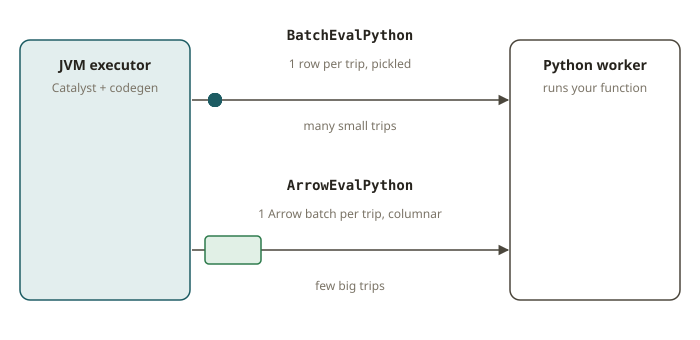

# SPK-09 · UDFs and the Pandas API

## Why this module exists

Every Spark user eventually writes a Python UDF, and most of them regret it. A plain Python
user-defined function is the one place where you deliberately step *outside* the engine: Catalyst
can no longer see what you are doing, so it stops optimizing, and the executor has to ship every
single row out of the JVM, into a Python worker process, run your function, and ship the result
back. That round trip — row by row, with Python object (de)serialization on both ends — is the
single most common reason a Spark job that "should be fast" is mysteriously slow.

This module is about *not reaching for the UDF* when a built-in exists, and — when you genuinely
do need Python — using the **vectorized** forms (pandas/Arrow UDFs) that move data in Arrow batches
instead of one row at a time. It is also where the **Pandas API on Spark** lives: the pandas you
already know, running distributed, so you don't have to collect a billion rows to a driver to call
`.groupby()`.

## How a Python UDF actually runs

A scalar Python UDF, e.g.

```python
from pyspark.sql.functions import udf
to_usd = udf(lambda amt, rate: amt * rate, "double")
df.withColumn("usd", to_usd("amount", "rate"))
```

shows up in the physical plan as a **`BatchEvalPython`** node. That node is the tell: it means
Spark will serialize each row's inputs, send them to a Python worker, call your lambda, and read
the result back. Three costs follow:

1. **Serialization per row.** Pickle in, pickle out, for every row.
2. **No pushdown through the UDF.** Catalyst cannot see inside the lambda, so it cannot push a
   filter below it or prune columns it "might" need. The UDF is an optimizer fence.
3. **No vectorization.** The JVM's whole-stage codegen stops at the UDF boundary.



The fix, in order of preference:

- **Use a built-in.** 95% of what people write UDFs for — arithmetic, string cleanup, dates,
  conditionals, hashing, JSON — already exists in `pyspark.sql.functions`. A built-in stays inside
  Catalyst and codegen; there is no `BatchEvalPython` at all.
- **If you must use Python, vectorize it.** A **pandas UDF** / **Arrow UDF**
  (`@pandas_udf`, or `functions.udf(..., useArrow=True)` in 4.x) receives a whole `pandas.Series`
  (or an iterator of Series) per batch, transferred as an Arrow columnar batch, not one row at a
  time. It appears as **`ArrowEvalPython`** in the plan, and `pandas_udf(... , GROUPED_MAP)` /
  `applyInPandas` show as `FlatMapGroupsInPandas`. Same Python, a fraction of the overhead, because
  the Python↔JVM boundary is crossed once per batch, in Arrow format.

So the test that matters is not "which API did you use?" but **"is there a `BatchEvalPython` in the
plan?"** A correct solution — native functions, a pandas UDF, or an Arrow UDF — has none.

## Pandas UDF flavors

- **Series → Series** (scalar): vectorized element-wise, e.g. a custom numeric transform.
- **Iterator[Series] → Iterator[Series]**: same, but lets you amortize an expensive setup (loading
  a model once) across batches.
- **Grouped map** (`df.groupBy(...).applyInPandas(fn, schema)`): each group arrives as a whole
  `pandas.DataFrame`; return a `pandas.DataFrame`. This is the "dbt Python model per partition"
  shape — great for group-local logic that has no SQL equivalent, like a per-customer curve fit.
- **Grouped aggregate** (`@pandas_udf` used in `groupBy().agg(...)`): Series in, one scalar out.

All of these cross the boundary in Arrow batches, so none produce `BatchEvalPython`.

## Pandas API on Spark

`import pyspark.pandas as ps` gives you a pandas-shaped API (`ps.DataFrame`, `.groupby()`,
`.merge()`, `.describe()`) that compiles down to Spark jobs. The advantage over real pandas is that
it is **distributed and lazy** — you keep the ergonomics of pandas without pulling the data to a
single machine's memory. The advantage over hand-written DataFrame code is familiarity: you can
port an existing pandas notebook almost verbatim and have it scale.

Caveats: it is not 100% pandas-compatible (some operations trigger expensive shuffles or are
unsupported), and the default index can cost a shuffle — set
`ps.set_option("compute.default_index_type", "distributed")` for large data. Treat it as "pandas
ergonomics, Spark semantics", not as a promise that every pandas trick works.

## From your world

| dbt / pandas / Redshift | Spark | Note |
|---|---|---|
| A dbt **Python model** that does group-local logic | `applyInPandas` grouped map | per-group `pandas.DataFrame` in/out |
| `df.apply(lambda row: ...)` in pandas (slow) | **avoid** the scalar Python UDF equivalent | `BatchEvalPython`, row-by-row |
| A pandas vectorized `Series` op | `@pandas_udf` Series→Series | Arrow batch, `ArrowEvalPython` |
| Reaching for pandas because the SQL is awkward | first check `pyspark.sql.functions` | a built-in almost always exists |
| A pandas notebook you want to scale | `import pyspark.pandas as ps` | same API, distributed |

## When NOT to use a UDF (or the Pandas API)

- **Don't write a scalar Python UDF for anything a built-in covers.** Currency math, `upper`/`trim`,
  `regexp_replace`, `to_date`, `coalesce`, `when/otherwise`, `sha2`, `from_json` — all native. The
  UDF only buys you a `BatchEvalPython` fence and a slowdown.
- **Don't use a non-deterministic UDF without marking it so** — Catalyst may evaluate it an
  unexpected number of times, breaking assumptions (e.g. a UDF that calls `random`).
- **Don't use the Pandas API on Spark for tiny data** — if it already fits in memory, real pandas
  (or DuckDB) is simpler and faster. The Pandas API earns its keep only when the data is too big
  for one machine.
- **Don't use a grouped-map UDF when a `groupBy().agg()` of built-ins would do** — you give up
  partial aggregation and pay to materialize each whole group in Python.

## Further reading

Pinned to Spark **4.0.0** (official docs only):

- Python UDFs: <https://spark.apache.org/docs/4.0.0/api/python/user_guide/sql/python_udf.html>
- Pandas UDFs / function APIs:
  <https://spark.apache.org/docs/4.0.0/api/python/user_guide/sql/arrow_pandas.html>
- Pandas API on Spark:
  <https://spark.apache.org/docs/4.0.0/api/python/user_guide/pandas_on_spark/index.html>
- `pyspark.sql.functions` reference:
  <https://spark.apache.org/docs/4.0.0/api/python/reference/pyspark.sql/functions.html>
