# SPK-10 · Structured Streaming I — the micro-batch engine and exactly-once

## Why Structured Streaming exists

You already run a kind of streaming: a **dbt incremental model**. In each run, you do these steps:

1. Find what is new since the last run (a high-water mark on `updated_at`).
2. Transform only that slice.
3. Merge the slice into the target.

The hard parts are always the same. *Where does the system remember "last time"?* *What happens
if a run dies halfway?* If you reprocess an overlapping slice, do you create duplicates, or does the
merge absorb them?

Structured Streaming is Spark's answer to these exact questions. It is more general, and it is
automatic. This mental model makes everything else easy to understand: **a stream is an unbounded table
that grows. A streaming query is the same query that you would write on a static table. Spark re-runs it
incrementally as new rows arrive.** The engine remembers the high-water mark (the source *offsets*),
not you. The engine also guarantees that a run that failed and restarted produces the same result as a
run that never failed. This guarantee is **exactly-once**. The **checkpoint** makes it real.

## The micro-batch model

By default, Structured Streaming runs as a sequence of small **micro-batches**. Each micro-batch does
these steps:

1. It asks the source *"what's new since the last committed offset?"*
2. It runs the (unchanged) query plan over only those new rows.
3. It writes the output to the sink.
4. It **commits** the new offsets to the checkpoint — atomically, after the write.

The offset commit happens *after* the write, and Spark records it durably in the checkpoint. So a
crash can happen in only one of two safe places:

- Before the commit: the batch is redone on restart, from the same offsets.
- After the commit: the next batch starts cleanly.

Now add a sink that is idempotent or that takes part in the commit. Then you get **end-to-end
exactly-once**. This is the streaming analogue of the question for your incremental model: "did we
remember the right watermark, and is the merge idempotent?"

## Sources, sinks, triggers, output modes

- **Sources:** files (a directory where you put files), Kafka (KFK track — not until Phase 3 here),
  sockets (toy), and the `rate` source (synthetic rows, for testing). In this module, we use a
  **file source**: new files that appear in a directory are new rows.
- **Sinks:** files, Kafka, `foreachBatch`, `console`/`memory` (testing), and table sinks.
  - `foreachBatch` runs any batch code for each micro-batch. It is a very flexible tool. SPK-11 uses it
    for `MERGE INTO`.
  - We write to an **Iceberg table** via `.toTable("local.db.t")`.
- **Triggers:** how often a micro-batch starts.
  - `processingTime="10 seconds"`
  - `once`
  - `availableNow` (process everything that is available right now, in one or more batches, then
    stop). It is good for deterministic tests and for "incremental batch" jobs.
- **Output modes** decide what the sink receives in each batch:
  - **append** — only brand-new result rows. It is correct for a stream with no aggregation (every
    input row maps to one output row). It is also correct for windowed aggregations after a window is
    finalized.
  - **complete** — the *entire* updated result table in every batch. It is valid only for aggregations.
    It rewrites everything each time, so use it for small results and debugging.
  - **update** — only the result rows that changed in this batch. Use it for aggregations where you
    want incremental changes.

  Choosing the wrong mode is a classic bug. Spark rejects `append` on a running aggregation. The
  aggregate rows keep changing, so there is nothing final to append. The exception is a watermark that
  lets windows close (SPK-11).

## Checkpoints and exactly-once in practice

The **`checkpointLocation`** is the most important part. It stores the source offsets, the log of
committed batches, and (for stateful queries) the state store. The exercises teach you these rules:

- **Always set a checkpoint** for anything that you want to recover. If there is no checkpoint, the
  query does not remember what it already read when it restarts. It reprocesses from the beginning
  (duplicates) or cannot recover at all.
- **Reuse the SAME checkpoint across restarts.** A *new* checkpoint directory in each run is as bad as
  no checkpoint. The query thinks that it has never run, and it ingests everything again. This is the
  most common cause of the bug "my restart duplicated all my data".
- **Make the sink idempotent or transactional.** The file sink and the Iceberg table sink track which
  output files/snapshots belong to which committed batch. So a redone batch does not write twice.
  A hand-made sink that only appends collected rows is *not* idempotent. A redo creates duplicates.

The result is this: you stop the query, add more input, and restart it with the same checkpoint. The
result is exactly the same as if the query had run without a stop. There are no gaps and no duplicates.
The main exercise proves this property directly.

> **Kafka note.** The classic version of this exercise is *Kafka → stream → Iceberg*. Kafka is not
> available until Phase 3 (the KFK track). So here the source is a **file source**. The
> exactly-once reasoning is the same: offsets in the checkpoint, and an idempotent sink. Only the
> source changes. You revisit the Kafka source, consumer offsets and `startingOffsets` in KFK.

## From your world

| dbt / Redshift | Structured Streaming | Note |
|---|---|---|
| Incremental model's high-water mark | source **offsets** in the checkpoint | engine-managed, not a column you pick |
| `is_incremental()` slice | a **micro-batch** | just the new rows |
| Idempotent `MERGE` in an incremental model | idempotent/transactional **sink** | same anti-duplicate goal (SPK-11 does the MERGE) |
| "did the run die mid-way?" | checkpoint + atomic offset commit | **exactly-once** recovery |
| Full refresh | **complete** output mode | rewrites everything |

## When NOT to use Structured Streaming

- **Millisecond latency.** The latency of a micro-batch is seconds, not milliseconds. For true
  low-latency processing of each event, use Flink (FLK track).
- **A one-off backfill of static files.** If the data is bounded and already here, a plain batch job
  is simpler. (`trigger(availableNow=True)` makes this line less clear, which is useful for incremental
  batch.)
- **No checkpoint storage.** If you have no durable place for the checkpoint, you cannot get the
  fault-tolerance guarantees. Do not say that a stream without a checkpoint is exactly-once.

## Further reading

Pinned to Spark **4.0.0** (official docs only):

- Structured Streaming Programming Guide:
  <https://spark.apache.org/docs/4.0.0/structured-streaming-programming-guide.html>
- Output modes & triggers:
  <https://spark.apache.org/docs/4.0.0/structured-streaming-programming-guide.html#output-modes>
- Recovery / checkpointing:
  <https://spark.apache.org/docs/4.0.0/structured-streaming-programming-guide.html#recovering-from-failures-with-checkpointing>
- Iceberg Spark Structured Streaming writes:
  <https://iceberg.apache.org/docs/latest/spark-structured-streaming/>
