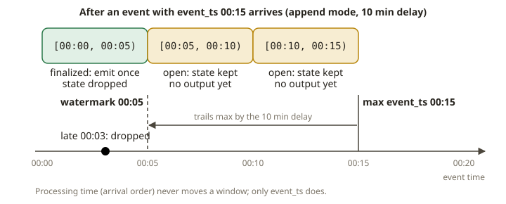

# SPK-11 · Structured Streaming II — watermarks, state, and streaming SCD2

## Why watermarks and state exist

SPK-10 streams were *stateless*: each input row produced an output row and nothing had to be
remembered between rows. The interesting streams aren't like that. A per-window count, a dedup, a
stream-stream join, an SCD2 upsert — all of them must **remember** something across micro-batches:
the running count for each window, the ids seen recently, the current version of each dimension row.
That memory is **state**, kept in the state store inside the checkpoint.

State can't grow forever. If you keep every window's count and every id you've ever seen, memory
grows without bound and the job eventually dies. The mechanism that bounds state is the
**watermark**: a moving threshold on **event time** that says *"I will not wait for data older than
this."* Once event time has advanced past a window's end plus the watermark delay, the window is
**finalized**, its result can be emitted (even in `append` mode), and its state is dropped. Data
that arrives *later* than the watermark is **late** and is discarded.

This is exactly the problem you know from building **SCD2 dimensions over late-arriving facts**: how
long do you keep a dimension "open" waiting for a correction, and what do you do with a change that
shows up after you've already closed the version? The watermark is the streaming formalization of
that "how long do we wait" decision.

## Event time vs processing time

**Event time** is when the thing happened (a column in the data: `event_ts`). **Processing time**
is when Spark happened to see it. Correct streaming analytics use *event time*, because that's the
only time that is stable under replay, reordering, and delay. If you window by processing time, the
same input produces different results depending on when the job ran — a cardinal sin for anything
that must be reproducible (think SOX). The watermark is defined on an **event-time** column:

```python
events.withWatermark("event_ts", "10 minutes") \
      .groupBy(window("event_ts", "5 minutes"), "company_id") \
      .count()
```

Here Spark tracks the max `event_ts` seen; the watermark trails it by 10 minutes. A 5-minute window
`[00:00, 00:05)` is finalized once the watermark passes `00:05`, i.e. once an event with
`event_ts >= 00:15` arrives. Events for that window arriving after that are dropped as late.



## Stateful aggregation and the output modes it unlocks

With a watermark, a windowed aggregation can be written in **append** mode: each window is emitted
exactly once, when it finalizes. (Without a watermark, only `complete`/`update` are legal — SPK-10.)
This is the clean, bounded way to produce "per 5-minute window per company, the event count",
suitable for appending to a fact table.

The key testable invariant (docs/TESTING.md): **once all input has arrived and the watermark has
passed every window, the streaming result equals the batch result over the same in-window events.**
Late events (beyond the watermark) are *not* in that batch answer — they were legitimately dropped.

## Streaming deduplication

Duplicates are a fact of streaming life (at-least-once sources, retries). Two tools:

- `dropDuplicates(["id"])` — remembers every id forever. Correct, but unbounded state.
- `dropDuplicatesWithinWatermark(["id"])` — with a watermark on event time, only remembers ids
  within the watermark horizon, then forgets them. Bounded state, at the cost that a duplicate
  arriving *after* the horizon is no longer recognized (which is fine: that's the same "we don't
  wait forever" contract). This is new in Spark 3.5+/4.x and is the production-correct dedup.

## foreachBatch + Iceberg MERGE INTO: streaming SCD2

The sink for a dimension upsert isn't a plain append — it's a **merge**. `foreachBatch` hands you
each micro-batch as an ordinary (batch) DataFrame, so you can run any batch code, including an
Iceberg `MERGE INTO`. The SCD2 pattern:

- Each incoming change for a natural key that **differs** from the current open version must:
  1. **close** the current open row (set its `valid_to` to the change's effective time, so it is no
     longer open), and
  2. **insert** a new open row (new `valid_from`, `valid_to = NULL`, `is_current = true`).
- An unchanged repeat must do nothing.

Done naively, this is two MERGE passes (close, then insert) or one MERGE with careful matched/not-
matched clauses. The invariants a correct SCD2 must satisfy — and the mutants in the exercise
violate — are:

- **Exactly one open (`valid_to IS NULL`) row per natural key.** (A mutant that overwrites instead
  of versioning, or forgets to close the old row, breaks this.)
- **Versioning, not overwriting.** History is preserved: old versions remain with a closed
  `valid_to`. (A mutant that overwrites loses history.)
- **Correct effective dating.** The new version's `valid_from` equals the change time; the old
  version's `valid_to` equals that same instant (no gaps, no overlaps).

Operational notes for `foreachBatch`:

- The batch DataFrame is re-evaluated per action; call `.persist()` if you use it more than once.
- Make the merge **idempotent** so a redone batch (recovery) doesn't double-apply. Keying the merge
  on the natural key + effective time achieves this.
- Use a **watermark** upstream so the state (and any dedup) stays bounded.

## From your world

| Kimball / dbt / SOX | Structured Streaming | Note |
|---|---|---|
| SCD2 dimension with `valid_from`/`valid_to`/`is_current` | `foreachBatch` + Iceberg `MERGE INTO` | the merge, streamed |
| "how long do we wait for a late fact?" | the **watermark** delay | the explicit wait bound |
| Event timestamp on the fact | **event-time** column + `withWatermark` | never processing time |
| Reproducible restatements (SOX) | event time + versioned history | replay-stable, auditable |
| Dedup a reloaded extract | `dropDuplicatesWithinWatermark` | bounded, keyed on the business id |

## When NOT to use these

- **Don't window by processing time** for anything that must be reproducible — use event time.
- **Don't use unbounded `dropDuplicates`** on a high-volume stream — the state grows forever; use
  the watermarked form.
- **Don't set a huge watermark delay** to "never lose late data" — you also never finalize windows
  or free state. The delay encodes a real latency/completeness trade-off; pick it deliberately.
- **Don't overwrite a dimension row in place** when you need history — that's SCD1; SCD2 versions.

## Further reading

Pinned to Spark **4.0.0** (official docs only):

- Window operations & watermarks:
  <https://spark.apache.org/docs/4.0.0/structured-streaming-programming-guide.html#window-operations-on-event-time>
- Handling late data & watermarking:
  <https://spark.apache.org/docs/4.0.0/structured-streaming-programming-guide.html#handling-late-data-and-watermarking>
- Streaming deduplication (incl. `dropDuplicatesWithinWatermark`):
  <https://spark.apache.org/docs/4.0.0/structured-streaming-programming-guide.html#streaming-deduplication>
- `foreachBatch`:
  <https://spark.apache.org/docs/4.0.0/structured-streaming-programming-guide.html#foreachbatch>
- Iceberg `MERGE INTO`: <https://iceberg.apache.org/docs/latest/spark-writes/#merge-into>
