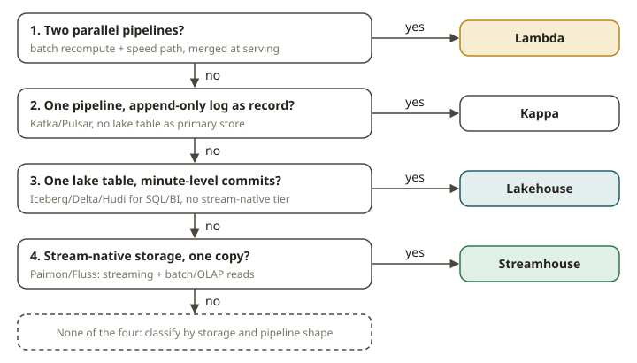

# STH-01 · Architecture history — Lambda → Kappa → lakehouse → streamhouse

## Why these architectures exist

Every data architecture answers one question: **how fresh must the answer be, and what do you pay
for that freshness?** The four landmark architectures below are four different answers. Each one
exists because the previous one caused a problem.

- **Lambda** (Marz, ~2011). Run **two** pipelines over the same events.
  - A *batch layer* recomputes the correct, complete result. It is slow.
  - A *speed layer* computes an approximate result for the recent window. It has low latency.
  - A serving layer merges the two results.

  Lambda exists because the batch tools of that time could not give low latency. The streaming tools
  could not give completeness or reprocessing. The cost is that **you maintain the same business
  logic twice, in two code bases, and the two copies drift**. The batch answer and the speed answer
  disagree, and someone must reconcile them.

- **Kappa** (Kreps, ~2014). Delete the batch layer. Keep **one** streaming pipeline. Use the log
  (Kafka) as the system of record. *Replay* the log to reprocess history. There is one code path,
  so nothing drifts. Kappa exists to remove the cost of two code bases in Lambda. The cost of Kappa
  is this:
  - **Long-term, queryable history in Kafka is expensive.**
  - Ad-hoc OLAP over the log is awkward.
  - Replaying months of events to fix a bug is slow and needs a lot of operational work.

- **Lakehouse** (Databricks, ~2020). Put a **transactional table format** (Iceberg, Delta, Hudi) on
  cheap object storage. Then one copy of the data serves both SQL/BI and ML. You get ACID commits,
  time travel and schema evolution. This is warehouse semantics on a data lake. The lakehouse exists
  to end the split between a warehouse and a lake (two storage systems, two copies, and ETL between
  them). The cost that matters here: **it commits at batch/micro-batch latency**. Snapshots land
  every few minutes at best. So it does not answer sub-minute streaming questions. Frequent commits
  also create a small-files problem.

- **Streamhouse** (Ververica coined the term, ~2024. It is now a cross-vendor working group: Aiven,
  Confluent, Redpanda, StreamNative, Ververica). Put a **stream-native storage layer** (Apache
  Paimon, Apache Fluss) on the lake. Then **one copy** of the data serves *streaming* reads
  (changelogs, CDC, low latency) **and** batch/OLAP reads. It usually uses Flink as the engine. The
  streamhouse gives the lakehouse a sub-minute tier. It gives the stream a cheap, queryable,
  long-term tier. It keeps the single pipeline of Kappa, with lakehouse-grade storage underneath.
  The cost: **more parts to run and a newer ecosystem that is less settled**. You pay for the extra
  tier in operations and skills.

The through-line:

1. Lambda had two pipelines, and the logic drifted.
2. Kappa unified the pipeline but not the storage, so history was expensive.
3. The lakehouse unified the storage, but at batch latency.
4. The streamhouse unifies the storage **and** serves both latencies. The price is a younger, more
   complex stack.

## How to classify an architecture (the rubric)

You classify a real system by its **storage and pipeline shape**. You do not use the name the vendor
gives it. Four yes/no signals decide the answer. Apply them in this order:

1. **Two parallel pipelines** (a batch recompute path *and* a separate speed path) that are
   merged at serving time → **Lambda**.
2. **One streaming pipeline** whose system of record and reprocessing substrate is an
   **append-only log** (Kafka/Pulsar), with no transactional lake table as the primary store →
   **Kappa**.
3. **One transactional lake table format** (Iceberg/Delta/Hudi) as the primary store, read by
   SQL/BI, committing at **batch/micro-batch** latency (minutes), with no stream-native storage →
   **Lakehouse**.
4. **A stream-native storage layer** (Paimon/Fluss, or Iceberg explicitly driven as streaming
   storage) that serves **both** a streaming/changelog read path **and** a batch/OLAP read path from
   **one copy** → **Streamhouse**.

The exercise encodes exactly these signals as booleans. It asserts that the classification is
deterministic.

## From your world

Your current stack is a **batch lakehouse**. dbt models are materialized into Iceberg on S3. Athena
and Redshift query them. They refresh on a schedule. Map the signals to your stack:

- You have one transactional lake format (signal 3 → lakehouse).
- You have no second speed pipeline, so it is not Lambda.
- Kafka is an *ingestion* bus that feeds batch loads. It is not the queryable system of record, so
  it is not Kappa.
- Nothing serves a sub-minute changelog read from the same copy, so it is not yet a streamhouse.

A streamhouse would add Paimon/Fluss **underneath** the same marts. Then the facts that change most
slowly can also answer "what changed in the last 30 seconds". You would not need a parallel speed
layer to reconcile. The reconciliation pain of Lambda (the SOX reconciliation pain) is exactly what
you want to avoid.

## When NOT to use a streamhouse

- **Hourly or daily freshness is fine.** A batch lakehouse is simpler, cheaper and more mature. Do
  not add Paimon/Fluss, Flink and a tiering job to serve a dashboard that refreshes every night.
- **You truly only need a log.** Suppose every consumer is a streaming app that replays Kafka, and
  nobody runs OLAP over history. Then plain Kappa is less to operate.
- **You need two genuinely different computations.** One example is an exact nightly regulatory
  recompute plus a separate real-time estimate with different logic. That is a legitimate Lambda.
  Do not "fix" it by unifying it.

## Further reading

- Apache Paimon — Overview (streaming lakehouse / streamhouse storage):
  <https://paimon.apache.org/docs/master/concepts/overview/>
- Apache Fluss — What is Fluss (streaming storage for real-time analytics):
  <https://fluss.apache.org/docs/intro/>
- Apache Iceberg — Flink streaming reads/writes (Iceberg as streaming storage):
  <https://iceberg.apache.org/docs/latest/flink/>
