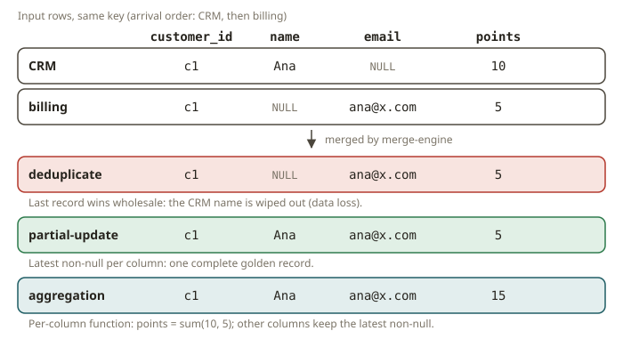

# STH-02 · Apache Paimon — primary-key tables, merge engines, partial-update

## Why Paimon exists

A plain lake table (Iceberg/Delta) is **append-and-snapshot**. Writers add files. Readers see a
snapshot. This works well for immutable facts. It is awkward for data that *updates in place*, for
example a customer whose email changes or an account whose balance moves. To update one row, you
must do one of two things:

- Rewrite files (copy-on-write).
- Stack delete files (merge-on-read).

You also get no cheap streaming changelog.

**Apache Paimon** adds an **LSM-tree** (log-structured merge tree) on top of the lake. Writes go to
small sorted files. The system compacts these files from time to time. This is the same design as
the storage engine of a streaming database. On top of the LSM, Paimon offers **primary-key tables**.
A configurable **merge engine** *merges* rows that have the same primary key. It does this at
compaction time or at read time. This turns a lake table into a store that you can mutate, upsert
into and use for streaming. This store is the storage layer of a streamhouse.

## How primary-key tables and merge engines work

You declare a PK table with `PRIMARY KEY(...) NOT ENFORCED` and a **bucket** setting. For a small,
deterministic table, you pin `'bucket' = '1'` (a fixed bucket). Without it, the bucket count is
dynamic and the layout is not reproducible. Two records can share a key. Then the **merge engine**
decides which row survives:

| `merge-engine` | behaviour on same key |
|---|---|
| `deduplicate` (default) | keep the **last** record wholesale — a last-writer-wins upsert |
| `partial-update` | keep the latest **non-null** value *per column* — fields from different writers combine into one row |
| `aggregation` | combine columns with per-column aggregate functions (sum, max, ...) |
| `first-row` | keep the first record for a key, ignore later ones |

**`partial-update` is the right engine for an MDM golden record.** Three source systems each know
*part* of the customer:

- The CRM knows the name.
- Billing knows the email.
- The loyalty app knows the phone.

Each system writes a row keyed by `customer_id`. It fills only its own column and leaves the other
columns `NULL`. With `partial-update`, Paimon merges the rows into one complete row, the *golden
record*. It keeps each non-null field as it arrives. With the default `deduplicate` engine, the last
write would **wipe out** the columns of the earlier systems with its NULLs. This is a classic MDM
data-loss bug.

> Order and NULLs: `partial-update` keeps the latest **non-null** value of a column. A later writer
> may send `NULL` for a column. This does **not** erase the value that an earlier writer set. (To
> erase a value on a retract, you need `sequence.field` + `partial-update.remove-record-on-delete`.
> This is out of scope here.)

## Changelog producers (why STH-03 cares)

A PK table can also emit a **changelog**. Then downstream streams see `+I/-U/+U/-D` events, not only
the merged state. You set the producer with `'changelog-producer'`. The value `'input'` echoes the
input rows. The values `'lookup'` and `'full-compaction'` compute true before/after images. This
module focuses on the merged *state*. STH-03 uses the changelog.

## From your world

This is **master data management**, which you already do in dbt. You have a `stg_customer` model
for each source system. Then a golden-record model coalesces the attributes by precedence into one
conformed `dim_customer`. The `partial-update` merge engine of Paimon *is* that coalesce. It runs
continuously in the storage layer. It does not run in a nightly dbt job. Compare the parts:

- `PRIMARY KEY` is your business key.
- `bucket` is the physical layout.
- The merge engine is your `COALESCE`/precedence policy.

The failure mode is the same one that SOX auditors fear. One source system overwrites the
attributes of another source system, and data is lost without any signal.

## When NOT to use it

- **Immutable, append-only facts** (events, orders as placed): A plain Iceberg/Delta table is
  simpler and cheaper. You do not need an LSM, PK merges or compaction.
- **You actually want last-writer-wins** across the whole row (for example a full-document upsert):
  Use the default `deduplicate` engine, not `partial-update`.
- **Heavy ad-hoc OLAP with no updates**: The LSM compaction overhead gives you no benefit. Stay on
  a columnar lake table.

## Further reading

- Apache Paimon — Primary Key Table & merge engines:
  <https://paimon.apache.org/docs/master/concepts/primary-key-table/merge-engine/>
- Apache Paimon — Overview (LSM on the lake):
  <https://paimon.apache.org/docs/master/concepts/overview/>
- Apache Paimon — Changelog producers:
  <https://paimon.apache.org/docs/master/primary-key-table/changelog-producer/>
