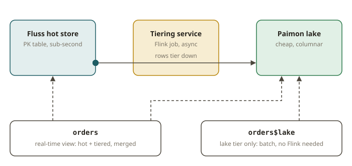

# STH-03 · Apache Fluss — PK tables, lake tiering, streaming vs batch consistency

## Why Fluss exists

Kafka gives you a cheap, low-latency *log*. But a log is a poor place for two jobs. One job is to
answer "what is the current value for key K?". The other job is to run columnar OLAP. The log is
row-oriented and append-only, and it is expensive to retain. The lakehouse gives you cheap columnar
OLAP, but only at batch latency.

**Apache Fluss** is a *streaming storage* layer built for exactly this gap. It is columnar and has
low latency. It is designed to be **tiered to the lake**:

- The recent data lives in Fluss (sub-second).
- The historical data lives in Paimon/Iceberg (cheap, queryable).
- Both tiers form **one logical table**.

Fluss offers two kinds of table:

- **Log tables** — append-only, like a Kafka topic but columnar. You read them as a stream.
- **Primary-key (PK) tables** — upsertable. Fluss serves the latest value per key with low latency.
  You can read either the changelog (streaming) or a point-in-time snapshot (batch).

## How lake tiering makes one table serve two latencies

You create a Fluss table `WITH ('table.datalake.enabled'='true')`. Then a **tiering service** (a
Flink job) continuously moves committed data from the hot store of Fluss down into the lake format
(Paimon here). The two tiers are **one logical table**. This is the key property:

- You read the Fluss table name directly. You get the **real-time** view (hot Fluss data merged with
  the data that Fluss already tiered).
- You read the `` `table$lake` `` system table. You get the **tiered lake** view (the data that has
  landed in Paimon). You can read it in **batch** with Flink. You can also read it with a
  pure-Python engine (pypaimon) with **no Flink at all**.

You must preserve one invariant, and this module grades it. The invariant is **read consistency**.
The data is tiered and quiesced. Then a **streaming** read of the table and a **batch** read of the
lake tier return the **same set of rows**. If they disagree, the streamhouse breaks its whole
promise ("one copy, two latencies, same answer"). This is the STH streaming-vs-batch oracle
(TESTING.md G6) applied to tiered storage.

### What has to be true for tiering to work

1. `'table.datalake.enabled'='true'` is set on the table (you opt in for each table).
2. The table is a Fluss **PK table**. Then each key has a well-defined latest value to tier
   (`PRIMARY KEY(...) NOT ENFORCED`).
3. The server knows the lake format and warehouse (`datalake.format: paimon`,
   `datalake.paimon.warehouse: file://...`). The fixture sets this when you pass
   `fluss_cluster(paimon_warehouse=...)`.
4. The `$lake` read path needs `paimon-flink` on the classpath (the fixture already provides it).

Tiering is asynchronous. So you must read `$lake` in batch with a **wall-clock deadline**, and the
read must be bounded (never block on an unbounded stream). The `paimon_sql.batch` function of the
fixture and the bounded `$lake` read of the Fluss runner do this. Tiering typically lands in
~30–40 s.

## From your world

You already run two serving systems:

- A low-latency store (DynamoDB/ElastiCache) for the point lookups of the app.
- Athena/Redshift over Iceberg for historical analytics.

This gives you **two copies, and you own the pipelines that keep them in sync**. A Fluss PK table
with lake tiering collapses them into **one logical table**. The hot tier answers the sub-second
lookup. The lake tier answers the historical scan. Fluss keeps the two consistent for you. The
read-consistency check in this exercise is the same check that your reconciliation jobs make today.
They assert that the fast store and the warehouse agree.

## When NOT to use it

- **You only ever need batch/OLAP.** If nothing reads the hot tier, skip Fluss. Write straight to
  Paimon/Iceberg. You have fewer parts to run.
- **You only ever need a log.** Suppose every consumer only replays events. Nobody needs a keyed
  latest value or OLAP. Then a plain Kafka/Fluss log table (or Kafka itself) is enough. The PK
  store and tiering are overhead.
- **Tiny data / low QPS.** A single database can serve both the lookup and the scan. A tiered
  streaming store is worth its operational cost only at scale or with strict freshness SLAs.

## Further reading

- Apache Fluss — Introduction (streaming storage, log vs PK tables):
  <https://fluss.apache.org/docs/intro/>
- Apache Fluss — Lakehouse / tiering to Paimon:
  <https://fluss.apache.org/docs/maintenance/tiered-storage/lakehouse-storage/>
- Apache Paimon — Primary Key Table (the lake tier format):
  <https://paimon.apache.org/docs/master/concepts/primary-key-table/merge-engine/>
