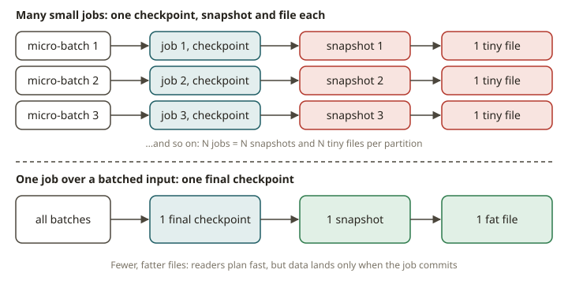

# STH-04 · Iceberg as streaming storage — commit interval vs small files

## Why it exists

You already run Iceberg as a *batch* lakehouse. dbt or Spark writes a snapshot on every run. Athena
and Trino read it. A **streamhouse** keeps the same table. But Flink writes to it continuously, and
readers see new data within seconds. Iceberg does not change. What changes is *who* commits and
*how often*. A Flink Iceberg sink commits a new snapshot **on every checkpoint**. So the checkpoint
interval is the single setting that decides your freshness *and* your file count. The two work
against each other.

This is the small-files problem that you already know. But here time causes it, not a bad
`repartition`. Each commit writes at least one data file per partition per writer task. Suppose you
checkpoint every second. Then you get ~60 snapshots and ~60 data files a minute per partition.
Readers then open hundreds of tiny files, and planning gets slow. Suppose you checkpoint every five
minutes. Then the files are large and few, but your "streaming" table is five minutes stale. You
cannot get both for free. **Freshness and file count are the same setting.** Compaction is the cost
that you pay to separate them after the fact.

## How it works

A Flink → Iceberg pipeline has three parts:

1. **A bounded or unbounded source.** For CDC, the path without Docker is a `debezium-json` file
   source. Each line is a change event (`op` = `c`/`u`/`d` with `before`/`after`). A **bounded**
   source lets the streaming job *finish* and fire its final commit. An unbounded `datagen`/`VALUES`
   source leaves the committer waiting, and it never commits. This is a classic hang (see "When NOT
   to use it").
2. **The commit cadence of the sink = the checkpoint cadence.** Each committed checkpoint becomes
   one Iceberg **snapshot**. One job run over a bounded input commits **one** snapshot. It writes
   roughly **one data file per writer task per partition**.
   - Run the ingest as *many small jobs* (one per micro-batch). You get *many* snapshots and *many*
     small files.
   - Run the ingest as *one job over a batched input*. You get one snapshot and one file.

   This relationship is deterministic. This exercise measures exactly this relationship.
3. **Upsert vs append.** Suppose a target has `PRIMARY KEY (...) NOT ENFORCED` and
   `'format-version'='2'`. Then it applies the `+I/-U/+U/-D` events of the changelog by key
   (row-level deletes). Without the PK, the sink can only append. The table then never reflects
   deletes or updates.

**Iceberg vs Paimon for the streaming write.** Both land on the lake. Both commit per checkpoint.
So both have the small-files setting. The difference is the *merge model*.

- Iceberg v2 is **copy-on-write-ish / merge-on-read**. It uses equality or positional delete files.
  This is good for tables that are mostly append with occasional updates. But reads must merge the
  deletes.
- Paimon is an **LSM tree** with primary-key buckets and background compaction. It is built for
  *high-rate upserts*. Updates land as new sorted runs, and compaction merges them. So a table with
  many changelog events stays efficient to read. You do not schedule a separate rewrite job.

Suppose a feed is 90% appends. Then Iceberg is the simpler fit. Suppose a feed is mostly updates to
the same keys (a CDC mirror of an OLTP table). Then Paimon's LSM usually wins on read
amplification. This module writes the *same* CDC into both and compares the result.

## From your world

| Your batch Iceberg world | Streaming Iceberg (streamhouse) | Note |
|---|---|---|
| One snapshot per dbt/Spark run | One snapshot per Flink **checkpoint** | the interval is now the freshness SLA |
| Small files from a bad `repartition` | Small files from a short checkpoint interval | same symptom, time-driven cause |
| `OPTIMIZE` / `rewrite_data_files` nightly | Compaction decouples freshness from file size | still needed; it's the tax |
| `MERGE INTO dim USING cdc` | `INSERT INTO tgt SELECT … FROM debezium_src` by PK | the sink applies +I/-U/+U/-D |
| "Pick CoW or MoR for this table" | "Pick Iceberg v2 or Paimon LSM for this feed" | update rate decides |

## When NOT to use it

- **Do not stream into Iceberg with a tiny checkpoint interval and no compaction.** Too many small
  files fill the table and slow every reader. Suppose you truly need sub-second freshness. Then put
  a stream-native store (Fluss / Kafka) in front. Tier it to the lake less often.
- **Do not use an unbounded `VALUES`/`datagen` source into an Iceberg sink in a test or a one-shot
  backfill.** The committer never sees a final checkpoint, and the job hangs with zero commits. Use
  a bounded `filesystem`/`debezium-json` source. Then the job finishes and commits.
- **Do not use Iceberg v2 MoR when the feed is almost entirely high-rate upserts to the same
  keys.** The overhead of delete files and the cost of the merge on read grow. Paimon's LSM is the
  better fit.
- **Do not stream at all if hourly freshness is fine.** A batch Iceberg write on a schedule is
  simpler and cheaper. It also produces large files naturally.

## Further reading

Official docs only:

- Apache Iceberg — Flink writes & the streaming sink / commit on checkpoint:
  <https://iceberg.apache.org/docs/latest/flink-writes/>
- Apache Iceberg — maintenance & compaction (`rewrite_data_files`, small files):
  <https://iceberg.apache.org/docs/latest/maintenance/>
- Apache Paimon — primary-key tables, LSM & compaction:
  <https://paimon.apache.org/docs/master/primary-key-table/overview/>
- Flink 2.2 — the `debezium-json` format (bounded CDC source):
  <https://nightlies.apache.org/flink/flink-docs-release-2.2/docs/connectors/table/formats/debezium/>
