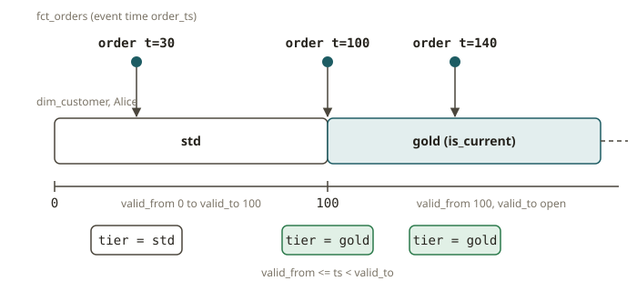

# STH-05 · Streaming dimensional modeling — SCD2 + temporal (as-of) joins

## Why it exists

This is your own area, moved onto a stream. In the warehouse, you build an SCD2 `dim_customer` with
`valid_from` / `valid_to` / `is_current`. You value each fact with the dimension version that was in
effect when the fact happened. This is a point-in-time (as-of) join. The streamhouse keeps that
exact model. But a **CDC changelog** now feeds the dimension, not a nightly snapshot. The fact table
is built continuously. The modeling discipline does not change. What changes is that versions
arrive over time. You must value a fact against the version that was effective *then*, not against
the latest version. If you do this wrong, you make the most common defect in streaming finance. The
defect silently restates history.

## How it works

A streaming star schema has three ideas that you already know, in a new form:

1. **CDC → SCD2 dimension.** Every change to a customer is a row in a changelog. The row carries the
   new attributes and an **effective timestamp**. A version is an SCD2 row with an open `valid_to`.
   You close the previous version. To do this, you set its `valid_to` to the effective time of the
   next version. In SQL, this is
   `LEAD(effective_from) OVER (PARTITION BY key ORDER BY effective_from)`. The last version per key
   gets an open `valid_to` (a sentinel value far in the future) and `is_current = true`. This gives
   exactly the same result as the SCD2 `MERGE` that you write in dbt. Here you write it as a window
   over the changelog.
2. **The fact stream.** Orders arrive. Each order has its own business/event time (`order_ts`).
3. **The temporal (as-of) join.** For each order, pick the dimension version where
   `valid_from <= order_ts < valid_to`. This is the as-of rule: the version effective at the event
   time of the fact, never today's version. In Flink SQL over versioned tables, you write this as
   `FOR SYSTEM_TIME AS OF`. Over an explicit SCD2 dimension (as here), you write it as a range join
   on the validity interval. In both cases, the engine picks exactly one version per order.

**Why "as-of" and not "latest".** Alice is `std` until t=100 and `gold` after. She placed an order
at t=30. You must stamp this order `std`, even if you reprocess it next week, when she is already
`gold`. If you value it `gold`, this is not a rounding error. It restates a historical fact and
breaks reconciliation and SOX accuracy. The SCD2 dimension exists to make this impossible.

**Reconciliation is the test.** The streaming (continuous) build of `dim_customer` and `fct_orders`
must equal an independent **batch rebuild** over the same events. This is the TESTING.md G6
streaming invariant. We compute the batch answer with DuckDB (an AS-OF join over the same
changelog). We assert that the Flink result matches it, and the order of rows does not matter. Two
engines agree on the same semantics. This makes the expected result trustworthy.

## From your world

| Kimball / dbt / SOX | Streamhouse (Flink + Paimon/Iceberg) | Note |
|---|---|---|
| SCD2 `dim_customer` with `valid_from`/`valid_to`/`is_current` | `LEAD(effective_from)` over the CDC changelog | a change event = a new version |
| Nightly SCD2 `MERGE` | continuous CDC → versioned dimension | same output, continuous input |
| Point-in-time join of fact × dimension version | temporal / as-of range join on the validity interval | the version effective then |
| `current` view of the dimension | `is_current = true` filter | for "latest" dashboards only |
| dbt test: fact totals reconcile to source | streaming result == batch rebuild (G6) | the acceptance gate |
| Converting / attributing at the policy date | as-of version, not latest | SOX accuracy defect if wrong |

## When NOT to use it

- **Do not model a fact enrichment as a join to the *current* row of the dimension** if back-dated
  corrections or reprocessing matter. This is the "latest, not as-of" bug. Use the SCD2 validity
  interval.
- **Do not build an SCD2 dimension for an attribute that nobody reports historically.** Suppose
  people only query the current value (for example a display name). Then an SCD1 overwrite is
  simpler and cheaper. SCD2 costs version bookkeeping.
- **Do not rely on event order to close versions.** `valid_to` comes from the order of
  `effective_from`, not from the arrival order. A late-arriving change must still go into the
  correct interval. Order by the business timestamp, not by processing time.
- **Do not skip reconciliation.** If nobody checks a streaming dimensional model against a batch
  rebuild, it will drift without any signal. The batch oracle is the control, exactly like a dbt
  test.

## Further reading

Official docs only:

- Flink 2.2 — Joins (regular / interval / **temporal**):
  <https://nightlies.apache.org/flink/flink-docs-release-2.2/docs/dev/table/sql/queries/joins/>
- Flink 2.2 — Versioned tables & temporal table joins:
  <https://nightlies.apache.org/flink/flink-docs-release-2.2/docs/dev/table/concepts/versioned_tables/>
- Apache Paimon — primary-key tables (the SCD2 dimension & fact storage):
  <https://paimon.apache.org/docs/master/primary-key-table/overview/>
- Flink 2.2 — Over (window) aggregation (`LEAD`):
  <https://nightlies.apache.org/flink/flink-docs-release-2.2/docs/dev/table/sql/queries/over-agg/>
