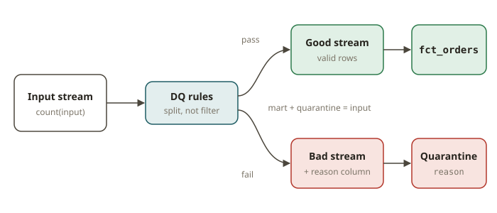

# STH-06 · Streaming data quality — in-flight DQ, quarantine / DLQ, completeness

## Why it exists

In the warehouse your data-quality checks run *after* the load: dbt tests assert not-null, accepted
values and relationships, and a failing test fails the run so a human looks before anything
downstream reads it. A stream has no "after the run" — data flows continuously and consumers read it
immediately. So quality moves **in-flight**: you check each record as it passes and decide, per
record, whether it is fit to enter the mart. The dangerous reflex is to write a `WHERE good`
predicate that silently discards everything else. That turns a data problem into an invisible data
problem: your fact table reconciles to itself, looks clean, and is quietly missing rows nobody can
account for. In a SOX context, *unexplained* missing records are a worse finding than bad ones.

The fix is a **quarantine** (a.k.a. dead-letter queue, DLQ): every record that fails a rule is
*routed* to a side table with the reason it failed, not dropped. The governing invariant is
**completeness**: `count(mart) + count(quarantine) == count(input)`, and the two sets are disjoint.
Every input is accounted for — valued in the mart or explained in the quarantine. That is the
streaming form of "the load balanced".

## How it works

A streaming DQ stage is a routing step, not a filter:

1. **Define the rules as a data contract.** For orders: `cid` not null (not-null), `amt` present and
   `> 0` (a value/accepted-range rule), and `cid` must reference a real customer (a relationship /
   referential rule). These are exactly dbt's `not_null`, accepted-values and `relationships` tests,
   evaluated per event.
2. **Split, don't filter.** Partition the input into two streams by the same predicate: the **good**
   stream (all rules pass) feeds the mart (`fct_orders` via the STH-05 as-of join); the **bad**
   stream (any rule fails) feeds the **quarantine** table, each row tagged with a `reason`. The two
   predicates must be exact complements so no row goes to both and no row goes to neither.
3. **Keep the reason.** The quarantine row carries *why* it failed (`null_customer`,
   `non_positive_amount`, `unknown_customer`), so an operator can triage, fix the source, and
   replay — the whole point of a DLQ over a silent drop.
4. **Assert completeness continuously.** The acceptance check is counts: `|good| + |quarantine|
   == |input|` with `good ∩ quarantine = ∅`. A silent-drop bug (a `WHERE` that filters without a
   matching quarantine) breaks this immediately — which is exactly what the tests here enforce.

**Order of rules matters for the reason, not for the split.** When a row violates several rules, you
report *one* reason (the first that applies, via a `CASE`), but it must still be in the quarantine
exactly once. The *membership* (good vs bad) is rule-order-independent; only the label depends on the
`CASE` ordering.

## From your world

| dbt / SOX control | Streaming DQ (in-flight) | Note |
|---|---|---|
| `not_null` test on `customer_id` | route null-`cid` rows to quarantine with `reason='null_customer'` | per event, not per run |
| accepted-values / range test on `amount` | `amt > 0` rule → `reason='non_positive_amount'` | business rule |
| `relationships` test (FK to `dim_customer`) | referential check → `reason='unknown_customer'` | a left-join miss |
| A failing dbt test blocks the run | quarantine routes bad rows, the mart keeps flowing | no "stop the world" in a stream |
| "the load balanced" reconciliation | `count(mart)+count(quarantine)==count(input)` | the completeness invariant |
| An unexplained missing row (audit finding) | a silent `WHERE good` drop | the anti-pattern this module kills |

## When NOT to use it

- **Don't filter bad rows with a bare `WHERE` and no quarantine** — that is a silent drop. If a rule
  removes a row from the mart, that row must land in the quarantine with a reason, or your counts no
  longer reconcile.
- **Don't quarantine what you can safely fix in-flight** — if a rule has a deterministic repair
  (e.g. uppercase a currency code, default a missing region), fix it rather than DLQ it; reserve
  quarantine for records you genuinely cannot trust.
- **Don't let the quarantine grow unbounded and unwatched** — a DLQ is a queue to be triaged and
  replayed, not a graveyard. If nobody reads it, you have reinvented the silent drop with extra
  steps.
- **Don't apply heavy DQ at sub-second latency when hourly is fine** — if the batch lakehouse SLA is
  adequate, run the same checks as dbt tests on a schedule; in-flight DQ earns its complexity only
  when the mart must be both fresh and trustworthy.

## Further reading

Official docs only:

- Flink 2.2 — Side outputs (the DataStream mechanism behind quarantine/DLQ routing):
  <https://nightlies.apache.org/flink/flink-docs-release-2.2/docs/dev/datastream/side_output/>
- Flink 2.2 — SQL queries (`CASE`, filtering, joins used for the DQ split):
  <https://nightlies.apache.org/flink/flink-docs-release-2.2/docs/dev/table/sql/queries/overview/>
- Apache Paimon — primary-key tables (the mart & quarantine storage):
  <https://paimon.apache.org/docs/master/primary-key-table/overview/>
- Apache Iceberg — Flink writes (if the mart/quarantine land in Iceberg):
  <https://iceberg.apache.org/docs/latest/flink-writes/>
